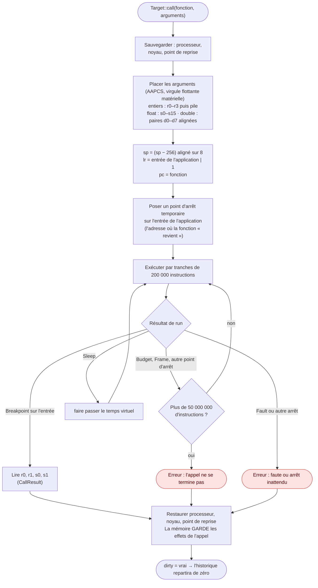

# Les expressions

::: tip En bref
Les expressions sont un **mini-C** évalué dans le contexte du programme arrêté. Lire est sans risque ; écrire ou appeler une fonction **modifie l'appareil**, et fait repartir l'historique de zéro.
:::

`debuginfo/expr.rs` (environ 1 400 lignes) évalue les expressions que l'on saisit pour regarder ou modifier une variable : `x`, `shape.corner.x`, `*p`, `&n`, `a[2][3]`, `n + 1`, `(char)n`, `sizeof(Shape)`, `x = 5`, `i++`, `n > 2 ? a : b`, `factorial(4)`, `$r0 = 1`.
**La syntaxe est celle du C**, quel que soit le langage de l'application (voir [C++ et Rust](./langages.md) pour ce qui s'y ajoute).

## Lexique

Le lexeur reconnaît : identifiants (`::` compris : `shapes::Rect`, `Stack<int, 4>::push`), registres (`$r0`…`$r15`, `$sp`, `$lr`, `$pc`), entiers (décimal, `0x`, suffixes `u`, `l`), flottants (`1.5`, `1e-3`, suffixe `f`), caractères (`'A'`, `'\n'`, `'\x41'`, `'\0'`),
et la ponctuation (`<<=`, `>>=`, `&&`, `||`, `==`, `!=`, `<=`, `>=`, `++`, `--`, `->`, `+=`, `-=`, `*=`, `/=`, `%=`, `&=`, `|=`, `^=`, `<<`, `>>`, `::`…).

## Grammaire

Un analyseur à descente récursive, par niveaux de priorité C :

Les niveaux, du moins prioritaire (en haut) au plus prioritaire (en bas) :

| Niveau | Opérateurs | Associativité |
|---|---|---|
| virgule | `,` | gauche |
| affectation | `=` `+=` `-=` `*=` `/=` `%=` `&=` `\|=` `^=` `<<=` `>>=` | droite |
| conditionnel | `? :` | droite |
| ou logique | `\|\|` | gauche |
| et logique | `&&` | gauche |
| ou, ou exclusif, et binaires | `\|` puis `^` puis `&` | gauche |
| égalité | `==` `!=` | gauche |
| comparaison | `<` `<=` `>` `>=` | gauche |
| décalages | `<<` `>>` | gauche |
| addition | `+` `-` | gauche |
| produit | `*` `/` `%` | gauche |
| unaire | `-` `+` `!` `~` `*` `&` `++` `--` `sizeof` `(type)` | droite |
| suffixe | `[ ]` `( )` `.` `->` `++` `--` | gauche |
| primaire | nombre, caractère, registre, `( expression )`, nom (variable, fonction, constante d'énumération, type) | |

`try_type` décide si `(…)` est une conversion : il essaie de lire un **nom de type** (`unsigned char`, `struct Item`, `Point *`, `uint8_t`, `shapes::Rect *`). Les noms se comparent sans tenir compte des espaces et avec une **recherche par la fin** (`Rect` trouve
`shapes::Rect`), en excluant les déclarations sans contenu.

## Opérandes : `Operand`

Chaque sous-expression produit un `Operand` :

| `Operand` | Sens |
|---|---|
| `Int` | entier de 64 bits (signe porté séparément) |
| `Float` | `f64` |
| `Typed` | une valeur lue d'après un type, avec son lieu (modifiable) |
| `Object` | une structure, une union, un tableau : un lieu et un type |
| `Address` | une adresse avec un type pointé |
| `Func` | une fonction (adresse, prototype) |
| `Overloads` | plusieurs fonctions de même nom (C++) |
| `Register` | un registre du cadre |
| `Void` | rien (appel sans retour) |

L'arithmétique suit le C : promotion des petits entiers, entier signé 64 bits, non signé si un opérande l'est ; division par zéro → erreur ; `%` ; décalages bornés ; comparaisons rendent 0 ou 1 ; l'arithmétique de **pointeurs** multiplie par la taille de l'objet pointé
et `p - q` divise ; flottant dès qu'un opérande l'est. `cast` convertit en entier de la taille voulue (`truncate`), en flottant, en pointeur ; `(unsigned char)-1` donne 255.

## Écrire : `store`

Une affectation (`=` et les composées) et `++`/`--` écrivent par `Target::write` à l'adresse du lieu, tronquée à la taille du type, ou par `set_register` pour un registre. L'écriture en **flash est refusée** (`0x9000_0000..0xA000_0000`) : seul le noyau
simulé programme la flash. Un registre `$pc` écrit perd son bit 0 ; `$sp` ses deux bits de poids faible.

## Appeler une fonction : `Target::call`

`fib(6)`, `rect.area()`, `op(3, 4)` (pointeur de fonction). Le débogueur exécute **la fonction sur l'émulateur**, comme le ferait un vrai débogueur sur une carte :

Le type du résultat vient du prototype : entier selon sa taille (64 bits : `r0:r1`), flottant (`s0`) ou double (`s0:s1`), pointeur. Les fonctions qui **rendent une structure ou un tableau** sont exécutées mais leur résultat est refusé ; les **arguments
structures** ne sont pas gérés.

Un appel qui se fait **sur l'application en pause à n'importe quel point** exige que la pile soit saine : l'appel écrit sous `sp`.

## C++ : méthodes, `this`, surcharges

`call_method` cherche la méthode (`find_method`, `method_function`) dans le type (et ses bases), puis son adresse (`method_address`) : par le nom de fonction qualifié, ou, pour une méthode **virtuelle**, par la **table des fonctions virtuelles** — le pointeur `_vptr`
du lieu et le numéro de case donné par `DW_AT_vtable_elem_location`. `this` est passé en `r0`. Les **surcharges** (`Overloads`) se résolvent par `best_overload` d'après le nombre et le genre des arguments (entiers, flottants, pointeurs) ; les arguments à virgule
flottante suivent l'ABI ci-dessus. Dans une fonction membre, un nom inconnu se cherche en tant que membre de `*this` (**`this` implicite**).

## Effets sur l'historique

Chaque commande de source qui évalue (`eval`, `assign`) signale si elle a modifié l'appareil (`with_context` rend `(valeur, dirty)`) ; **`history_reset`** s'applique alors. Les lectures pures ne touchent pas à l'historique ([Historique](./historique.md)).

## Dans le code

| Où | Quoi |
|---|---|
| [`expr.rs`](code:src/debuginfo/expr.rs) | le lexeur, l'analyseur et l'évaluateur |
| [`evaluate`](code:src/debuginfo/expr.rs#evaluate) | le point d'entrée |
| [`lex`](code:src/debuginfo/expr.rs#lex), [`Token`](code:src/debuginfo/expr.rs#Token) | les lexèmes |
| [`Operand`](code:src/debuginfo/expr.rs#Operand), [`Parser`](code:src/debuginfo/expr.rs#Parser) | les valeurs intermédiaires et l'analyseur |
| [`binary_precedence`](code:src/debuginfo/expr.rs#binary_precedence) | la table de priorités |
| [`truncate`](code:src/debuginfo/expr.rs#truncate) | conversion en entier d'une taille donnée |
| [`Target`](code:src/debuginfo/eval.rs#Target), [`CallArg`](code:src/debuginfo/eval.rs#CallArg), [`CallResult`](code:src/debuginfo/eval.rs#CallResult) | ce que l'évaluateur demande à l'appareil |
| [`EmuTarget`](code:src/session/source.rs#EmuTarget) | l'implémentation sur l'émulateur : lire, écrire, registres, **appeler** |
| [`CALL_BUDGET`](code:src/session/source.rs#CALL_BUDGET) | la limite d'un appel |
| [`with_context`](code:src/session/source.rs#with_context) | construit le contexte d'un cadre, rend aussi `dirty` |
| [`types.rs`](code:src/debuginfo/types.rs) | `complete` : types de base, pointeurs, tableaux imbriqués |

## Pourquoi un évaluateur à nous

GDB sait évaluer des expressions, mais **pas** dans la page web ni sans GDB. Un évaluateur intégré donne la même syntaxe à la console, aux espions et à la zone « expressions suivies », et il peut parler **directement** à l'émulateur : appeler une fonction sans protocole, restaurer exactement l'état du processeur après, savoir si l'appareil a été modifié (`dirty`). Il évalue en C quel que soit le langage : une syntaxe commune est plus simple à retenir qu'un dialecte par langage.

Le **trait `Target`** est l'astuce : l'évaluateur ne connaît ni `Emulator` ni `Memory`, seulement « lis ici, écris là, appelle ça ». On le teste avec une fausse cible en mémoire.

## Pour modifier

- **Un nouvel opérateur** : [`binary_precedence`](code:src/debuginfo/expr.rs#binary_precedence) (ou le niveau unaire), le lexeur si ce n'est pas déjà un symbole, puis le calcul dans [`Parser`](code:src/debuginfo/expr.rs#Parser). Ajouter un test dans [`debugger.rs`](code:tests/debugger.rs).
- **Une nouvelle sorte d'opérande** : une variante d'[`Operand`](code:src/debuginfo/expr.rs#Operand), traitée dans **toutes** les fonctions qui la consomment (`finish`, `cast`, `store`…) ; le compilateur signale les `match` incomplets.
- **Faire échouer un appel plus tôt, ou plus tard** : [`CALL_BUDGET`](code:src/session/source.rs#CALL_BUDGET).
- **Une expression qui modifie l'appareil sans le dire** : un bug sérieux (l'historique serait faux). Tout chemin qui écrit passe par [`Target::write`](code:src/debuginfo/eval.rs#Target) ou `set_register`, qui posent `dirty`.
