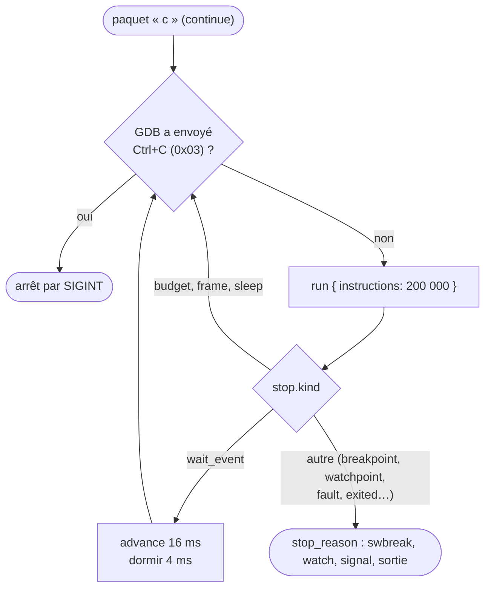
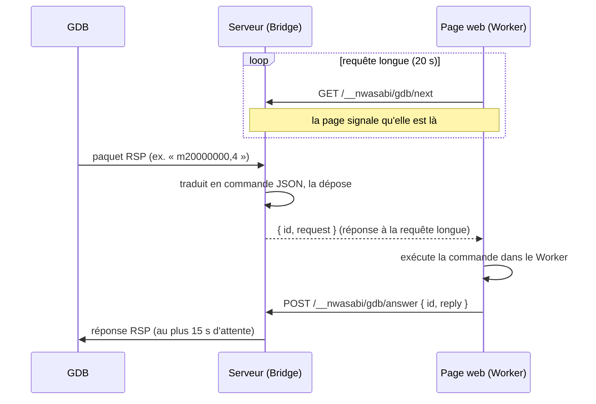

# Le serveur GDB

::: tip En bref
GDB parle un protocole texte très simple (des paquets `$…#somme`). Nwasabi **traduit** chaque paquet en commande de session. Quand l'émulation vit dans le navigateur, le serveur sert de **facteur** entre GDB et la page.
:::

Le dossier [`src/gdb/`](code:src/gdb/) permet à GDB (ou à un éditeur qui le pilote) de se brancher par TCP « comme sur une sonde ST-Link » et de piloter un appareil émulé. Le protocole est le **Remote Serial Protocol** de GDB : des paquets `$données#somme`, où la somme est la somme des octets modulo 256.
Tout passe par les commandes JSON de la [session](./session.md) (`run`, `step`, `break`, `watch`, `cpu`, `memory_read`…) : **GDB voit exactement ce que voit la page**, sans second chemin d'exécution.

## Le trait `Debuggee`

`serve_connection` sert un débogueur **sur un `Debuggee`** : tout ce qui répond à des commandes JSON, une ligne par commande. Deux implémentations :

| `Debuggee` | Quand | Comportement |
|---|---|---|
| une `Session` du même processus | `--gdb-headless PORT` (avec `--nwa`) | lit le `.nwa` tel qu'il est sur le disque à **chaque connexion** et repart de zéro |
| le `Bridge` | `--gdb PORT` | l'émulation tourne **dans le navigateur** ; le serveur relaie |

## Paquets pris en charge

| Paquet | Rôle |
|---|---|
| `?` | le dernier arrêt (`T05…`, signal 5) |
| `g`, `G`, `p`, `P` | registres : 17 registres de 32 bits, dans l'ordre `r0`–`r12`, `sp`, `lr`, `pc`, `xpsr` (`REGISTER_COUNT`) |
| `m`, `M` | lire et écrire la mémoire ; une erreur (`E…`) si une adresse sort de la mémoire |
| `Z0`/`z0`, `Z1`/`z1` | points d'arrêt logiciels et matériels (la session les traite pareil : `break` / `unbreak`) |
| `Z2`/`Z3`/`Z4` et `z…` | points d'observation en **écriture**, **lecture** et **accès** (`watch` avec `stop: true`) ; la table `(sorte, adresse, longueur) → identifiant` permet de les retirer |
| `c`, `s`, `vCont;c`, `vCont;s`, `vCont?` | reprendre, un pas d'instruction (la réponse d'un pas est `S05`) |
| `bs`, `bc` | **en arrière** d'une instruction, ou jusqu'au point d'arrêt ou d'observation précédent (`step_back`, `reverse_continue`) |
| `H`, `T` | un seul fil |
| `D`, `k` | détacher ; `k` ferme la connexion |
| `qSupported` | les fonctions annoncées par `gdbstub` : taille des paquets, `vCont`, mode sans accusé, `ReverseStep+`, `ReverseContinue+`… |
| `qXfer:features:read:target.xml` | la description des registres : l'architecture `arm`, la fonctionnalité `org.gnu.gdb.arm.m-profile`, 17 registres (`sp` de type `data_ptr`, `pc` de type `code_ptr`) |
| `qAttached`, `qC`, `qfThreadInfo`, `qsThreadInfo` | un fil, `1` |
| `QStartNoAckMode` | plus d'accusés de réception (`+`) après la négociation |
| octet `0x03` | **interruption** (Ctrl+C) |

Un paquet que `gdbstub` ou la cible ne gèrent pas reçoit une **réponse vide**, la convention du protocole pour « non pris en charge » : GDB s'adapte. Le registre `FPSCR` et les registres flottants ne sont pas décrits : un débogueur ne voit que les registres entiers.

## Arrêts

[`stop_reason`](code:src/gdb/cible.rs#stop_reason) traduit l'arrêt de la session (`stop.kind`) en raison d'arrêt GDB ; `gdbstub` en fait la réponse :

| `stop.kind` | Raison d'arrêt GDB |
|---|---|
| `exited` | sortie avec le code |
| `breakpoint` | point d'arrêt logiciel (`swbreak`) |
| `watchpoint` | point d'observation en écriture (`watch`) ou en lecture (`rwatch`) |
| `fault` | `SIGSEGV` pour un accès mémoire invalide, `SIGILL` pour une instruction interdite, `SIGTRAP` pour `bkpt` |
| `home_pressed`, `reset` | `SIGTERM` |
| autre (un pas fini) | pas terminé (`S05`) |

## Reprendre : l'attente d'un arrêt

L'attente ([`Boucle`](code:src/gdb/cible.rs#Boucle)) boucle sur `run` par tranches de **200 000 instructions** (`SLICE`) : entre deux tranches, il regarde si le débogueur a demandé l'interruption. `wait_event` (l'application attend une touche) fait **passer 16 ms** de temps virtuel et dort 4 ms, pour ne pas occuper tout le processeur.

## Retour en arrière

`bs` et `bc` utilisent l'[historique](./historique.md), **démarré à la connexion**. Au début de l'historique, la réponse porte `replaylog:begin`, que GDB comprend comme « on ne peut pas remonter plus loin ». Les pas arrière avec les entrées d'avant sont rejoués
tels que l'historique les a enregistrées.

## Le pont avec la page : `Bridge`

Quand l'émulation est dans le **navigateur**, le serveur ne la possède pas. Le `Bridge` inverse les rôles :

- la **page est la seule à décider** : elle interroge `/__nwasabi/gdb/next` seulement si l'utilisateur a coché « Accepter un débogueur GDB » (décoché à chaque ouverture) ; chaque interrogation signale que la page est là (`ATTACH_TIMEOUT = 25 s` sans interrogation, et la page est crue partie) ;
- **un seul débogueur à la fois** ; `/__nwasabi/gdb` donne l'état, `/__nwasabi/gdb/detach` retire la page ;
- le serveur n'écoute que sur **cette machine** par défaut (`--host` le change) : un débogueur peut modifier la mémoire et les registres.

## Ce que GDB lit sans passer par Nwasabi

Les **symboles, les lignes, les variables et les types** viennent de l'**ELF** que GDB a chargé (`file app.elf`, [Application et export ELF](../edition-de-liens/application.md#export-elf-pour-gdb)) : Nwasabi ne les renvoie pas sur le fil. C'est ce qui permet à `list`, `info locals`, `print`, `next`, `finish`
et `backtrace` de fonctionner sans extension de protocole. Les expressions sont évaluées **par GDB**, pas par `expr.rs` : celui-ci sert la console de la page et la zone d'expressions.

## Dans le code

| Où | Quoi |
|---|---|
| [`src/gdb/`](code:src/gdb/) | `mod.rs` (l'interface), `arch.rs` (le Cortex-M vu par GDB : 17 registres), `cible.rs` (l'appareil vu par `gdbstub` : lire, écrire, avancer, points d'arrêt, attente d'un arrêt), `paquets.rs` (la description des registres), `pont.rs` (le pont avec la page) |
| [`serve_connection`](code:src/gdb/cible.rs#serve_connection) | sert un client : lance `gdbstub` sur la connexion |
| [`Debuggee`](code:src/gdb/mod.rs#Debuggee) | « quelque chose qui répond à des commandes JSON » |
| [`Cible`](code:src/gdb/cible.rs#Cible) | l'appareil : les fonctions que `gdbstub` appelle (registres, mémoire, points d'arrêt et d'observation, pas) |
| [`Boucle`](code:src/gdb/cible.rs#Boucle) | l'attente d'un arrêt, par tranches, en regardant la connexion entre deux (Ctrl+C) |
| [`stop_reason`](code:src/gdb/cible.rs#stop_reason) | la raison d'arrêt de la session traduite pour GDB |
| [`TARGET_XML`](code:src/gdb/paquets.rs#TARGET_XML), [`CortexM`](code:src/gdb/arch.rs#CortexM) | la description des registres |
| [`Bridge`](code:src/gdb/pont.rs#Bridge) | le pont avec la page |
| [`serve_gdb`](code:src/server/main.rs#serve_gdb), [`gdb_session`](code:src/server/main.rs#gdb_session) | les deux modes du serveur |
| [`gdbBridge.ts`](code:web/src/gdbBridge.ts), [`GdbView.vue`](code:web/src/components/debug/GdbView.vue) | le côté page |
| [`gdb.rs` (tests)](code:tests/gdb.rs), [`gdb_real.rs`](code:tests/gdb_real.rs) | simulé / avec un vrai GDB |

## Pourquoi une bibliothèque pour le protocole, et la session pour le reste

Le **protocole** de GDB (paquets, sommes de contrôle, négociation, description de la cible, marche arrière, mode sans accusé…) est maintenu par la bibliothèque [`gdbstub`](https://crates.io/crates/gdbstub) : ses mises à jour suivent l'évolution du protocole et ses correctifs, sans que Nwasabi réécrive du texte de paquets. Ce qui reste à Nwasabi est **ce que fait chaque opération** : [`Cible`](code:src/gdb/cible.rs#Cible) la traduit en **commande de session** (lire la mémoire → `memory_read`, point d'arrêt → `break`, marche arrière → `reverse_continue`). GDB, la page et la ligne de commande exercent ainsi **le même code**, donc les mêmes bugs sont corrigés une fois.

Le **pont** existe parce que l'émulation de la page vit dans le navigateur, qui ne sait pas **écouter** un port : le serveur écoute, la page vient chercher le travail (requête longue) et rend le résultat. Le débogueur ne sait pas qu'il y a un navigateur au bout.

## Pour modifier

- **Une opération de plus** (si `gdbstub` la propose) : une fonction de [`Cible`](code:src/gdb/cible.rs#Cible) qui appelle une commande de session ; si la commande n'existe pas, l'ajouter d'abord à la [session](./session.md#pour-modifier). Ne jamais lire la mémoire de l'appareil depuis `gdb.rs`.
- **Décrire plus de registres** (FPU) : [`TARGET_XML`](code:src/gdb/paquets.rs#TARGET_XML), [`REGISTER_COUNT`](code:src/gdb/arch.rs#REGISTER_COUNT) et [`CoreRegisters`](code:src/gdb/arch.rs#CoreRegisters) ensemble.
- **Un arrêt de plus** : [`stop_reason`](code:src/gdb/cible.rs#stop_reason).
- **Tester** : [`tests/gdb.rs`](code:tests/gdb.rs) rejoue des paquets sans GDB ; [`gdb_real.rs`](code:tests/gdb_real.rs) lance un vrai GDB si `NWASABI_GDB` ou `gdb-multiarch` est disponible.
