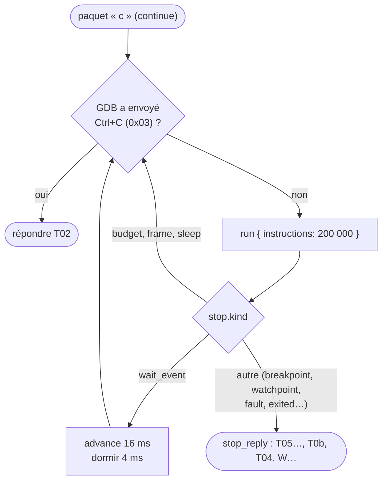
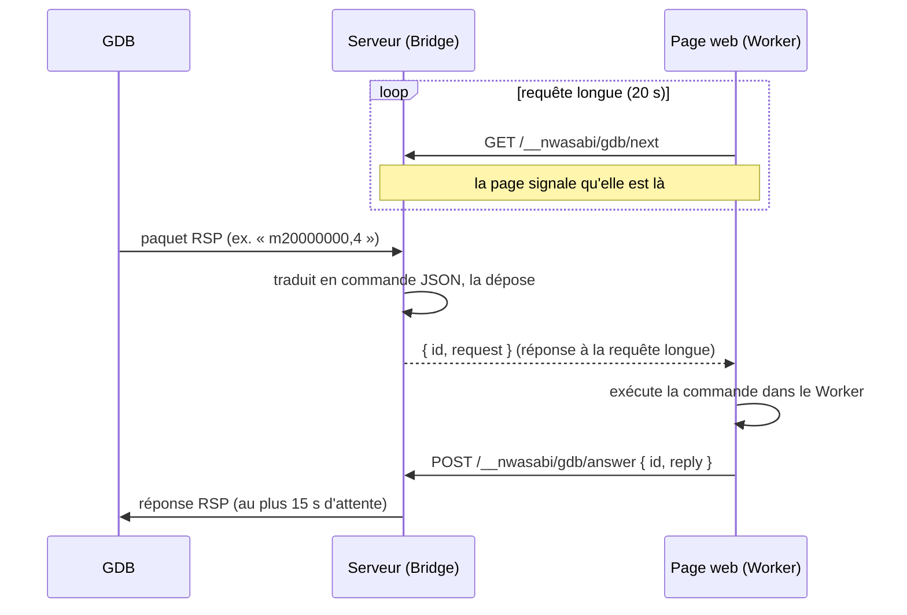

# Le serveur GDB

::: tip En bref
GDB parle un protocole texte très simple (des paquets `$…#somme`). Nwasabi **traduit** chaque paquet en commande de session. Quand l'émulation vit dans le navigateur, le serveur sert de **facteur** entre GDB et la page.
:::

`gdb.rs` permet à GDB (ou à un éditeur qui le pilote) de se brancher par TCP « comme sur une sonde ST-Link » et de piloter un appareil émulé. Le protocole est le **Remote Serial Protocol** de GDB : des paquets `$données#somme`, où la somme est la somme des octets modulo 256.
Tout passe par les commandes JSON de la [session](./session.md) (`run`, `step`, `break`, `watch`, `cpu`, `memory_read`…) : **GDB voit exactement ce que voit la page**, sans second chemin d'exécution.

## Le trait `Debuggee`

`serve_connection` sert un débogueur **sur un `Debuggee`** : tout ce qui répond à des commandes JSON, une ligne par commande. Deux implémentations :

| `Debuggee` | Quand | Comportement |
|---|---|---|
| une `Session` du même processus | `--gdb-headless PORT` (avec `--nwa`) | lit le `.nwa` tel qu'il est sur le disque à **chaque connexion** et repart de zéro |
| le `Bridge` | `--gdb PORT` | l'émulation tourne **dans le navigateur** ; le serveur relaie |

## Paquets pris en charge

| Paquet | Rôle |
|---|---|
| `?` | `T05` (arrêt par signal 5) |
| `g`, `G`, `p`, `P` | registres : 17 registres de 32 bits, dans l'ordre `r0`–`r12`, `sp`, `lr`, `pc`, `xpsr` (`REGISTER_COUNT`) |
| `m`, `M` | lire et écrire la mémoire ; `E14` si une adresse sort de la mémoire |
| `Z0`/`z0`, `Z1`/`z1` | points d'arrêt logiciels et matériels (la session les traite pareil : `break` / `unbreak`) |
| `Z2`/`Z3`/`Z4` et `z…` | points d'observation en **écriture**, **lecture** et **accès** (`watch` avec `stop: true`) ; la table `(sorte, adresse, longueur) → identifiant` permet de les retirer |
| `c`, `s`, `vCont;c`, `vCont;s`, `vCont?` | reprendre, un pas d'instruction |
| `bs`, `bc` | **en arrière** d'une instruction, ou jusqu'au point d'arrêt ou d'observation précédent (`step_back`, `reverse_continue`) |
| `H`, `T` | `OK` (un seul fil) |
| `D`, `k` | détacher ; `k` ferme la connexion |
| `qSupported` | `PacketSize=4000;qXfer:features:read+;swbreak+;hwbreak+;vContSupported+;QStartNoAckMode+;ReverseStep+;ReverseContinue+` |
| `qXfer:features:read:target.xml` | la description des registres : l'architecture `arm`, la fonctionnalité `org.gnu.gdb.arm.m-profile`, 17 registres (`sp` de type `data_ptr`, `pc` de type `code_ptr`) |
| `qAttached`, `qC`, `qfThreadInfo`, `qsThreadInfo` | un fil, `1` |
| `QStartNoAckMode` | plus d'accusés de réception (`+`) après la négociation |
| octet `0x03` | **interruption** (Ctrl+C) |

Tout paquet inconnu reçoit une **réponse vide**, la convention du protocole pour « non pris en charge » : GDB s'adapte. Le registre `FPSCR` et les registres flottants ne sont pas décrits : un débogueur ne voit que les registres entiers.

## Arrêts

`stop_reply` traduit l'arrêt de la session (`stop.kind`) en réponse GDB, en joignant `sp` (`0d`), `lr` (`0e`) et `pc` (`0f`) pour éviter au débogueur de les redemander :

| `stop.kind` | Réponse |
|---|---|
| `exited` | `W<code>` |
| `breakpoint` | `T05swbreak:;…` |
| `watchpoint` | `T05watch:<adresse>;…` ou `rwatch:` (lecture) |
| `fault` | `T0b` (SIGSEGV) pour un accès mémoire invalide, `T04` (SIGILL) pour une instruction interdite, `T05` pour `bkpt` |
| `home_pressed`, `reset` | `S0f` |
| autre | `T05…` |

## Reprendre : `resume`

`c` boucle sur `run` par tranches de **200 000 instructions** (`SLICE`) : entre deux tranches, il regarde si le débogueur a demandé l'interruption. `wait_event` (l'application attend une touche) fait **passer 16 ms** de temps virtuel et dort 4 ms, pour ne pas occuper tout le processeur.

## Retour en arrière

`bs` et `bc` utilisent l'[historique](./historique.md), **démarré à la connexion**. Au début de l'historique, la réponse porte `T05replaylog:begin;`, que GDB comprend comme « on ne peut pas remonter plus loin ». Les pas arrière avec les entrées d'avant sont rejoués
tels que l'historique les a enregistrées.

## Le pont avec la page : `Bridge`

Quand l'émulation est dans le **navigateur**, le serveur ne la possède pas. Le `Bridge` inverse les rôles :

- la **page est la seule à décider** : elle interroge `/__nwasabi/gdb/next` seulement si l'utilisateur a coché « Accepter un débogueur GDB » (décoché à chaque ouverture) ; chaque interrogation signale que la page est là (`ATTACH_TIMEOUT = 25 s` sans interrogation, et la page est crue partie) ;
- **un seul débogueur à la fois** ; `/__nwasabi/gdb` donne l'état, `/__nwasabi/gdb/detach` retire la page ;
- le serveur n'écoute que sur **cette machine** par défaut (`--host` le change) : un débogueur peut modifier la mémoire et les registres.

## Ce que GDB lit sans passer par Nwasabi

Les **symboles, les lignes, les variables et les types** viennent de l'**ELF** que GDB a chargé (`file app.elf`, [Application et export ELF](../edition-de-liens/application.md#export-elf-pour-gdb)) : Nwasabi ne les renvoie pas sur le fil. C'est ce qui permet à `list`, `info locals`, `print`, `next`, `finish`
et `backtrace` de fonctionner sans extension de protocole. Les expressions sont évaluées **par GDB**, pas par `expr.rs` : celui-ci sert la console de la page et la zone d'expressions.
