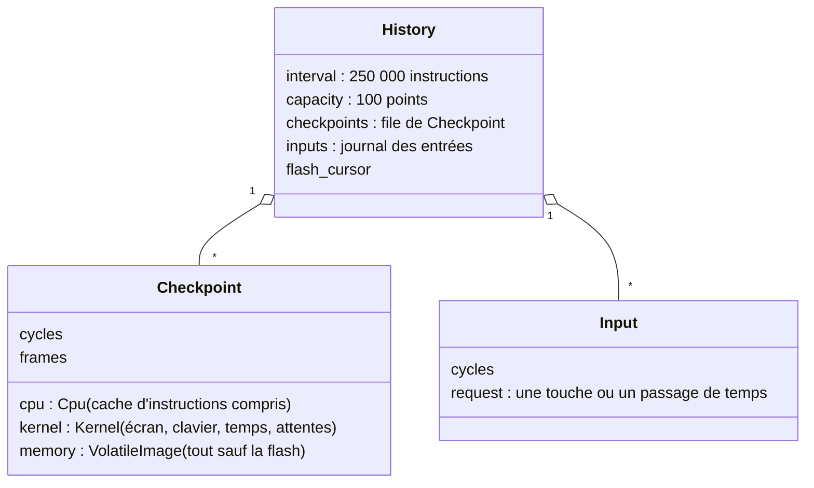
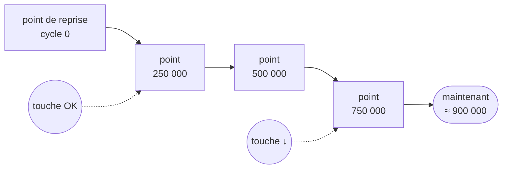
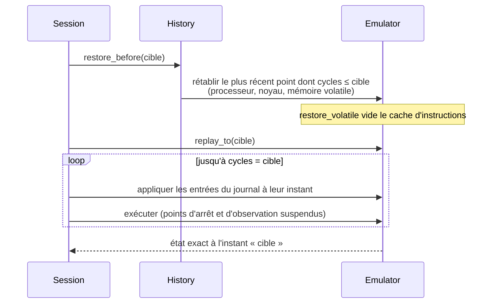
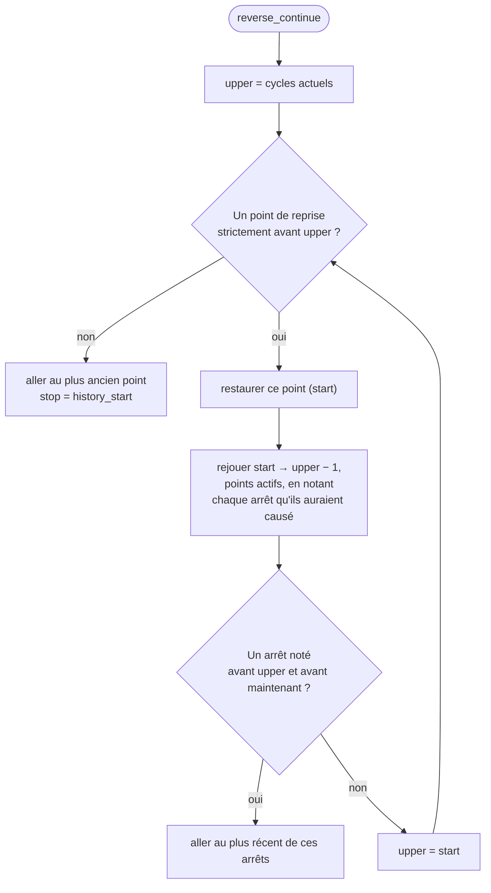

# Remonter le temps

::: tip En bref
Remonter le temps, c'est **recharger une photo** de l'appareil puis **rejouer** jusqu'à l'instant voulu. Cela marche parce que l'émulation est déterministe : mêmes entrées, même résultat.
:::

L'émulation est **déterministe** : le même départ et les mêmes entrées donnent toujours la même suite. Reculer, c'est donc **rétablir un point de reprise** puis **rejouer** jusqu'à l'instruction voulue. `session/history.rs` le réalise sans rien enregistrer d'autre que quelques
copies et le journal des entrées de l'hôte.

## Ce qui est gardé

Sur une ligne de temps, cela donne :

Les points sont des **photos** de l'appareil ; les touches du journal sont les **seules entrées** de l'extérieur : avec les deux, on sait refaire l'exécution à l'identique.

- **Points de reprise** : une copie du processeur (cache d'instructions compris), du noyau (écran, clavier, temps, attentes…) et de la mémoire **volatile** (toutes les zones qui ne sont pas de la flash : RAM, registres simulés). Un point est pris tous les
  **250 000 instructions** (`DEFAULT_INTERVAL`) et **100** sont gardés (`DEFAULT_CAPACITY`) : l'historique couvre `250 000 × 100 = 25 millions d'instructions`. `history start` accepte d'autres valeurs (`interval` d'au moins 1000, `capacity` entre 2 et 2000).
- **Le journal** : chaque commande qui est une **entrée** de l'hôte (`key`, `advance`) est enregistrée avec le compteur de cycles auquel elle s'est produite. Les entrées antérieures au plus ancien point de reprise sont jetées (`inputs.retain`).
- **La flash n'est pas copiée** : `flash_changed_since(cursor)` détecte qu'elle a changé (fichiers écrits par l'application, programmation par `svc` 30 et 32). Dans ce cas, tout ce qui précède n'est plus rejouable : les points et le journal sont vidés.

`history_slice()` impose à la prochaine tranche d'exécution de ne pas dépasser l'heure du prochain point : `Session::run` découpe ses tranches en conséquence, pour ne jamais en manquer un.

## Reculer : `restore_before` et `replay_to`

Pour aller à l'instant `cible` : on prend la **photo la plus proche avant**, puis on **rejoue** jusqu'à `cible`.

1. **`restore_before(target)`** cherche, du plus récent au plus ancien, le point de reprise dont `cycles <= target`, rétablit processeur, noyau et mémoire, et le compteur d'images ;
2. **`replay_to(target, scan)`** rejoue instruction après instruction : les **entrées** du journal sont appliquées aux bons instants, les **points d'arrêt et d'observation sont suspendus** (`suspend_debugging`), pour reconstituer exactement l'état.
   Si `scan` est donné, il recueille chaque arrêt qu'un point d'arrêt ou d'observation **aurait** provoqué, avec son instant (utilisé par `reverse_continue`). Une garde de **100 000 tours sans progrès** (`STALL_LIMIT`) évite de tourner en rond.

### `reverse_continue` : chercher en arrière

Commandes qui en découlent :

| Commande | Effet |
|---|---|
| `step_back` | une instruction en arrière : `history_to(c − 1)` (`restore_before` puis `replay_to`) ; refuse au cycle 0 |
| `history_goto` | revient à l'instant donné (en instructions) |
| `reverse_continue` | remonte **de point de reprise en point de reprise** : pour chaque intervalle, rétablit le point puis rejoue jusqu'à l'instant de départ en **notant où un point d'arrêt ou d'observation aurait arrêté** l'exécution (les points sont réactivés pour ce balayage) ; va au plus récent arrêt antérieur, sinon au plus ancien point (`stop.kind = history_start`) |

Au début de l'historique, GDB reçoit `replaylog:begin` (« on ne peut pas remonter plus loin »).

## Avancer à nouveau : `history_fork`

Quand on est revenu en arrière puis qu'on **avance** (`run`, `step`, `key`…), **ce qui était enregistré après n'aura plus lieu** : c'est un autre chemin. `history_fork` coupe le journal et les points de reprise à l'instant courant avant que l'exécution reparte. L'historique se poursuit
alors depuis cet endroit.

## Ce qui remet à zéro : `effect_of`

Chaque commande de session est classée par `effect_of(cmd)` :

| `Effect` | Commandes | Conséquence |
|---|---|---|
| `Input` | `key` (`press`, `release`), `advance` | **enregistrée** pour le rejeu ; **sauf `key` en `tap`** (défaut), qui exécute des instructions pendant l'appui et remet donc l'historique à zéro |
| `Forward` | `run`, `step`, `step_source`, `step_back`, `reverse_continue`, `history_goto` | fait avancer l'exécution (traitée par la commande elle-même) |
| `None` | lectures : `cpu`, `regions`, `memory_read`, `changes`, `disasm`, `symbol`, `backtrace`, `fs_list`, `settings_get`, `dump`…, points d'arrêt, **et tout le débogage du code source** (`debug_info`, `line_at`, `source_lines`, `break_line`, `break_function`, `frames`, `locals`, `globals`, `eval`, `assign`, `ptype`, `export_elf`) | aucun effet |
| `Reset` | **tout le reste** : `memory_write`, `cpu_set`, `load`, `launch`, `fs_write`, `flash_load`, `settings_set`… | l'historique **repart de zéro** (un nouveau point est pris tout de suite) |

`eval` et `assign` sont classés `None` mais **signalent eux-mêmes** s'ils ont modifié l'appareil (affectation, appel de fonction) et déclenchent alors `history_reset` : les expressions de lecture pure ne coûtent donc pas l'historique.
Toute commande inconnue de `effect_of` est `Reset` par défaut — une règle de prudence : mieux vaut perdre l'historique qu'en garder un faux.
