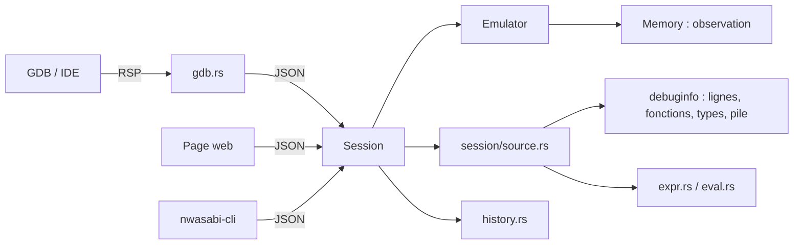

# Le débogage

::: tip En bref
Tous les débogueurs (page web, GDB, ligne de commande) parlent à **la même session**, par des requêtes JSON. Il n'y a qu'un seul chemin d'exécution à maintenir, donc GDB voit exactement ce que voit la page.
:::

Le débogage de Nwasabi repose sur une idée : **une seule voie de contrôle**. La page web, `nwasabi-cli session`, la bibliothèque `@nwasabi/js` et le serveur GDB envoient tous des **requêtes JSON** à une `Session`, qui pilote un `Emulator`. Il n'y a
aucun second chemin d'exécution à maintenir : un débogueur GDB voit exactement ce que voit l'interface web.

## Les briques

| Brique | Rôle | Page |
|---|---|---|
| points d'arrêt (adresse, condition) et d'observation | `Emulator` et `Memory` | [Exécution](../execution/index.md), [Mémoire](../memoire/index.md) |
| `debuginfo` : lecture DWARF | lignes, fonctions, variables, types | [DWARF](./dwarf.md) |
| pile d'appels | CFI exacte, ou estimée sans informations | [Pile d'appels](./pile.md) |
| expressions | syntaxe C, affectations, appels de fonctions | [Expressions](./expressions.md) |
| C++ et Rust | noms qualifiés, classes, variantes, méthodes, noms lisibles | [C++ et Rust](./langages.md) |
| historique | remonter le temps par points de reprise et rejeu | [Historique](./historique.md) |
| session | protocole JSON, effets sur l'historique | [Session](./session.md) |
| GDB | Remote Serial Protocol, pont avec la page | [GDB](./gdb.md) |

## Sans informations de débogage

Sans `-g`, rien de ce qui précède (lignes, variables, types) n'existe. Restent : les points d'arrêt par adresse, l'observation, le pas à l'instruction, le désassemblage, les registres, la mémoire, la pile **estimée**, le profil et les
symboles du fichier `.nwa` (qui donnent les noms de fonctions). `step` et `next` deviennent des pas d'instruction.

## Choix de conception notables

- **Les expressions peuvent modifier l'appareil.** Une affectation ou un appel de fonction écrit dans la mémoire ou les registres ; la session le détecte (`EmuTarget::dirty`) et **remet l'historique à zéro**. Les expressions de lecture seule ne le font pas.
- **Un appel de fonction est exécuté sur l'émulateur**, avec un retour piégé par un point d'arrêt, puis le processeur et le noyau sont **restaurés** ; la mémoire garde les effets de l'appel, comme avec GDB.
- **Le rejeu ignore points d'arrêt et d'observation** (`suspend_debugging`) pour reconstituer un état exactement, puis les rétablit.
- **Pas de modèle de temps pour les exceptions** : une faute arrête l'application ; ses causes sont dans les [registres de faute](../memoire/appareil.md#registres-de-faute).

## Dans le code

| Dossier ou fichier | Contenu |
|---|---|
| [`src/debuginfo/`](code:src/debuginfo/) | lecture DWARF, types, valeurs, expressions, pile |
| [`src/session/`](code:src/session/) | la session, l'historique, les commandes de source |
| [`src/gdb.rs`](code:src/gdb.rs) | le serveur GDB et le pont |
| [`src/symbols.rs`](code:src/symbols.rs) | noms lisibles (démanglage) |
| [`web/src/gdbConsole.ts`](code:web/src/gdbConsole.ts) | la console à la GDB de la page |
| [`web/src/components/debug/`](code:web/src/components/debug/) | les vues de l'onglet Débogage |

Les pages suivantes détaillent chaque brique avec ses fichiers et des recettes de modification.

## Pourquoi cette organisation

- **`debuginfo` ne dépend pas de l'émulateur** : il lit des octets et produit des structures ; l'accès à la mémoire de l'appareil passe par un trait ([`Target`](code:src/debuginfo/eval.rs#Target)). Cela le rend testable sans appareil, et réutilisable par l'ELF exporté.
- **La session fait le lien** : elle seule connaît à la fois l'émulateur et `DebugInfo`. Ajouter une commande, c'est toujours ajouter une branche à la session.
- **GDB ne duplique rien** : il ne contient aucune logique de débogage, seulement de la traduction de paquets.

## Pour modifier

- **Ajouter une commande de débogage** : voir [La session](./session.md#pour-modifier).
- **Ajouter un langage** : il faut du DWARF qui décrit ses types ; voir [C++ et Rust](./langages.md#pour-modifier).
- **Ajouter une vue à la page** : un composant dans [`components/debug/`](code:web/src/components/debug/), une entrée dans [`DebugTab.vue`](code:web/src/components/tabs/DebugTab.vue), des clés de traduction dans les **deux** langues (`locales.mjs` vérifie les deux).
