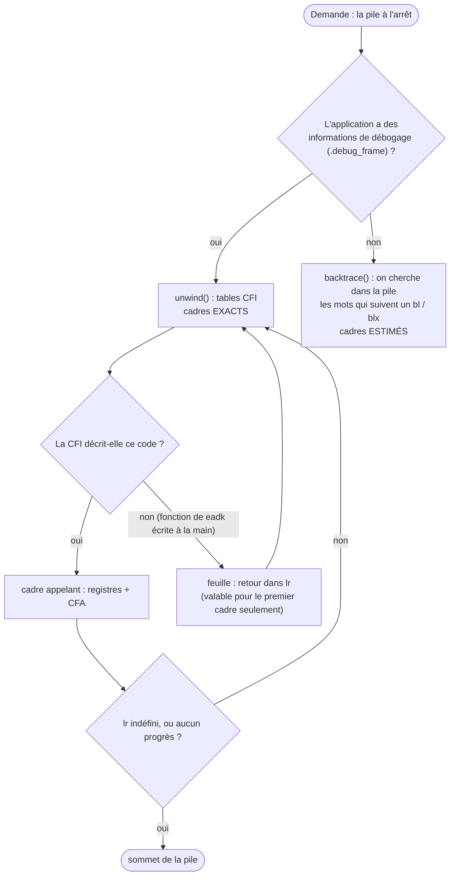

# La pile d'appels

::: tip En bref
Pour savoir « qui m'a appelé ? », il faut remonter la pile. Avec `-g`, le compilateur donne le **plan exact** ; sans lui, Nwasabi **devine** en cherchant, dans la pile, des adresses qui ressemblent à des retours d'appel.
:::

Un jeu d'instructions Thumb **n'enchaîne pas les cadres de pile** : aucun registre ne pointe vers le cadre de l'appelant. Nwasabi connaît donc deux méthodes.

## Exacte : les tables CFI (`debuginfo/unwind.rs`)

Avec `-g`, l'application contient `.debug_frame` : pour chaque adresse de code, des tables d'appel (CFI, « Call Frame Information ») qui disent **où la fonction a rangé son adresse de retour** et comment retrouver le cadre de l'appelant.

- `cfa_at(regs, pc, is_return_address)` calcule la **CFA** (l'adresse de la pile à l'entrée de la fonction) pour l'instruction `pc` ;
- `caller(...)` rend le cadre appelant : ses registres (les registres que la fonction n'a pas sauvegardés gardent leur valeur actuelle, faute de mieux) et sa CFA ;
- `unwind(...)` répète jusqu'au sommet. Il s'arrête sur `lr` **indéfini** (« on est en haut de la pile »), quand les tables manquent, ou **sans progrès** (pile ou adresse identiques) : une boucle ne peut pas s'éterniser.

Pour les cadres autres que le premier, l'adresse examinée est `adresse_de_retour − 1`, pour tomber dans l'instruction d'appel et non sur la suivante (une fonction qui ne rend jamais la main ou qui se termine par un appel).

**Le code non décrit par le compilateur** (les fonctions de `eadk` écrites à la main dans le runtime) est une **feuille** : l'adresse de retour est dans `lr`, la pile n'a pas bougé. Seul le **premier** cadre peut s'y fier : c'est ce qui permet de s'arrêter
dans un appel système et de remonter à l'application.

Un cadre (`Frame`) donne : l'adresse de l'instruction (celle en cours pour le cadre 0, l'adresse de retour pour les autres), les 16 registres, la CFA, et — via `DebugInfo` — la fonction, la ligne, les paramètres et les variables.

## Estimée : sans informations

Sans `.debug_frame` (ou dans du code qu'elles ne décrivent pas : une bibliothèque compilée sans `-g`), `session/debug.rs::backtrace` **reconstruit** la pile : elle parcourt la pile en cherchant les mots qui sont des **adresses de retour plausibles**,
c'est-à-dire qui suivent une instruction d'appel (`bl` ou `blx`) du code de l'application. Pour chaque candidat, `call_before(ret)` regarde l'instruction qui précède l'adresse (bit 0 retiré), donne sa taille et, pour un `bl`, sa cible. Au plus
8192 mots de pile sont examinés (`MAX_WORDS`).

C'est une **estimation** : une vieille adresse de retour restée dans la pile peut s'y glisser (les cadres estimés sont signalés comme tels). Elle suffit à localiser « qui m'a appelé » dans une application sans `-g`.

## Les noms

Un nom de fonction vient des informations de débogage s'il y en a, sinon des **symboles du fichier `.nwa`** (`LinkedApp::symbols`) ; sans eux, seules les adresses sont connues. `session/debug.rs::symbol_text` rend `fonction+0x10`. Les noms C++ et
Rust sont **démanglés** ([C++ et Rust](./langages.md#noms-lisibles-demanglage)).

## Dans le code

| Où | Quoi |
|---|---|
| [`unwind`](code:src/debuginfo/unwind.rs#unwind), [`caller`](code:src/debuginfo/unwind.rs#caller), [`cfa_at`](code:src/debuginfo/unwind.rs#cfa_at) | la pile exacte |
| [`backtrace`](code:src/session/debug.rs#backtrace), [`call_before`](code:src/session/debug.rs#call_before) | la pile estimée |
| [`frames_of`](code:src/session/source.rs#frames_of) | les cadres utilisés par le débogage du code source |
| [`symbol_text`](code:src/session/debug.rs#symbol_text) | « fonction+0x10 » |

## Pourquoi deux méthodes

L'estimation fonctionne **partout** (code sans `-g`, bibliothèques) mais peut se tromper ; la CFI est **exacte** mais ne décrit que ce que le compilateur a décrit. Garder les deux permet d'avoir **toujours** une pile, avec le niveau de confiance affiché. La CFI s'appuie sur `.debug_frame` plutôt que `.eh_frame` ou les tables ARM (`.ARM.exidx`) : ces dernières ne sont pas placées par l'éditeur de liens et leur format est moins général.

## Pour modifier

- **Mieux déboguer du code écrit à la main** (assembleur) : ajouter des directives `.cfi_*` dans le source assembleur ; la pile devient exacte sans toucher à Nwasabi.
- **Une pile fausse au premier cadre** : regarder si le pc est dans du code **non décrit** (la fonction est alors traitée comme une feuille).
