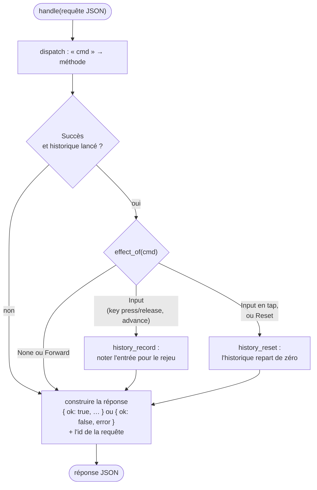
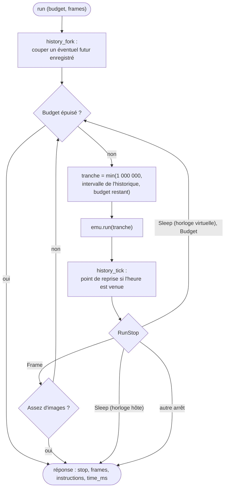
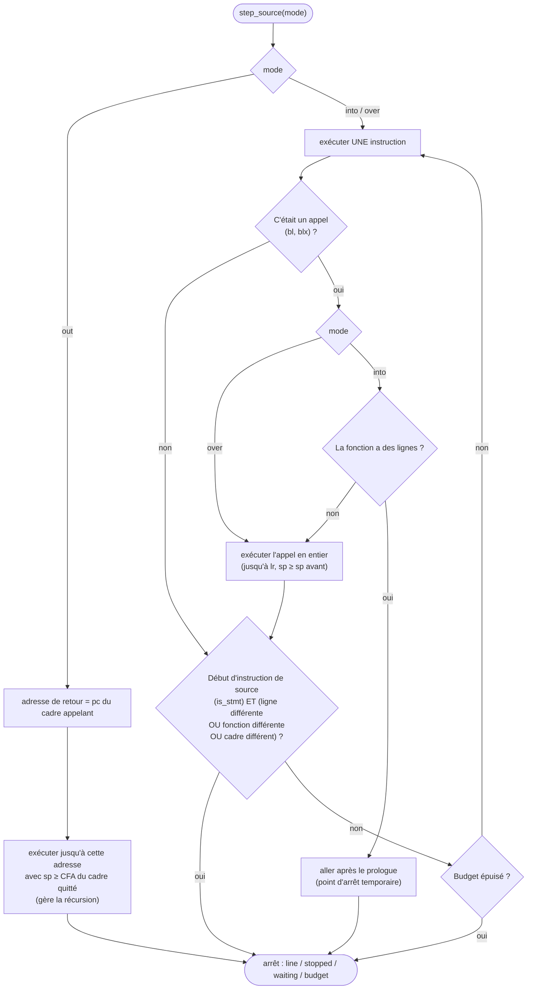

# La session

::: tip En bref
La session est la **porte d'entrée unique** : on lui envoie `{"cmd": "…"}`, elle répond `{"ok": …}`. Page web, ligne de commande, bibliothèque JavaScript et GDB ne font que transporter ces messages.
:::

`Session` (`src/session/`) est **le** point d'entrée : un appareil émulé (`Emulator`), un historique facultatif et les réglages de la conversation. Une requête est un objet JSON `{"cmd": "…", …}` avec un `"id"` facultatif renvoyé tel quel ; la réponse est
`{"ok": true, …}` ou `{"ok": false, "error": "…"}`. C'est le même contrat pour `nwasabi-cli session`, le serveur, la page web, `@nwasabi/js` et le serveur GDB, qui n'ont qu'à transporter ces objets. Les commandes elles-mêmes sont décrites dans la
[référence du protocole](../../reference/protocole-session.md) ; cette page dit comment la session les traite.

La session ne touche **ni au disque ni à l'horloge** : les fichiers entrent et sortent en base64 (en hexadécimal pour la mémoire), le temps est donné par `advance`. Les objets JSON sont écrits avec leurs clés **triées** (`json.rs`, sur `serde_json`) : la
sortie est déterministe, les résultats se comparent tels quels.

## Cycle d'une requête

`Reply = Result<Value, String>` : les erreurs sont des **messages en clair**, en français, avec la raison (« aucun appareil : utiliser « new » ou « load » », « mode inconnu : … (into, over, out) »). La commande `help` liste toutes les commandes ; les
commandes du débogage du code source sont dans `source.rs::COMMANDS`.

## `run`

`run` ne confie jamais tout le budget à l'émulateur d'un coup : il le découpe en tranches, pour pouvoir prendre des points de reprise de l'historique et réagir aux arrêts.

- budget par défaut **10 000 000** instructions (`DEFAULT_INSTRUCTIONS`), `instructions` le change ; `frames` s'arrête après autant d'images ;
- tranches de **1 000 000** (`CHUNK`), **plus courtes si un historique tourne**, pour ne pas manquer l'heure d'un point de reprise ;
- avec l'**horloge hôte**, une attente ne finit que si l'hôte fait passer du temps : inutile d'insister, on lui rend la main ;
- la réponse porte `stop` (description de l'arrêt, avec l'adresse de l'instruction fautive pour une faute), `frames`, `instructions` et `time_ms`.

`key` avec `action: "tap"` exécute **2 000 000 instructions** (`instructions` le change) entre l'appui et le relâchement : c'est un appui d'une durée qui laisse l'application réagir ; `press` et `release` sont des événements isolés, enregistrés pour le rejeu.

## Le débogage du code source : `source.rs`

Ces commandes s'appuient sur `DebugInfo` (`Session::debug_of` rend l'émulateur et le `DebugInfo` partagé, `Arc`) :

| Commande | Rôle |
|---|---|
| `debug_info` | fonctions, fichiers, présence d'informations ; |
| `line_at`, `source_lines` | adresse → ligne ; texte des fichiers (donné par l'hôte ou lu par le serveur : voir ci-dessous) |
| `break_line`, `unbreak_line`, `break_function` | points d'arrêt par ligne (`fichier:ligne`, la ligne sans code glisse à la suivante qui en a) et par fonction (**après le prologue** : `DebugInfo::after_prologue`) |
| `frames` | la pile : fonction, fichier, ligne, adresse de retour, paramètres |
| `locals`, `globals` | variables visibles dans le cadre choisi, valeurs dépliables |
| `eval`, `assign`, `ptype` | expressions ([Expressions](./expressions.md)), modification, description d'un type |
| `step_source` | `mode` `into`, `over` ou `out` |
| `export_elf` | l'ELF lié, pour GDB |

### Pas à la ligne : `step_source`

Un pas « à la ligne » n'existe pas dans le processeur : la session le fabrique avec des **pas d'instruction** et des **points d'arrêt temporaires**, dans la limite de 20 000 000 d'instructions (`STEP_BUDGET`).

La condition « cadre différent » (CFA qui change) est ce qui distingue un **retour dans l'appelant** d'une **boucle sur la même ligne**. Une attente d'événement s'arrête avec `outcome = "waiting"` ; un `Sleep` fait passer le temps virtuel.

### Le texte des sources

Le `.nwa` ne contient que les **noms de fichiers** et les numéros de lignes. `source_lines` en demande le texte à l'hôte : la page garde les fichiers donnés par l'utilisateur (choix ou glisser-déposer, rattachés **par la fin de leur nom**) ; avec le serveur, `--src dossier` fait lire
les fichiers au serveur à chaque chargement (`/__nwasabi/source`), qui ne sert que des fichiers de ce dossier choisis par la **fin de leur chemin DWARF** — **jamais un chemin que la requête donnerait**.

## Autres blocs de la session

- **Appareil** : `new`, `load` (avec `nwa`, `data`, `nfd`, `model`, `firmware`, `clock`, `speed`, `mhz`), `launch`, `dump`/`restore` ([`.nds`](../../reference/formats/nds.md)), `speed`, `device_name`, `fcc_id`, `serial_number`, `settings_get`/`settings_set`, `exam_mode`… (via `Settings`) ;
- **Mémoire** : `memory_read` (au plus 1 Mio : `MAX_TRANSFER`), `memory_write`, `changes`, `regions`, `usage`, `watch`/`unwatch`/`watch_list`/`watch_hits` ;
- **Exécution et observation** : `run`, `step`, `break`/`unbreak`/`breaks`, `cpu`, `cpu_set`, `disasm`, `profile`, `backtrace`, `symbol`, `symbols`, `svc_stats`, `svc_log`, `stdout`, `screen`, `time`, `advance` ;
- **Fichiers** : `fs_*` ([Système de fichiers](../noyau/fichiers.md)), `flash_load`, `flash_export`.

## Dans le code

| Fichier | Rôle | À regarder |
|---|---|---|
| [`session/mod.rs`](code:src/session/mod.rs) | la session et son entrée | [`Session`](code:src/session/mod.rs#Session), [`handle`](code:src/session/mod.rs#handle) |
| [`session/dispatch.rs`](code:src/session/dispatch.rs) | l'aiguillage : le texte de `cmd` désigne la fonction qui traite la commande | [`dispatch`](code:src/session/dispatch.rs#dispatch) |
| [`session/appareil.rs`](code:src/session/appareil.rs) | création, chargement, lancement, état enregistré, données en flash | [`load`](code:src/session/appareil.rs#load), [`dump`](code:src/session/appareil.rs#dump), [`restore`](code:src/session/appareil.rs#restore) |
| [`session/execution.rs`](code:src/session/execution.rs) | exécution, temps, touches, pas à pas, points d'arrêt | [`run`](code:src/session/execution.rs#run), [`step`](code:src/session/execution.rs#step), [`advance`](code:src/session/execution.rs#advance) |
| [`session/observation.rs`](code:src/session/observation.rs) | processeur, mémoire, points d'observation, appels système, symboles, désassemblage | [`cpu`](code:src/session/observation.rs#cpu), [`memory_read`](code:src/session/observation.rs#memory_read), [`disasm`](code:src/session/observation.rs#disasm) |
| [`session/fichiers.rs`](code:src/session/fichiers.rs), [`session/reglages.rs`](code:src/session/reglages.rs) | fichiers de la calculatrice ; réglages de l'appareil | [`fs`](code:src/session/fichiers.rs#fs), [`settings`](code:src/session/reglages.rs#settings) |
| [`session/aide.rs`](code:src/session/aide.rs) | la liste des commandes de `help` | [`COMMANDS`](code:src/session/aide.rs#COMMANDS) |
| [`session/source.rs`](code:src/session/source.rs) | débogage du code source | [`COMMANDS`](code:src/session/source.rs#COMMANDS), [`step_source`](code:src/session/source.rs#step_source), [`debug_of`](code:src/session/source.rs#debug_of), [`frames_of`](code:src/session/source.rs#frames_of), [`STEP_BUDGET`](code:src/session/source.rs#STEP_BUDGET) |
| [`session/history.rs`](code:src/session/history.rs) | l'historique | voir [Historique](./historique.md) |
| [`session/debug.rs`](code:src/session/debug.rs) | arrêts, symboles, pile estimée, profil | [`stop_json`](code:src/session/debug.rs#stop_json), [`backtrace`](code:src/session/debug.rs#backtrace) |
| [`session/views.rs`](code:src/session/views.rs) | mise en JSON des vues | [`structures`](code:src/session/views.rs#structures), [`regions`](code:src/session/views.rs#regions), [`stop`](code:src/session/views.rs#stop) |
| [`json.rs`](code:src/json.rs) | construction de JSON | [`ValueExt`](code:src/json.rs#ValueExt) |
| [`wasm.rs`](code:src/wasm.rs), [`cli/commands.rs`](code:src/cli/commands.rs) | les transports | |

## Pourquoi un protocole JSON unique

Chaque hôte aurait pu parler à `Emulator` directement. On a choisi un **protocole textuel unique** parce que : (1) il se **transporte** partout (message de Worker, ligne sur l'entrée standard, corps HTTP) sans dépendre de types Rust ; (2) il se **rejoue** (`.nrp` n'est qu'une liste de requêtes) ; (3) il oblige à décrire chaque commande **une fois**, pour tous. Le prix (sérialisation) est négligeable : l'écran, qui est volumineux, passe à part, par un pointeur partagé.

## Pour modifier

**Ajouter une commande de session** :

1. Une fonction dans le fichier de son domaine (voir le tableau ci-dessus) qui lit ses champs avec les aides de [`json.rs`](code:src/json.rs) et rend un `Reply`, et une ligne dans [`dispatch`](code:src/session/dispatch.rs#dispatch) (ou dans [`COMMANDS`](code:src/session/source.rs#COMMANDS) si elle concerne le code source).
2. L'ajouter à la liste [`COMMANDS`](code:src/session/aide.rs#COMMANDS) de la commande `help`.
3. **La classer** dans [`effect_of`](code:src/session/history.rs#effect_of) : lecture (`None`), entrée rejouable (`Input`), avancement (`Forward`) ou modification (le défaut, `Reset`).
4. La documenter dans le [protocole](../../reference/protocole-session.md).
5. La tester dans [`session.rs`](code:tests/session.rs) et, si la page s'en sert, dans [`tests/wasm/`](code:tests/wasm/) (parité native/WebAssembly).

**Les erreurs** sont des messages en français qui disent quoi faire (« utiliser `new` ou `load` ») : pas de codes numériques.
