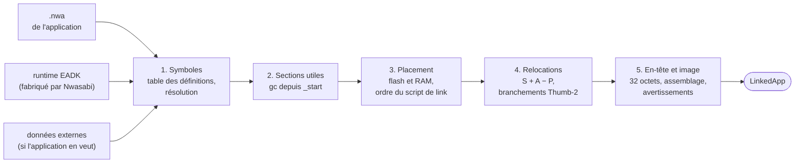

# L'édition de liens

::: tip En bref
Un `.nwa` est un **puzzle dont les pièces n'ont pas encore d'adresse**. L'éditeur de liens choisit où poser chaque pièce en flash et en RAM, puis calcule toutes les adresses qui s'y réfèrent.
:::


Un fichier `.nwa` **n'est pas un programme** : c'est un objet ELF 32 bits ARM **relogeable** (`-Wl,--relocatable`), avec des relocations qui n'ont pas encore d'adresse. L'outil de flashage officiel de NumWorks le lie avec un petit objet
de support (le **runtime EADK**) avant de l'écrire dans la flash de la calculatrice. Nwasabi refait ce travail : `link::link` produit une image, que `DeviceImage::install` place en flash comme l'outil de flashage. Les images
obtenues sont **identiques octet pour octet** à celles de l'éditeur de liens GNU (`arm-none-eabi-ld`) avec le même script de link, à la fusion des chaînes près (Nwasabi ne fusionne pas les chaînes identiques, sans conséquence).

```rust
link::link(nwa: &[u8], external_data: Option<&[u8]>, layout: &LayoutParams, options: &LinkOptions)
    -> Result<LinkedApp, LinkError>
```

## Les entrées

| Entrée | Rôle |
|---|---|
| `nwa` | l'objet de l'application |
| `external_data` | octets servis à `eadk_external_data` (ex. KhiCAS) ; sans eux, une application qui s'en sert échoue (`LinkError::MissingExternalData`) |
| `LayoutParams` | zone de flash `[flash_start, +flash_length)`, zone de RAM `[ram_start, +ram_length)`, adresse de la **trampoline** du userland : elles viennent du `UserlandHeader` du firmware cible et changent avec le modèle et la version |
| `LinkOptions` | `limits` (bornes de lecture) et `extended_runtime` (fournir aussi batterie et USB ; désactivé par défaut : un vrai appareil refuserait ces applications) |

Trois objets sont liés, dans cet ordre : **runtime**, **application**, éventuellement **données externes**. En cas de définitions multiples d'un symbole, **la première gagne** (comme `eadk.o` avant l'application dans l'outil officiel) :
le runtime l'emporte donc sur une application qui définirait elle-même une fonction EADK.

## Les cinq temps



1. **Symboles** ([Symboles et sections utiles](./symboles.md)) : table des définitions globales (forte > faible > commune), résolution de chaque symbole utilisé.
2. **Sections inutiles** : parcours d'accessibilité à partir de `_start` et des trois sections d'en-tête ; ce que rien n'utilise est écarté (équivalent de `--gc-sections`).
3. **Placement** ([Placement](./placement.md)) : classes et ordre du script de link, flash et RAM.
4. **Relocations** ([Relocations](./relocations.md)) : calcul de chaque emplacement, y compris les branchements longs Thumb-2.
5. **En-tête et image** ([Application et export ELF](./application.md)) : l'en-tête de 32 octets, l'assemblage et les avertissements.

## Le résultat : `LinkedApp`

| Champ | Contenu |
|---|---|
| `name`, `api_level`, `icon` | lus dans `.rodata.eadk_app_name`, `.rodata.eadk_api_level` (exactement 4 octets) et `.rodata.eadk_app_icon` (image NWI brute) |
| `flash_start`, `flash` | l'image à écrire en flash : en-tête, code, constantes, copie initiale de `.data` |
| `entry` | adresse de `_start`, bit 0 à 1 (Thumb) |
| `app_end` | fin des constantes (`_eadk_app_end`), valeur écrite dans l'en-tête |
| `data`, `bss`, `heap` | `DataSegment { address, flash_address, size }`, `Region { address, size }` ; le **tas** va de la fin de `.bss` (et des variables communes) à la fin de la RAM réservée |
| `sections`, `symbols` | les `PlacedSection` (nom, origine, classe, adresse, adresse en flash, taille, alignement) et les `LinkedSymbol` de l'image finale |
| `debug` | les sections `.debug_*` avec leurs relocations appliquées ([Application et export ELF](./application.md#informations-de-debogage)) |
| `warnings` | `LinkWarning`, par exemple `AppSizeMismatch` |

`installed_size()` donne la place occupée une fois installée : l'outil de flashage complète jusqu'au **secteur de 64 Kio** (`APP_SECTOR_SIZE = 0x1_0000`) suivant, et **ajoute un secteur entier** quand la taille est déjà alignée.

## Erreurs : `LinkError`

`Elf` (fichier illisible), `MissingSection` (une section exigée par le format d'application), `InvalidApiLevel`, `UndefinedSymbol` (symbole utilisé défini nulle part), `MissingExternalData`, `Relocation` (une relocation n'a pu être
appliquée), `DiscardedSection` (un symbole actif désigne une section écartée : cas anormal), `FlashOverflow`/`RamOverflow` (avec ce qu'il faut et ce qu'il y a) et `Unsupported` (variables locales aux threads). Les messages indiquent le symbole, la
section et l'objet.

## Pages

- [Lecture ELF](./elf.md)
- [Symboles et sections utiles](./symboles.md)
- [Placement](./placement.md)
- [Relocations](./relocations.md)
- [Le runtime EADK](./runtime.md)
- [Application et export ELF](./application.md)
