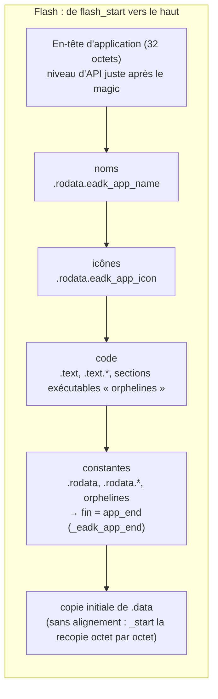
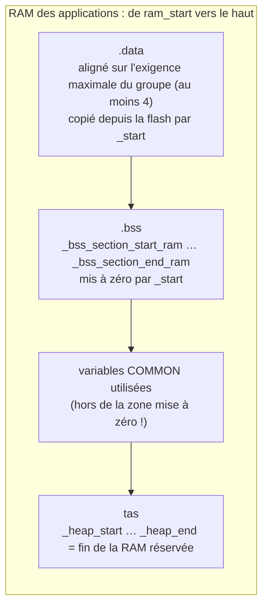

# Placement en flash et en RAM

::: tip En bref
Le placement décide de l'**ordre** des sections en flash et en RAM. Il suit celui du script de link officiel : si l'ordre différait d'un octet, les adresses ne seraient plus les mêmes.
:::

`linker.rs::layout` reproduit le **script de link** de l'outil de flashage officiel : même ordre, mêmes alignements, donc mêmes adresses.

## Classes et rang

Chaque section vivante reçoit une **classe** (`Class`) et un **rang** (`classify`, `named_class`) :

| Classe | Sections | Rang |
|---|---|---|
| `ApiLevel`, `Name`, `Icon` | `.rodata.eadk_api_level`, `.rodata.eadk_app_name`, `.rodata.eadk_app_icon` | 0 |
| `Text` | `.text` (rang 0), `.text.*` (1), autres sections exécutables (2, « orphelines ») | |
| `Rodata` | `.rodata` (0), `.rodata.*` (1), autres sections allouées en lecture seule (2) | |
| `Data` | `.data` (0), `.data.*` (1), autres sections allouées et écrivables (2) | |
| `Bss` | `.bss` (0), `.bss.*` (1), autres sections sans contenu (2) | |

Dans une classe, on trie par rang puis par ordre d'apparition (objet, section) : d'abord les sections nommées exactement `.text`, puis `.text.*`, puis les autres sections de même nature.

## Ordre en flash

`place(cursor, ids, min_align)` aligne l'ensemble sur l'alignement le plus exigeant de ses membres (au moins `min_align`) puis chaque section sur le sien.

## RAM

La **copie de `.data`** vit en flash juste après les constantes, à `data_flash`, et s'exécute en RAM à `data_ram` ; l'adresse de chaque section `.data` en flash est `data_flash + (adresse_ram − data_ram)`.

## Contrôles de capacité

`image_end` (la fin la plus haute en flash, copie de `.data` comprise) doit tenir dans `[flash_start, flash_end)` : sinon `LinkError::FlashOverflow { needed, available }`. De même, `commons_end` dans la RAM
(`RamOverflow`). Le tas n'est jamais vérifié : c'est ce qui reste.

## Cas particulier : la taille de l'en-tête

La taille que l'en-tête écrit (`app_end − flash_start`) **ne compte pas** la copie de `.data`. L'outil de flashage, lui, place l'application suivante d'après la taille **réelle** de l'image. Si les deux tailles tombent dans des
secteurs de 64 Kio différents, le système cherche l'application suivante au mauvais endroit et la « perd ». Ce défaut du format officiel est **reproduit tel quel**, et signalé : `LinkWarning::AppSizeMismatch` (voir
[`device::list_apps`](../memoire/appareil.md#fabriquer-installer-relire)).
