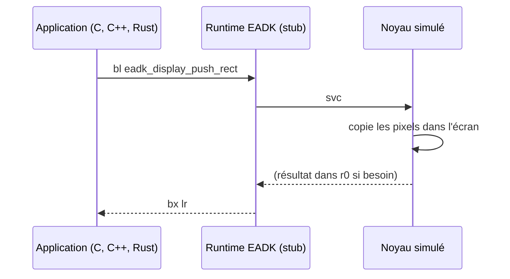
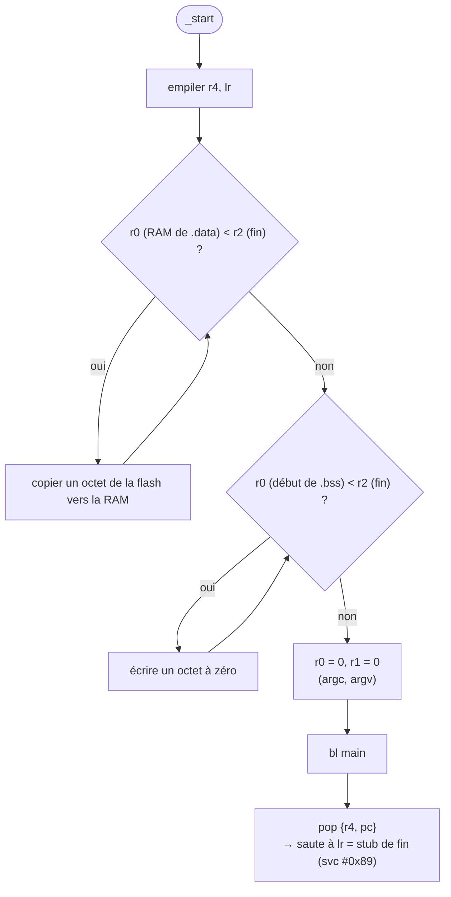

# Le runtime EADK

::: tip En bref
Le runtime est le **kit de démarrage** de toute application : les fonctions `eadk_*` (qui se réduisent à un `svc`) et `_start`, qui prépare la mémoire puis appelle `main`.
:::


Sur la calculatrice, une application appelle par exemple `eadk_display_push_rect` ; cette fonction n'existe pas dans le `.nwa` : elle vient d'un objet fourni à l'édition de liens, fait de quelques instructions (`svc #N` puis retour).
`link::runtime::build_runtime(extended)` **fabrique** cet objet en octets (avec `ObjectWriter`), instruction par instruction, vérifiées avec l'assembleur GNU pour ARM.

## Les fonctions EADK

Chaque fonction EADK est `svc #N ; bx lr` (`0xDF00 | N` puis `0x4770`) : les résultats sont déjà dans `r0`, `r1` ou `s0` quand le noyau rend la main. `EADK_SVC` donne la table (nom → numéro, ceux du noyau
d'Epsilon) ; `EADK_EXTENDED_SVC` ajoute `eadk_battery_is_charging` (3), `eadk_battery_level` (4), `eadk_battery_voltage` (5) et `eadk_usb_is_plugged` (52) si `extended_runtime` est vrai.

## En deux images

Un appel EADK n'est qu'un **tremplin** vers le noyau :



Et `_start` prépare la mémoire avant d'appeler `main` :



## `_start`

```text
 0: push {r4, lr}
 2: ldr r0, =_data_section_start_ram          ; mots du pool à 0x30…0x40
 4: ldr r1, =_data_section_start_flash
 6: ldr r2, =_data_section_end_ram
 8: cmp r0, r2 ; bcs 0x16                     ; boucle de copie octet par octet
 c: ldrb r3, [r1], #1 ; strb r3, [r0], #1 ; b 0x8
16: ldr r0, =_bss_section_start_ram
18: ldr r2, =_bss_section_end_ram
1a: movs r3, #0
1c: cmp r0, r2 ; bcs 0x26                     ; boucle de mise à zéro
20: strb r3, [r0], #1 ; b 0x1c
26: movs r0, #0 ; movs r1, #0
2a: bl main                                   ; R_ARM_THM_CALL
2e: pop {r4, pc}
```

`_start` appelle `main(0, NULL)`. Au retour, le `pop {r4, pc}` saute à `lr`, qui vaut au lancement l'adresse du stub **`svc #0x89 ; b .`** du userland fabriqué (`EXIT_STUB_OFFSET`) : le noyau y voit la fin de l'application avec le code rendu par `main`.

## Support de la bibliothèque C

`_sbrk` (`svc #0x81`) et `_write` (`svc #0x82`) sont des appels privés de Nwasabi ; `_read`, `_lseek`, `_fstat` rendent 0, `_isatty` rend 1, `_open` et `_close` rendent −1 : de quoi lier `newlib` sans système.

## `eadk_display_draw_string`

L'EADK appelle la fonction de dessin de texte du **userland**. Le runtime officiel la lit dans la table de fonctions du userland (la « trampoline », à `UserlandHeader + 0x38`) :

```text
0: ldr.w ip, [pc, #8]    ; ip = _userland_trampoline_address (mot à 0xc, relocation ABS32)
4: ldr.w ip, [ip]        ; ip = fonction du userland
8: bx ip
a: nop
```

L'adresse que lit `ip` est celle du stub `svc #0x80 ; bx lr` que `device::fabric` place à `UserlandHeader + 0x40`. Une application compilée pour un firmware donné **lie donc contre l'adresse de la table de ce firmware** : c'est pourquoi `LayoutParams` en dépend.

## Données externes

`build_external_data(octets)` fabrique l'objet d'une application qui utilise `eadk_external_data` (KhiCAS) : une section `.rodata.eadk_external_data` et deux symboles (`_eadk_external_data_start`, et `_eadk_external_data_size`, absolu).
Le runtime définit en plus deux variables `eadk_external_data` et `eadk_external_data_size` (dans `.data`, initialisées par relocation) pour que l'application les lise comme des variables C. Ces octets sont **liés dans l'application**,
à la différence des [données auxiliaires en flash](../../reference/donnees-flash.md), qui sont placées à des adresses de la flash à part.
