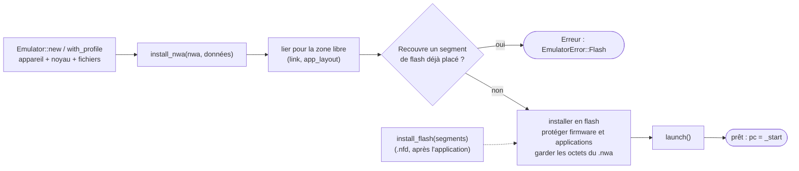
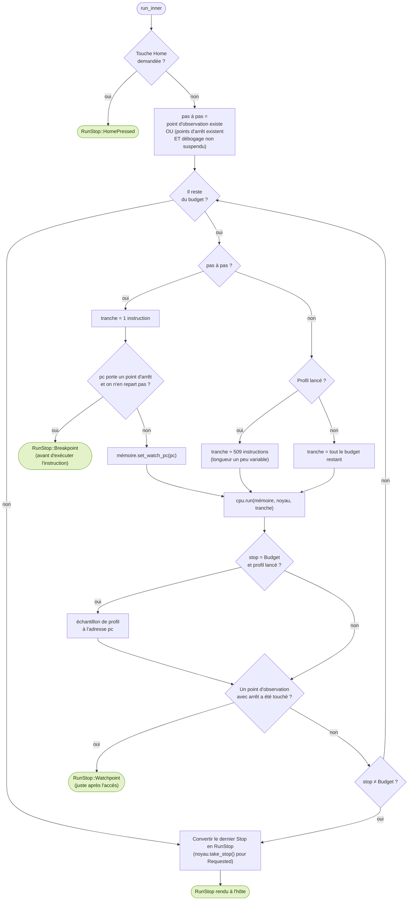

# L'exécution coopérative

::: tip En bref
L'émulateur est **coopératif** : il fait avancer l'application jusqu'à ce que l'hôte doive intervenir (image prête, attente, point d'arrêt, faute…), puis **rend la main** en disant pourquoi. Il ne dort jamais et ne regarde jamais l'heure.
:::

`Emulator` réunit un appareil (`DeviceImage` : mémoire, profil), un processeur (`Cpu`), le noyau simulé (`Kernel`) et le système de fichiers (`Storage`). Il ne dort **jamais** et ne lit **aucune horloge** : il avance
l'application **jusqu'à un point où l'hôte doit intervenir**, et dit pourquoi. C'est à l'hôte de faire passer le temps (`Kernel::advance_time`) et de donner les touches.

## Mise en route

1. **`Emulator::with_profile(profil, config)`** fabrique l'appareil, le noyau et le système de fichiers ; **`new(modèle)`** utilise le profil par défaut du modèle.
2. **`install_nwa(nwa, données_externes)`** lie le `.nwa`, refuse qu'il recouvre un segment de flash déjà placé, l'installe, protège le firmware et les applications (`kernel.flash_protected_end`), garde les octets (`AppSource`) pour pouvoir le **relier** si l'appareil change (profil, slot), puis appelle `launch`.
3. **`install_flash(segments)`** place des octets en flash à des adresses fixes ([`.nfd`](../../reference/formats/nfd.md)) ; ils ne peuvent pas recouvrir le firmware ni une application installée.
4. **`launch()`** (re)démarre : `clear_access`, `scb::reset`, attentes oubliées, `Cpu::new()`, `sp` = pile du processus du profil, `lr` = stub de fin `| 1`, `pc` = `_start`, tas fixé sur la région du tas de l'application. Refuse en mode examen (`EmulatorError::ExamMode`).

## `Emulator::run(max_instructions) -> RunStop`

`run` et `step` sont les deux points d'entrée. `RunStop` :

| `RunStop` | Signification |
|---|---|
| `Frame` | l'image est prête : l'hôte l'affiche |
| `Sleep { ms }` | l'application dort ; le temps virtuel a déjà avancé |
| `WaitEvent { remaining_ms }` | l'application attend une touche ; l'hôte doit faire passer du temps ou appuyer avant de relancer |
| `Exited(code)` | `main` est revenue |
| `Reset` | l'application a demandé un redémarrage |
| `HomePressed` | l'utilisateur a quitté l'application |
| `Budget` | `max_instructions` est épuisé |
| `Watchpoint(WatchHit)` | un point d'observation « avec arrêt » a été touché ; l'arrêt est juste **après** l'accès |
| `Breakpoint { pc }` | l'exécution est arrivée sur une instruction où l'hôte a posé un point d'arrêt (**pas encore exécutée**) |
| `Fault(Fault)` | l'application s'est arrêtée sur une faute (`Bus`, `Unimplemented`, `UsageFault`, `Breakpoint`, `WaitForInterrupt`, `UnknownSvc`) |

## Boucle interne : `run_inner`

Voici ce que fait `run` à chaque appel. Les losanges sont des questions, les rectangles des actions, et les formes arrondies les **sorties** (ce que l'hôte reçoit).

Points à retenir :

- **Pas de points d'arrêt, pas d'observation : exécution en bloc**. `Cpu::run` reçoit tout le budget, et le cache d'instructions fait le reste. Dès qu'un point existe, l'émulation passe **instruction par instruction** : plus lente, mais exacte.
- **`resume_from`** : le point d'arrêt où l'on vient de s'arrêter ne s'applique pas deux fois de suite à la même instruction ; `stopped_at_breakpoint` et `resume_point`/`set_resume_point` le sauvegardent quand le débogueur exécute du code
  pour lui-même (appel de fonction d'une expression : [Expressions](../debogage/expressions.md)).
- **Points d'arrêt conditionnels** : `Condition { register, compare, value }` avec `Compare` : `==`, `!=`, `<`, `<=`, `>`, `>=` (non signés) et `&` (au moins un bit en commun). Le registre est `r0`–`r12`, `sp`, `lr` ou `pc`.
- **`suspend_debugging`** : pendant un rejeu de l'historique, points d'arrêt et d'observation sont ignorés sans être retirés.
- **Une tranche de profil de longueur variable** : `PROFILE_SLICE (509) + (cycles >> 3) % 31`. Une longueur fixe retomberait toujours au même endroit d'une boucle et fausserait l'échantillonnage.

## Le profil d'exécution

`start_profile` active un compteur par adresse : à la fin de chaque tranche, l'adresse `pc & !1` gagne un échantillon. `profile_samples` / `stop_profile` rendent `(adresse, nombre)`. La session les regroupe par fonction (adresses sans nom par blocs de 256 octets) et par
adresse. Une application qui attend l'écran ou le clavier exécute trop peu d'instructions pour être profilée.

## Pas à pas

`step()` exécute **une** instruction (`resume_from = pc` puis `run(1)`) **même si un point d'arrêt y est posé**, et rend son `RunStop`. Les pas « par-dessus » et « sortir », ainsi que les pas de source, sont réalisés **par la session** à partir de `step` et des points d'arrêt temporaires, pas par
l'émulateur : voir [Session](../debogage/session.md).

## Utilisation de la mémoire

`usage()` mesure le tas (plage réservée, limite `brk`, plus haute adresse écrite) et la pile (plage réservée, plus basse adresse écrite, `sp` actuel) d'après les indicateurs d'accès de la mémoire, au grain de 32 octets.

## Fautes

À l'arrêt sur une faute, `Emulator` appelle `scb::record` ([Appareil](../memoire/appareil.md#registres-de-faute)) avec l'adresse de l'instruction fautive (`cpu.fault_pc`, ou celle du `svc` pour une faute causée par un pointeur
d'appel système).

## Dans le code

| Où | Quoi |
|---|---|
| [`Emulator`](code:src/emulator.rs#Emulator) | la structure : appareil, processeur, noyau, fichiers, points d'arrêt |
| [`with_profile`](code:src/emulator.rs#with_profile), [`install_nwa`](code:src/emulator.rs#install_nwa), [`install_flash`](code:src/emulator.rs#install_flash), [`launch`](code:src/emulator.rs#launch) | la mise en route |
| [`run`](code:src/emulator.rs#run), [`step`](code:src/emulator.rs#step), [`run_inner`](code:src/emulator.rs#run_inner) | l'exécution |
| [`RunStop`](code:src/emulator.rs#RunStop), [`Fault`](code:src/emulator.rs#Fault) | ce qu'on rend à l'hôte |
| [`Breakpoint`](code:src/emulator.rs#Breakpoint), [`Condition`](code:src/emulator.rs#Condition), [`Compare`](code:src/emulator.rs#Compare) | les points d'arrêt |
| [`PROFILE_SLICE`](code:src/emulator.rs#PROFILE_SLICE), [`start_profile`](code:src/emulator.rs#start_profile) | le profil |
| [`usage`](code:src/emulator.rs#usage) | mesure du tas et de la pile |
| [`debug_info`](code:src/emulator.rs#debug_info) | le DWARF, lu à la demande et gardé |

## Pourquoi coopératif

- **Un seul appelant décide** : `run` rend la main à **chaque** événement qui intéresse l'hôte, avec la raison. Il n'y a ni fil, ni rappel (callback), ni horloge : l'hôte choisit combien de temps passe, quand afficher, quand attendre.
- **L'exécution en bloc est le chemin par défaut**, le pas à pas le chemin **lent mais exact** : un point d'arrêt ou d'observation n'est détectable qu'entre deux instructions, donc on s'impose `tranche = 1` seulement quand c'est nécessaire.
- **Les points d'arrêt s'arrêtent *avant* l'instruction** et les points d'observation *après* l'accès : c'est la convention de GDB, et c'est ce qui permet de **reprendre** sans réexécuter (`resume_from`).

## Pour modifier

- **Un nouvel arrêt** (par exemple une nouvelle cause de rendre la main) : une variante de [`RunStop`](code:src/emulator.rs#RunStop) **et** sa conversion en JSON ([`views::stop`](code:src/session/views.rs#stop) et [`debug::stop_json`](code:src/session/debug.rs#stop_json)), sinon l'hôte la verra comme un arrêt inconnu.
- **Un nouveau type de condition de point d'arrêt** : [`Compare`](code:src/emulator.rs#Compare) et [`Compare::parse`](code:src/emulator.rs#parse), puis la commande `break` de la [session](../debogage/session.md).
- **Si l'on touche à `run_inner`** : relire le diagramme ci-dessus ; les cas les plus fragiles sont « on repart d'un point d'arrêt » (`resume_from`) et « un point d'observation touche à la dernière instruction d'une tranche ».
- **Tests** : [`emulator_apps.rs`](code:tests/emulator_apps.rs), [`debugger.rs`](code:tests/debugger.rs), [`emulator_nested.rs`](code:tests/emulator_nested.rs).
