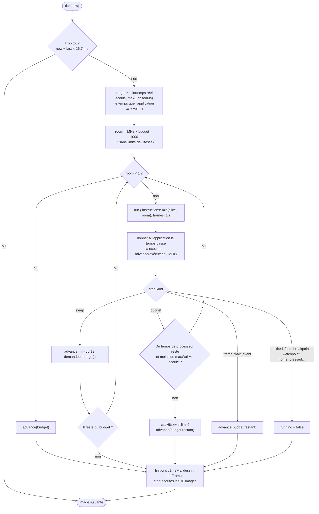

# La bibliothèque JavaScript

`packages/js` (`@nwasabi/js`) est une bibliothèque TypeScript qui fait tourner le module WebAssembly dans un navigateur ou sous Node.js ; `packages/wasm` (`@nwasabi/wasm`) embarque le `.wasm` lui-même. Son usage est décrit dans la
[référence](../../reference/bibliotheque-js.md) ; voici comment `Player` est fait.

## Fichiers

| Fichier | Rôle |
|---|---|
| `nwasabi.ts` | l'enveloppe du module : `alloc`, `request(json)`, `framebuffer()`, `drawTo(imageData)` |
| `player.ts` | `Player` : la boucle de cadence, l'état (`PlayerState`), les entrées |
| `input.ts`, `gestures.ts` | clavier de l'ordinateur et gestes tactiles → touches |
| `keymap.ts` | lecture des [`.nmk`](../../reference/formats/nmk.md) (mêmes règles que `keymap/` en Rust) |
| `keys.ts` | noms des touches |

## `Player`

`Player.create(wasm, options)` crée le module et une session. Options : `scheduler` (par défaut `requestAnimationFrame` ou une minuterie Node), `slice` (instructions par tranche, 2 000 000 par défaut), `maxWallMs` (temps réel maximal passé à exécuter sans limite de vitesse, 12 ms par défaut), `maxElapsedMs` (garde-fou contre une image très en retard, 250 ms par défaut).

La boucle `tick(now)` (une « image du navigateur ») :

La figure en mots : le **budget** est le temps que l'application a le droit de voir passer. Elle le consomme en exécutant des instructions (à la vitesse émulée), en dormant ou en attendant une touche ; ce qui reste lui est donné à la fin de l'image.

Le noyau est en **horloge hôte** : `advance` reçoit le temps réellement écoulé, et rien pendant une pause. `PlayerState` expose entre autres `loaded`, `running`, `model`, `firmware`, `speed`, `customMhz`, `limitMhz`, `appName`, `stop`, `frames`, `instructions`, `error`, `stdout`,
`timeMs`, `keymapName`, `needsData` (l'application demande des données externes qu'on ne lui a pas données : elle n'est pas lancée), `revision` (augmente quand les vues dérivées doivent se rafraîchir) et `capHits`.

**Touches** : une touche enfoncée puis relâchée entre deux images serait perdue pour une application qui ne lit le clavier qu'une fois par image. Le lecteur note donc les touches **échantillonnées** (`sampled`) par une tranche et **diffère** (`deferred`) le relâchement d'une touche déjà
relâchée jusqu'à ce qu'une tranche l'ait vue.

## Écran

`attach(canvas)` dessine dans un canvas 2D (`HTMLCanvasElement`, `OffscreenCanvas` ou tout objet ressemblant : `CanvasLike`) à chaque image (`createImageData` puis `putImageData`, la conversion RGB565 → RGBA étant faite dans le module par `drawTo`). Sans canvas, `framebuffer()` donne les pixels RGB565 bruts et
`rgba()` une copie RGBA 8 bits.

## Entrées

`InputMapper` traduit un `KeyboardEvent` (position `code` ou caractère `key`) en touches de la calculatrice d'après le `KeyMap`, avec la logique des **accords** (une touche de l'ordinateur → plusieurs touches de la calculatrice) ; `attachPointer` ajoute la reconnaissance de **gestes** tactiles (`gestures.ts`) liés par les règles du fichier de mapping. La répétition des touches est faite par le **noyau** ([Clavier](../noyau/clavier.md)), pas par la bibliothèque.

## Dans le code

| Où | Quoi |
|---|---|
| [`Player`](code:packages/js/src/player.ts#Player) | la classe principale : [`create`](code:packages/js/src/player.ts#create), [`tick`](code:packages/js/src/player.ts#tick), [`attach`](code:packages/js/src/player.ts#attach), [`call`](code:packages/js/src/player.ts#call) |
| [`PlayerState`](code:packages/js/src/player.ts#PlayerState), [`Scheduler`](code:packages/js/src/player.ts#Scheduler) | l'état et le planificateur |
| [`defaultScheduler`](code:packages/js/src/player.ts#defaultScheduler) | navigateur ou Node.js |
| [`Nwasabi`](code:packages/js/src/nwasabi.ts#Nwasabi) | l'enveloppe du module |
| [`InputMapper`](code:packages/js/src/input.ts#InputMapper) | clavier de l'ordinateur → touches |
| [`gestures.ts`](code:packages/js/src/gestures.ts), [`keymap.ts`](code:packages/js/src/keymap.ts) | gestes et mapping |
| [`index.ts`](code:packages/js/src/index.ts) | ce qui est exporté |
| [`player.mjs`](code:tests/wasm/player.mjs), [`speed.mjs`](code:tests/wasm/speed.mjs) | les tests de cadence |

## Pourquoi un `Scheduler` injectable

Le `Player` doit tourner dans un navigateur (`requestAnimationFrame`), dans un Worker (pas de `requestAnimationFrame`) et sous Node.js (tests, scripts). Plutôt que de tester l'environnement dans la boucle, on **lui passe** `now`, `request` et `cancel`. Les tests donnent un faux planificateur : on fait avancer le temps à la main, sans attendre, et le comportement est reproductible.

## Pour modifier

- **Changer la cadence** : [`tick`](code:packages/js/src/player.ts#tick) ; l'invariant à respecter est « l'application ne voit jamais plus de temps qu'il n'en est réellement passé, et rien en pause ».
- **Ajouter une méthode au `Player`** que la page appelle : l'ajouter aussi à `PlayerMethod` de [`worker-protocol.ts`](code:web/src/worker-protocol.ts#PlayerMethod), sinon le Worker ne la transmettra pas.
- **Publier** : `just build-npm`, `just pack-npm` ; les deux paquets partagent la même version.
