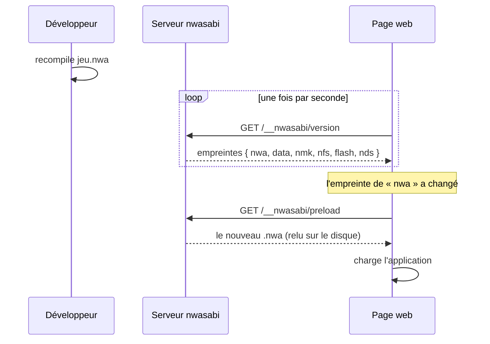

# Le serveur

`src/server/main.rs` (binaire `nwasabi`, fonctionnalité `serve`) est un petit serveur **axum**. L'émulation s'exécute dans le navigateur, pas dans le binaire : il **sert la page** et fait le lien avec le disque et le réseau.

## Un seul binaire

`build.rs` construit le site web en trois étapes dans `OUT_DIR` (jamais dans l'arbre source) : (1) s'assurer que la cible `wasm32-unknown-unknown` est installée (`rustup target add`), (2) compiler le module WebAssembly avec un `cargo` imbriqué, (3) construire avec Node
(`npm ci`, `@nwasabi/js`, puis l'interface Vue). `rust-embed` (dossier `NWASABI_WEB_DIST`) embarque le résultat dans le binaire. `NWASABI_NO_WEB=1` saute tout cela : le serveur n'a alors qu'une page qui explique comment construire l'interface.

## Routes

| Route | Rôle |
|---|---|
| `/` et les fichiers du site | la page, depuis le binaire |
| `/__nwasabi/health` | vérification de vie |
| `/__nwasabi/preload` | l'application `--nwa` (que la page charge au démarrage) |
| `/__nwasabi/version` | **empreintes** des fichiers donnés (`nwa`, `data`, `nmk`, `nfs`, `flash`, `nds`) : la page les interroge pour **recharger** quand un fichier change |
| `/__nwasabi/nmk`, `nfs`, `flash`, `nds` | les fichiers `--nmk`, `--nfs`, `--flash`, `--nds`, tels quels (404 sans eux) |
| `/__nwasabi/source?name=…` | texte d'un fichier source de `--src` |
| `/__nwasabi/gdb`, `/gdb/next`, `/gdb/answer`, `/gdb/detach` | pont GDB ([GDB](../debogage/gdb.md#le-pont-avec-la-page-bridge)) |

## Le rechargement automatique

Le serveur ne pousse rien : c'est la **page** qui demande si les fichiers ont changé.

## Garde-fous

- **Aucun chemin de requête n'est jamais lu.** Les seuls fichiers lus sont ceux donnés au démarrage, **relus à chaque requête** pour que la page puisse les recharger ; les sources de `--src` sont choisies par la **fin de leur chemin** parmi la liste des fichiers du dossier
  (`source_files`) : le plus long accord gagne, sinon le même nom de fichier.
- Les fichiers `.nmk`, `.nfs`, `.nfd`, `.nds` sont **vérifiés au démarrage** : une erreur de format empêche de démarrer, avec l'endroit de l'erreur.
- Le port GDB n'écoute que sur `--host` (la machine seule par défaut). `--gdb-headless` valide le `.nwa` avant d'écouter.
- Le modèle (`--model`) et le micrologiciel (`--firmware`) sont passés à chaque session GDB sans page.

## Options

Voir [Le serveur](../../guide/serveur.md) (guide) : `--nwa`, `--data`, `--nmk`, `--nfs`, `--flash`, `--nds`, `--src`, `--model`, `--firmware`, `--host`, `--port`, `--gdb`, `--gdb-headless`.

## Dans le code

| Où | Quoi |
|---|---|
| [`main.rs`](code:src/server/main.rs) | tout le serveur |
| [`Options`](code:src/server/main.rs#Options) | les options de la ligne de commande |
| [`Served`](code:src/server/main.rs#Served) | ce que le serveur sait servir |
| [`preload`](code:src/server/main.rs#preload), [`version`](code:src/server/main.rs#version), [`stamp`](code:src/server/main.rs#stamp) | le chargement et l'empreinte |
| [`source`](code:src/server/main.rs#source), [`source_files`](code:src/server/main.rs#source_files) | les sources de `--src` |
| [`gdb_next`](code:src/server/main.rs#gdb_next), [`gdb_answer`](code:src/server/main.rs#gdb_answer) | le pont GDB |
| [`gdb_session`](code:src/server/main.rs#gdb_session), [`serve_gdb`](code:src/server/main.rs#serve_gdb) | `--gdb-headless` et `--gdb` |
| [`build.rs`](code:build.rs) | construction du site embarqué |
| [`server.rs`](code:tests/server.rs) | les tests |

## Pourquoi relire les fichiers à chaque requête

Le serveur sert un **fichier que vous recompilez** : le lire une fois au démarrage obligerait à le relancer. L'empreinte (`stamp`) rend le rechargement bon marché : la page ne rechargera que ce qui a changé. Aucun chemin de la requête n'étant jamais lu, on ne peut pas faire sortir un fichier d'ailleurs que de ceux qui ont été donnés au démarrage.

## Pour modifier

- **Servir un fichier de plus** : un champ de [`Served`](code:src/server/main.rs#Served), une option, une route, et son empreinte dans [`version`](code:src/server/main.rs#version) ; le valider **au démarrage** (une erreur de format ne doit pas attendre la première requête).
- **Une nouvelle route** : toujours sous `/__nwasabi/` pour ne jamais entrer en conflit avec la page.
- **Sécurité** : toute route qui prend un nom (comme `source`) doit le **comparer à une liste** de ce que le serveur connaît, jamais l'ouvrir.
