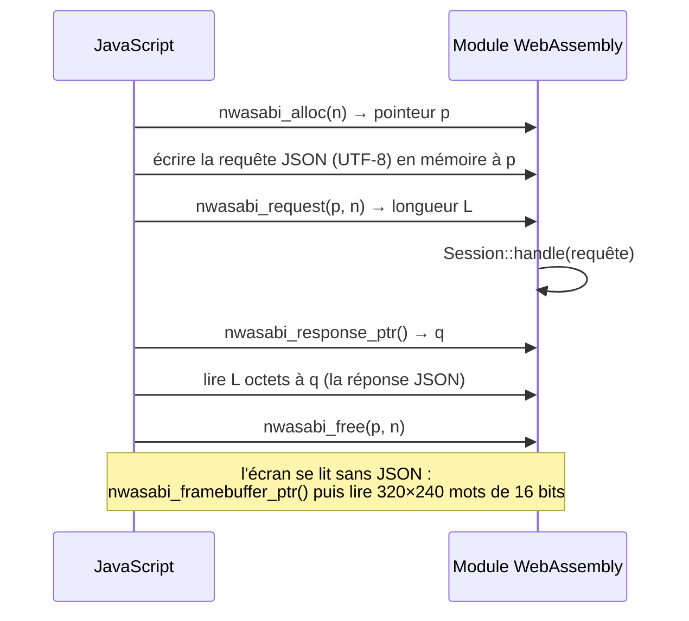

# Le module WebAssembly

::: tip En bref
Le module WebAssembly n'expose que **quelques fonctions** : réserver un tampon, envoyer une requête JSON, lire la réponse et les pixels. Tout le reste passe par ce protocole.
:::


`src/wasm.rs` est tout ce que JavaScript voit. **Pas de `wasm-bindgen`** : l'échange se fait par la mémoire du module, avec quelques fonctions `extern "C"`.

| Fonction | Rôle |
|---|---|
| `nwasabi_alloc(len) -> *mut u8` | réserve `len` octets dans la mémoire du module |
| `nwasabi_free(ptr, len)` | les libère (même taille) |
| `nwasabi_request(ptr, len) -> usize` | traite la requête JSON de `len` octets écrite à `ptr` et rend la **longueur de la réponse** |
| `nwasabi_response_ptr() -> *const u8` | adresse de la dernière réponse (valable jusqu'à la requête suivante) |
| `nwasabi_framebuffer_ptr() -> *const u16` | adresse des pixels de l'écran (RGB565, 320×240) ou 0 sans appareil ; **change quand un nouvel appareil est créé** |
| `nwasabi_framebuffer_len() -> usize` | nombre de pixels |

Un appel typique : JavaScript écrit la requête UTF-8 dans un tampon d'`alloc`, appelle `request`, lit la réponse à `response_ptr`. Les requêtes et les réponses sont celles de `Session`. L'**écran se lit sans JSON**, directement en mémoire.
Un module WebAssembly ne tourne que dans un seul fil : l'état (`Session`) est un `thread_local`.

### Une requête, de bout en bout



## Construction

```text
RUSTFLAGS="-C target-feature=+simd128,+bulk-memory"
cargo build --lib --profile wasm --no-default-features --features wasm --target wasm32-unknown-unknown
wasm-opt -O3 --enable-simd --enable-bulk-memory --enable-sign-ext --enable-nontrapping-float-to-int --enable-mutable-globals
```

- **SIMD et copies mémoire en bloc** : les boucles de pixels et de copies sont vectorisées (environ 20 % de plus sur une application qui dessine beaucoup). Tous les navigateurs actuels les ont (Chrome 91, Firefox 89, Safari 16.4).
- **Profil `wasm`** : hérite de `release`, `opt-level = 3`, **LTO**, `codegen-units = 1`, `panic = "abort"`.
- **Binaryen** (`wasm-opt`, paquet npm `binaryen`) réécrit le module après la compilation : code mort, doublons, opérations plus courtes ; environ 10 % de moins, sans changer ce que fait le module.
- La caisse a deux types : `rlib` (binaires et tests) et `cdylib` (le module, avec la fonctionnalité `wasm`).

## Parité native / WebAssembly

Le même cœur tourne dans les deux : les **tests de parité** (`tests/wasm/parity.mjs`) exécutent les mêmes requêtes en natif et en WebAssembly et comparent les sommes de contrôle de l'écran, du nombre d'instructions et des arrêts ([Vérification](../verification/index.md)).

## Dans le code

| Où | Quoi |
|---|---|
| [`nwasabi_alloc`](code:src/wasm.rs#nwasabi_alloc), [`nwasabi_free`](code:src/wasm.rs#nwasabi_free) | réserver et libérer un tampon |
| [`nwasabi_request`](code:src/wasm.rs#nwasabi_request), [`nwasabi_response_ptr`](code:src/wasm.rs#nwasabi_response_ptr) | requête et réponse |
| [`nwasabi_framebuffer_ptr`](code:src/wasm.rs#nwasabi_framebuffer_ptr), [`nwasabi_framebuffer_len`](code:src/wasm.rs#nwasabi_framebuffer_len) | les pixels |
| [`Nwasabi`](code:packages/js/src/nwasabi.ts#Nwasabi) | l'enveloppe JavaScript du module |
| [`justfile` : `build-wasm`](code:justfile#build-wasm) | la compilation et `wasm-opt` |
| [`Cargo.toml` : profil `wasm`](code:Cargo.toml#~[profile.wasm]) | LTO, `panic = "abort"` |
| [`parity.mjs`](code:tests/wasm/parity.mjs) | la parité avec le natif |

## Pourquoi pas `wasm-bindgen`

Le besoin est minuscule : six fonctions, des octets et des entiers. `wasm-bindgen` ajoute un générateur, un module de colle JavaScript et une dépendance de construction pour des services (types riches, objets) dont on n'a pas l'usage. Avec **JSON par la mémoire**, le module est utilisable tel quel depuis le navigateur, Node.js ou n'importe quel hôte WebAssembly, et la colle JavaScript (`nwasabi.ts`) tient en un fichier lisible.

Le **pointeur d'écran** existe parce que l'écran est la seule donnée volumineuse et fréquente (150 Kio par image) : le sérialiser en JSON serait un contresens. JavaScript lit les pixels **directement** dans la mémoire du module.

## Pour modifier

- **Exporter une nouvelle fonction** : `#[unsafe(no_mangle)] pub extern "C"` dans `wasm.rs`, avec un commentaire `# Safety` si elle prend un pointeur ; la lire côté JavaScript dans [`nwasabi.ts`](code:packages/js/src/nwasabi.ts). Préférer **une nouvelle commande de session** : elle marche partout sans rien exporter.
- **Changer les options de compilation** : `justfile` (`build-wasm`) **et** [`build.rs`](code:build.rs) (`WASM_FEATURES`), qui doivent rester identiques, sinon le serveur embarque un module différent de celui du site.
- **Après un changement du module** : `just test-wasm` (parité, cadence, états).
