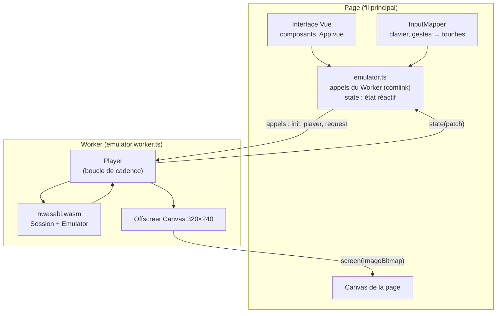

# La page web

::: tip En bref
L'émulation tourne dans un **Worker** pour ne pas figer la page. Elle envoie son écran **image par image** et ses changements d'état ; la page appelle ses fonctions comme les siennes (la bibliothèque `comlink` fait passer les messages).
:::

`web/` est une application **Vue 3** construite par Vite. L'émulation occupe un processeur presque entier quand l'application calcule sans attendre : sur le fil de la page, elle figerait toute l'interface. Elle tourne donc dans un **Worker**
(`emulator.worker.ts`) ; la page appelle ses fonctions typées (`WorkerApi`, dans `worker-protocol.ts`) et reçoit en retour les changements d'état du lecteur (`PageApi`).

## Les appels

Les fonctions que la page appelle dans le Worker ([`WorkerApi`](code:web/src/worker-protocol.ts#WorkerApi)) :

| Fonction | Rôle |
|---|---|
| `init(wasmUrl, page)` | charge le module, crée le `Player` et donne au Worker les fonctions de la page |
| `player(method, args)` | `load`, `restart`, `stepFrame`, `runWithoutData`, `changeModel`, `setSpeed`, `setCustomMhz`, `start`, `stop`, `key`, `bump`, `draw`, `dump`, `restore` |
| `request(request, quiet)` | une [requête de session](../../reference/protocole-session.md) ; `quiet` : une erreur n'est pas affichée (lectures périodiques) |
| `kept(document)` | les fichiers de la calculatrice à remettre dans chaque appareil neuf |
| `capture()`, `record(action)` | capture PNG, GIF |

Les fonctions que le Worker appelle dans la page ([`PageApi`](code:web/src/worker-protocol.ts#PageApi)) :

| Fonction | Rôle |
|---|---|
| `state(patch)` | les champs de `PlayerState` qui ont changé, plus `mips` (millions d'instructions par seconde, mesurés sur la dernière demi-seconde) et `slow` |
| `screen(bitmap)` | l'écran, à dessiner dans le canvas de la page (l'image est transférée sans copie) |

Une erreur levée dans le Worker rejette la promesse côté page, avec son message.

## Cadence

Le `Player` (voir [Bibliothèque JavaScript](./bibliotheque-js.md)) exécute `run` par tranches de **100 000** instructions (`SLICE`), au plus pendant `FRAME_MS = 1000/60 ms` de temps réel, et fait passer à l'application **le temps réellement écoulé** (horloge hôte).
Une planificateur (`Scheduler`) remplace `requestAnimationFrame` dans le Worker : `now`, `request`, `cancel` sur des minuteries qui visent 60 images par seconde (`wait = FRAME_MS − écoulé − 0,5`). Le noyau est en horloge **hôte** : en pause, l'application ne voit pas le temps passer.

## L'écran, image par image

Un canvas ne se partage pas entre deux fils : transférer le canvas de la page au Worker (`transferControlToOffscreen`) ne marchait plus dans certaines versions de Firefox (« Cannot update created context to different thread »). Le Worker dessine donc dans **son propre**
`OffscreenCanvas` (320×240) et, à chaque image, envoie à la page un **`ImageBitmap`** (`createImageBitmap(canvas)`, transféré sans copie) qu'elle dessine avec `drawImage` puis ferme (`close()`). Les images qui arrivent pendant qu'un envoi est en cours sont **regroupées en une seule**
(`showing`, `showAgain`) : rien ne s'accumule si la page est lente. Le surcoût mesuré est de l'ordre de 0,004 ms (Chromium) à 0,04 ms (Firefox) par image pour la création, et 0,002 à 0,02 ms pour le dessin. La capture PNG et l'enregistrement GIF lisent le canvas du Worker. La vidéo, elle, est faite dans la page (`ScreenView.vue`) : le canvas affiché est recopié trois fois plus grand, sans lissage, dans un canvas caché que `MediaRecorder` enregistre à partir de `captureStream`.

## Fichiers et conservation

Les fichiers de la calculatrice (`.py`…) sont copiés d'un appareil à l'autre (`carryFiles`, `restoreFiles`) : quand l'utilisateur relance, change de modèle ou de disposition, l'appareil est **refait** et reçoit les fichiers de l'ancien. Les points d'arrêt suivent de même (`breakpoints`, `restoreBreakpoints`)
et sont **remis à zéro quand l'application change** (`breakpointsApp`). L'option « Conserver vos fichiers » recopie les fichiers dans le navigateur (`persist.ts`, IndexedDB) à chaque modification (`filesChanged`).

## Pont GDB

Si la page est servie par `nwasabi`, la vue GDB (`GdbView.vue`, `gdbBridge.ts`) interroge `/__nwasabi/gdb/next` en **requête longue** et exécute chaque commande du débogueur dans le Worker, puis poste la réponse. La console GDB de la page (`gdbConsole.ts`) est un petit
interpréteur de commandes à la GDB au-dessus des requêtes de session.

## Tests

`tests/web/*.mjs` testent la logique pure (sélection, GIF, instantanés, recherche de valeurs, console, descriptions d'instructions, locales) sous Node.js ; l'interface elle-même se vérifie à la main. La construction du site est `just build-emulator` ; `just build-docs` l'embarque dans
le site de documentation à `/emulator/`.

## Dans le code

| Où | Quoi |
|---|---|
| [`emulator.ts`](code:web/src/emulator.ts) | côté page : [`useEmulator`](code:web/src/emulator.ts#useEmulator), [`rpc`](code:web/src/emulator.ts#rpc), [`pageApi`](code:web/src/emulator.ts#pageApi), [`attach`](code:web/src/emulator.ts#attach) |
| [`emulator.worker.ts`](code:web/src/emulator.worker.ts) | côté Worker : [`api`](code:web/src/emulator.worker.ts#api), [`show`](code:web/src/emulator.worker.ts#show), [`flush`](code:web/src/emulator.worker.ts#flush), [`carryFiles`](code:web/src/emulator.worker.ts#carryFiles) |
| [`worker-protocol.ts`](code:web/src/worker-protocol.ts) | les types des deux côtés : [`WorkerApi`](code:web/src/worker-protocol.ts#WorkerApi), [`PageApi`](code:web/src/worker-protocol.ts#PageApi) |
| [`components/`](code:web/src/components/) | les composants Vue |
| [`persist.ts`](code:web/src/persist.ts), [`idb.ts`](code:web/src/idb.ts) | conservation des fichiers |
| [`serverLink.ts`](code:web/src/serverLink.ts) | rechargement par le serveur |
| [`gdbBridge.ts`](code:web/src/gdbBridge.ts) | le pont GDB |
| [`locales/`](code:web/src/locales/) | traductions françaises et anglaises |
| [`vite.config.ts`](code:web/vite.config.ts) | la construction |

## Pourquoi un Worker, et pourquoi des appels typés

Dans un navigateur, tout ce qui s'exécute sur le fil principal **fige l'interface** s'il dure plus de quelques millisecondes ; une application qui calcule sans attendre occupe un processeur entier. Le Worker isole l'émulation. La page l'appelle par des **fonctions typées** : `comlink` envoie les messages et rend une promesse, donc une faute de nom ou de paramètre est vue à la compilation, et personne n'a à maintenir une table de requêtes en attente.

Le Worker envoie ses images **une par une** : voir [L'écran, image par image](#l-ecran-image-par-image) pour la raison.

## Pour modifier

- **Une fonction de plus** : l'ajouter à [`WorkerApi`](code:web/src/worker-protocol.ts#WorkerApi) (ou [`PageApi`](code:web/src/worker-protocol.ts#PageApi) pour ce que le Worker appelle dans la page), l'écrire dans [`api`](code:web/src/emulator.worker.ts#api) ; le compilateur signale ce qui manque.
- **Un nouveau champ d'état partagé** : [`StatePatch`](code:web/src/worker-protocol.ts#StatePatch) puis [`flush`](code:web/src/emulator.worker.ts#flush) (qui le compare à `sent`).
- **Un texte de l'interface** : ajouter la clé dans `fr.json` **et** `en.json` ; [`locales.mjs`](code:tests/web/locales.mjs) échoue si l'une manque ou si une clé n'est plus utilisée.
- **Types et construction** : `just typecheck-web`, `just build-emulator`.
