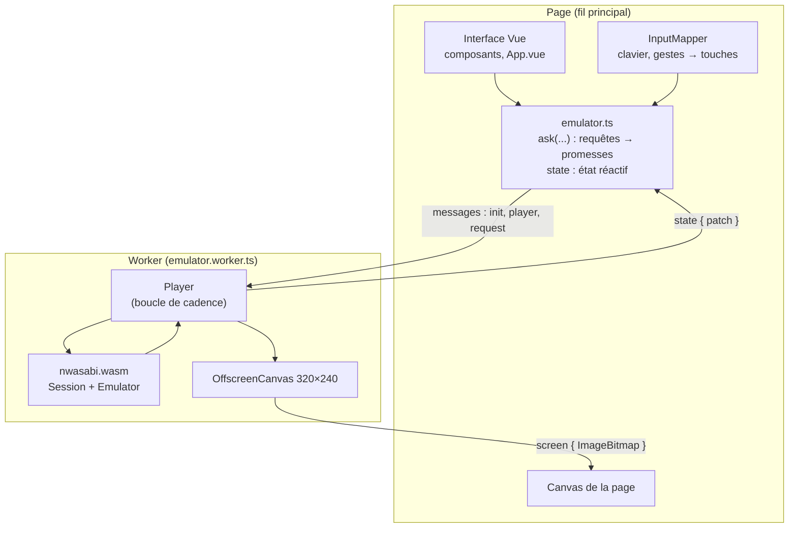

# La page web

::: tip En bref
L'émulation tourne dans un **Worker** pour ne pas figer la page. Elle envoie son écran **image par image** et ses changements d'état par messages.
:::

`web/` est une application **Vue 3** construite par Vite. L'émulation occupe un processeur presque entier quand l'application calcule sans attendre : sur le fil de la page, elle figerait toute l'interface. Elle tourne donc dans un **Worker**
(`emulator.worker.ts`) ; la page lui parle par des messages typés (`worker-protocol.ts`) et reçoit en retour les changements d'état du lecteur.

## Messages

| Page → Worker | Rôle |
|---|---|
| `init { wasmUrl }` | charge le module et crée le `Player` |
| `player { method, args }` | `load`, `restart`, `stepFrame`, `runWithoutData`, `changeModel`, `setSpeed`, `setCustomMhz`, `start`, `stop`, `key`, `bump`, `draw`, `dump`, `restore` |
| `request { request, quiet }` | une [requête de session](../../reference/protocole-session.md) ; `quiet` : une erreur n'est pas affichée (lectures périodiques) |
| `kept { document }` | les fichiers de la calculatrice à remettre dans chaque appareil neuf |
| `capture`, `record` | capture PNG, GIF |

| Worker → page | Rôle |
|---|---|
| `reply { id, result }`, `failure { id, message }` | réponse à une demande |
| `state { patch }` | les champs de `PlayerState` qui ont changé, plus `mips` (millions d'instructions par seconde, mesurés sur la dernière demi-seconde) et `slow` |
| `screen { bitmap }` | l'écran, à dessiner dans le canvas de la page |

## Cadence

Le `Player` (voir [Bibliothèque JavaScript](./bibliotheque-js.md)) exécute `run` par tranches de **100 000** instructions (`SLICE`), au plus pendant `FRAME_MS = 1000/60 ms` de temps réel, et fait passer à l'application **le temps réellement écoulé** (horloge hôte).
Une planificateur (`Scheduler`) remplace `requestAnimationFrame` dans le Worker : `now`, `request`, `cancel` sur des minuteries qui visent 60 images par seconde (`wait = FRAME_MS − écoulé − 0,5`). Le noyau est en horloge **hôte** : en pause, l'application ne voit pas le temps passer.

## L'écran, image par image

Un canvas ne se partage pas entre deux fils : transférer le canvas de la page au Worker (`transferControlToOffscreen`) ne marchait plus dans certaines versions de Firefox (« Cannot update created context to different thread »). Le Worker dessine donc dans **son propre**
`OffscreenCanvas` (320×240) et, à chaque image, envoie à la page un **`ImageBitmap`** (`createImageBitmap(canvas)`, transféré sans copie) qu'elle dessine avec `drawImage` puis ferme (`close()`). Les images qui arrivent pendant qu'un envoi est en cours sont **regroupées en une seule**
(`showing`, `showAgain`) : rien ne s'accumule si la page est lente. Le surcoût mesuré est de l'ordre de 0,004 ms (Chromium) à 0,04 ms (Firefox) par image pour la création, et 0,002 à 0,02 ms pour le dessin. La capture PNG et l'enregistrement GIF lisent le canvas du Worker.

## Fichiers et conservation

Les fichiers de la calculatrice (`.py`…) sont copiés d'un appareil à l'autre (`carryFiles`, `restoreFiles`) : quand l'utilisateur relance, change de modèle ou de disposition, l'appareil est **refait** et reçoit les fichiers de l'ancien. Les points d'arrêt suivent de même (`breakpoints`, `restoreBreakpoints`)
et sont **remis à zéro quand l'application change** (`breakpointsApp`). L'option « Conserver vos fichiers » recopie les fichiers dans le navigateur (`persist.ts`, IndexedDB) à chaque modification (`filesChanged`).

## Pont GDB

Si la page est servie par `nwasabi`, la vue GDB (`GdbView.vue`, `gdbBridge.ts`) interroge `/__nwasabi/gdb/next` en **requête longue** et exécute chaque commande du débogueur dans le Worker, puis poste la réponse. La console GDB de la page (`gdbConsole.ts`) est un petit
interpréteur de commandes à la GDB au-dessus des requêtes de session.

## Tests

`tests/web/*.mjs` testent la logique pure (sélection, GIF, instantanés, recherche de valeurs, console, descriptions d'instructions, locales) sous Node.js ; l'interface elle-même se vérifie à la main. La construction du site est `just build-emulator` ; `just build-docs` l'embarque dans
le site de documentation à `/emulator/`.
