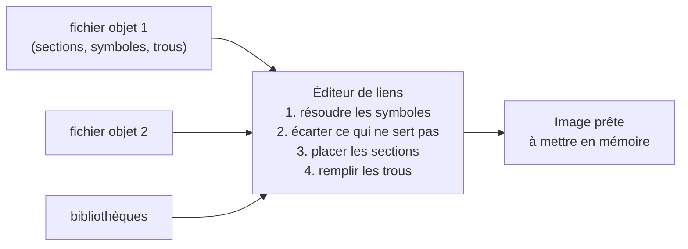

# Du code source au programme qui tourne

::: tip En bref
Le compilateur produit un fichier dont les **adresses ne sont pas encore connues**. L'**éditeur de liens** décide où poser chaque morceau en mémoire puis remplit les adresses. Un `.nwa` est ce fichier **avant** cette étape ; Nwasabi la fait lui-même, comme l'outil officiel de NumWorks.
:::

## 1. Le compilateur ne connaît pas les adresses

Vous écrivez :

```c
int compteur = 0;
void incrementer(void) { compteur++; }
int main(void) { incrementer(); return compteur; }
```

Le compilateur traduit chaque fichier en **instructions**, mais il ignore où `compteur` et `incrementer` seront placés en mémoire (cela dépend du reste du programme et de la machine). Il laisse donc des **trous** : « ici, l'adresse de `compteur` », « ici, l'adresse de `incrementer` ».

## 2. Un fichier objet : des sections, des symboles, des relocations

Le fichier produit (format **ELF**, extension `.o`) contient :

| Élément | Rôle | Exemple |
|---|---|---|
| **sections** | des blocs d'octets rangés par nature | `.text` (le code), `.rodata` (constantes), `.data` (variables initialisées), `.bss` (variables à zéro) |
| **symboles** | les **noms** définis et utilisés | `main`, `incrementer`, `compteur`, et `eadk_display_push_rect` (utilisé, défini ailleurs) |
| **relocations** | les **trous** à remplir et comment | « à l'octet 12 de `.text`, mettre l'adresse de `compteur` » |

## 3. L'éditeur de liens place tout et remplit les trous



Dans l'ordre : il **associe** chaque nom utilisé à sa définition, **jette** les sections que personne n'utilise, **place** les sections à des adresses (le code en flash, les variables en RAM), puis **calcule** chaque adresse et l'écrit dans les trous. Les détails sont dans [Édition de liens](../edition-de-liens/index.md).

## 4. Pourquoi un `.nwa` est « presque » un programme

NumWorks distribue les applications externes sous forme de **fichier objet non lié** (`.nwa`). La calculatrice ne sait pas lier : c'est l'**outil de flashage** (`nwlink`, sur l'ordinateur) qui lie l'application avec un petit fichier de support, **le runtime EADK**, puis écrit le résultat dans la flash.


**Nwasabi remplace les deux dernières cases** : il lie le `.nwa` lui-même (avec une implémentation maison du runtime), place l'image dans une flash **simulée**, puis fait exécuter les instructions par le processeur émulé.

## 5. Au démarrage : `_start`

Le runtime fournit `_start`, la toute première fonction exécutée. Elle prépare la mémoire — recopier `.data` de la flash vers la RAM, mettre `.bss` à zéro — puis appelle `main`. Quand `main` rend la main, l'application est finie.

## 6. Le runtime : les fonctions « du système »

Les fonctions `eadk_*` (`eadk_display_push_rect`, `eadk_keyboard_scan`…) n'existent pas dans votre code : elles viennent du runtime, qui les réduit à **un `svc` suivi d'un retour**. L'application demande donc un service au système sans connaître son code. C'est cette frontière que Nwasabi remplace par son noyau simulé.

## Pour retenir

- Un fichier objet = sections + symboles + trous (relocations).
- L'éditeur de liens place et remplit : sans lui, un `.nwa` n'a pas d'adresses.
- Nwasabi fait lui-même ce que fait l'outil de flashage, puis simule la calculatrice autour de l'application.

Suite : [Émuler : la boucle et ses pièges](./emuler.md).
