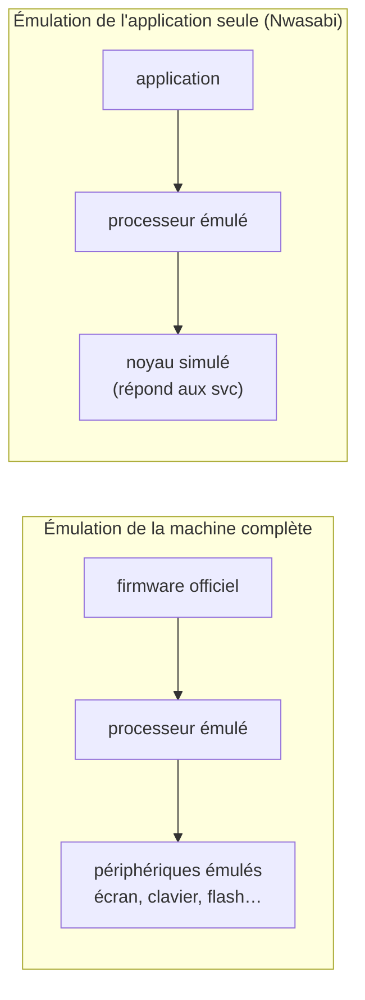
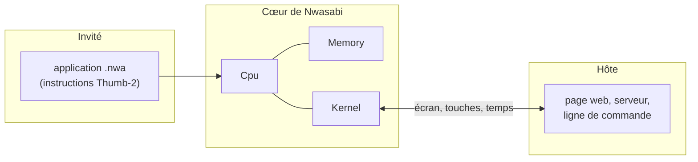

# Émuler : la boucle et ses pièges

::: tip En bref
Un émulateur de processeur est un programme qui **tient l'état** du processeur (ses registres, sa mémoire) dans des variables, et qui, pour chaque instruction, **applique à la main** ce que le vrai processeur ferait. La difficulté n'est pas l'idée, c'est l'exactitude.
:::

## L'idée : un `match` géant

L'état du processeur tient dans quelques structures :

```rust
struct Cpu { r: [u32; 13], sp: u32, lr: u32, pc: u32, xpsr: u32 /* … */ }
// la mémoire : un tableau d'octets (en réalité découpé en zones)
```

Et la boucle, en version minimale :

```rust
loop {
    let mot = memoire.lire16(cpu.pc);          // lire l'instruction
    let instr = decoder(mot);                  // la reconnaître
    cpu.pc += 2;                               // avancer
    match instr {
        Add { rd, rn, rm } => cpu.r[rd] = cpu.r[rn].wrapping_add(cpu.r[rm]),
        Ldr { rt, adresse } => cpu.r[rt] = memoire.lire32(adresse),
        BranchSiNonEgal { cible } => if !cpu.z() { cpu.pc = cible },
        // … quelques centaines de cas
    }
}
```

C'est exactement la structure de Nwasabi ([Décodage](../processeur/decodage.md), [Exécution](../processeur/execution.md)). Le gros du travail est de ne **rien oublier** : chaque instruction a des effets de bord sur les drapeaux, des cas limites (débordement, décalages, saturation), des conditions de faute.

## Pourquoi c'est plus dur qu'il n'y paraît

| Piège | Exemple | Ce que fait Nwasabi |
|---|---|---|
| **Exactitude bit à bit** | un `add` met à jour `N Z C V` d'une façon précise ; un décalage de 32 bits ne fait pas ce que fait `<<` en Rust | des tests contre **QEMU**, un émulateur de référence, sur des milliers de cas ([Vérification](../verification/index.md)) |
| **Le temps** | l'application demande « quelle heure est-il ? » : à quelle vitesse tourne-t-on ? | un **temps virtuel** qui avance avec les instructions, donc reproductible ([Noyau](../noyau/index.md#le-temps)) |
| **Le non-déterminisme** | si le résultat dépend de l'heure réelle, impossible de rejouer un bug | le cœur n'a **aucune horloge** ni entrée-sortie : l'hôte lui donne tout |
| **La vitesse** | décoder à chaque fois coûte cher | un **cache d'instructions** déjà reconnues ([Décodage](../processeur/decodage.md)) |
| **Le système autour** | une application s'attend à des en-têtes, un écran, un clavier | un **noyau simulé** et un « décor » fabriqué en mémoire ([Appareil](../memoire/appareil.md)) |
| **Les fautes** | un accès hors mémoire, une instruction inconnue | on **s'arrête** et on explique, au lieu de continuer faux |

## Émuler le processeur, pas la machine

Il y a deux grandes manières de faire :



La première (QEMU en mode machine) est **fidèle** mais lourde, et exige le firmware du constructeur. La seconde est **légère**, ne dépend d'aucun code officiel, et suffit tant que l'application ne parle au système que par `svc`. C'est le choix de Nwasabi, et il explique ses limites : ni interruptions, ni préemption, ni périphériques ([Compatibilité](../../reference/compatibilite.md)).

## L'hôte et l'invité

On appelle **invité** ce qui est émulé (l'application) et **hôte** ce qui l'émule (Nwasabi, dans un navigateur ou un terminal). L'invité ne sait pas qu'il est émulé ; l'hôte lui fournit tout ce qu'il croit venir du matériel. Dans Nwasabi, la frontière est très nette :



## Et maintenant ?

Vous avez le vocabulaire. Retournez à la [vue d'ensemble](../index.md) : chaque case y renvoie à une page qui détaille ce que vous venez de voir.

| Si vous voulez… | Commencez par… |
|---|---|
| comprendre le processeur | [Le processeur](../processeur/index.md) |
| comprendre comment une application est placée en mémoire | [L'édition de liens](../edition-de-liens/index.md) |
| comprendre ce que voit l'application du système | [Le noyau simulé](../noyau/index.md) |
| comprendre le débogueur | [Le débogage](../debogage/index.md) |
