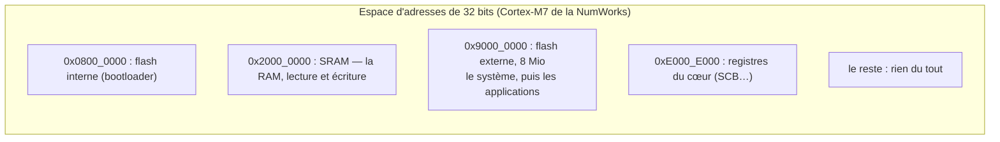

# La mémoire et les adresses

::: tip En bref
Pour le processeur, la mémoire est un **immense tableau d'octets** numérotés de 0 à 4 294 967 295 (2³² − 1). Un **pointeur** n'est rien d'autre qu'un entier qui sert d'indice dans ce tableau. Mais la plupart des cases n'existent pas, et celles qui existent n'ont pas toutes les mêmes droits.
:::

## Un tableau d'octets, un pointeur est un indice

Sur un processeur 32 bits, une **adresse** est un nombre de 32 bits. Lire `*p` (en C) revient à : « lire la valeur à l'indice contenu dans `p` ». Ce que vous avez appris sur les pointeurs reste exactement vrai, sans enrobage.

## Les zones : tout l'espace n'est pas de la mémoire

Les 4 Gio d'adresses ne sont pas de la mémoire vive. Le constructeur y place des **zones** :

Chaque zone a ses **droits** : lecture, écriture, exécution.

| Zone | Lire | Écrire | Exécuter |
|---|---|---|---|
| flash | oui | non (par le programme) | oui |
| RAM | oui | oui | oui |
| mémoire réservée au système | non | non | non |
| adresse sans zone | non | non | non |

Accéder à une adresse **sans zone**, ou **sans le droit** nécessaire, est une **faute** : le processeur s'arrête (sur le vrai appareil, il saute à un gestionnaire d'exception ; Nwasabi, lui, arrête l'application et le dit). C'est le fameux « segmentation fault ».

## Flash et RAM

- La **flash** garde son contenu sans courant : c'est là qu'est **installé** le programme (son code et ses constantes).
- La **RAM** s'efface à l'extinction : c'est là que vivent les variables, la pile et le tas.

Une variable globale initialisée (`int x = 5;`) a donc **deux** existences : sa valeur de départ dans la flash, et sa case en RAM. Au démarrage, une petite routine **recopie** la flash vers la RAM : c'est ce que fait `_start` ([runtime EADK](../edition-de-liens/runtime.md)).

## L'ordre des octets

Un entier de 32 bits occupe **4 octets** consécutifs. Dans quel ordre ? Le Cortex-M7 est **petit-boutiste** (*little-endian*) : l'octet de poids **faible** est à l'adresse **la plus basse**.

| Adresse | `0x2000_0000` | `0x2000_0001` | `0x2000_0002` | `0x2000_0003` |
|---|---|---|---|---|
| Contenu de `0x12345678` | `78` | `56` | `34` | `12` |

C'est un détail qui fait des erreurs silencieuses quand on le néglige, et c'est partout dans Nwasabi (formats de fichiers, tampons, JSON).

## Les périphériques sont aussi des adresses

Sur un vrai microcontrôleur, écrire à certaines adresses ne modifie pas de la mémoire : cela **commande un périphérique** (allumer une LED, démarrer un minuteur). Les applications NumWorks ne les touchent pas : elles passent par `svc`. Nwasabi n'a donc **aucun périphérique** à émuler, à part quelques registres de faute du cœur ([Appareil](../memoire/appareil.md#registres-de-faute)).

## Pour retenir

- Un pointeur est un indice dans un tableau d'octets de 4 Gio.
- Seules quelques zones existent, chacune avec ses droits ; en sortir est une faute.
- La flash garde le programme, la RAM ses variables ; au démarrage, l'un est recopié dans l'autre.
- Les entiers sont rangés **petit bout d'abord**.

Suite : [Du code source au programme qui tourne](./du-source-au-programme.md).
