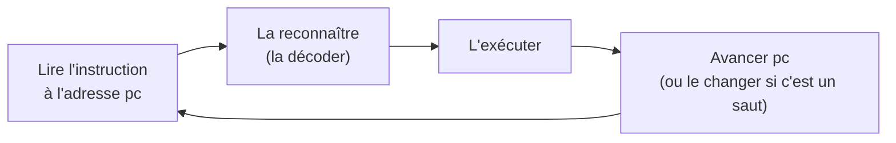
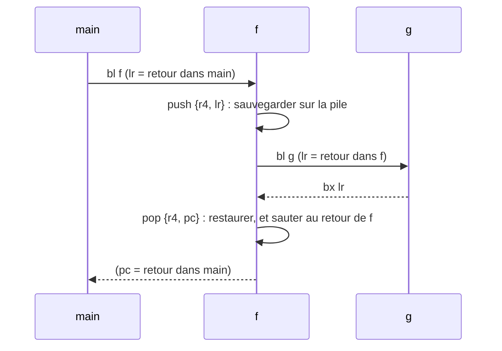

# Un processeur, vu par un programmeur

::: tip En bref
Un processeur exécute **une instruction à la fois**, en lisant et en modifiant un petit nombre de **cases très rapides** appelées registres. Tout ce que fait votre programme — boucles, appels, calculs — se ramène à cela.
:::

## Les registres : des variables intégrées au processeur

Un **registre** est une case mémoire **à l'intérieur** du processeur. Il est minuscule (32 bits sur un Cortex-M7), extrêmement rapide, et il a un **nom fixe**, pas une adresse. Le Cortex-M7 en a 16 d'usage général :

| Registre | Rôle habituel |
|---|---|
| `r0` à `r12` | des variables temporaires, pour calculer |
| `sp` (`r13`) | le **pointeur de pile** : où se trouve le sommet de la pile d'appels |
| `lr` (`r14`) | le **registre de lien** : où retourner à la fin de la fonction courante |
| `pc` (`r15`) | le **compteur de programme** : l'adresse de la prochaine instruction |

Il y a aussi un registre d'état, `xpsr`, qui contient des **drapeaux** (voir plus bas), et des registres pour les nombres à virgule flottante.

## Une instruction : un tout petit ordre

Un processeur ne comprend pas `x = a + b * 2`. Il comprend des ordres élémentaires, à peu près **une opération par instruction** :

```text
ldr  r0, [r1]        @ r0 ← la valeur lue en mémoire à l'adresse contenue dans r1
add  r0, r0, r2      @ r0 ← r0 + r2
str  r0, [r3]        @ écrire r0 en mémoire, à l'adresse contenue dans r3
cmp  r0, #10         @ comparer r0 et 10 (le résultat va dans les drapeaux)
bne  suite           @ sauter à « suite » si les deux n'étaient pas égaux
```

Ces lignes sont de l'**assembleur** : une écriture lisible des instructions. Ce que le processeur lit vraiment, ce sont des nombres : chaque instruction de ce jeu d'instructions (appelé **Thumb-2**) tient sur **2 ou 4 octets**, par exemple `0x4408` pour `add r0, r1`. C'est exactement ce que contiennent les `.nwa` : de longues suites de ces nombres.

## Le compteur de programme : la boucle de lecture

Le processeur répète sans cesse :



`pc` avance tout seul d'une instruction à la suivante. Un `if`, une boucle ou un appel de fonction ne sont que des instructions qui **changent `pc`** : un **saut**.

## Les drapeaux : la mémoire d'une comparaison

Une comparaison ne rend pas de valeur à une variable : elle **met à jour des drapeaux** dans `xpsr`.

| Drapeau | Il vaut 1 quand… |
|---|---|
| `N` (négatif) | le résultat est négatif |
| `Z` (zéro) | le résultat est zéro |
| `C` (retenue) | l'opération a produit une retenue (ou un emprunt) |
| `V` (débordement) | le résultat signé a débordé |

Un saut **conditionnel** (`beq`, `bne`, `blt`…) regarde ces drapeaux : `if (a == b)` devient « comparer `a` et `b`, puis sauter si `Z` vaut 1 ». Pour qui connaît les opérations binaires : ce sont exactement des tests sur des bits d'un mot de 32 bits.

## La pile et les appels de fonctions

Appeler une fonction, c'est : **mémoriser où revenir**, puis **sauter** à la fonction. L'instruction `bl adresse` (« branch with link ») met l'adresse de retour dans `lr`, puis saute. La fonction appelée se termine par un saut vers `lr`.

Si la fonction en appelle une autre, elle doit d'abord **sauvegarder** `lr` et les registres qu'elle va écraser. Elle les range sur la **pile** : une zone de mémoire qui grandit vers les adresses basses, dont le sommet est `sp`.



Les arguments sont passés dans `r0`–`r3` (les suivants sur la pile) et le résultat revient dans `r0`. Cette convention s'appelle l'**ABI** ; compilateur, bibliothèques et émulateur doivent la respecter ensemble.

## Les appels système : demander un service

Un programme ne peut pas dessiner à l'écran ni lire le clavier tout seul : cela appartient au système. Il le **demande** avec l'instruction `svc #N` (« supervisor call »), où `N` est le numéro du service. Sur la calculatrice, Epsilon traite l'appel ; sur Nwasabi, c'est le [noyau simulé](../noyau/index.md). C'est **la seule frontière** entre l'application et le système, et c'est pour cela qu'on peut émuler l'une sans l'autre.

## Pour retenir

- Un processeur, c'est des registres, un `pc` et une boucle « lire, reconnaître, exécuter ».
- `if`, boucles et appels sont des **sauts** ; les comparaisons passent par des **drapeaux**.
- Une application est une suite d'instructions qui ne parle au système que par `svc`.

Suite : [La mémoire et les adresses](./memoire.md).
