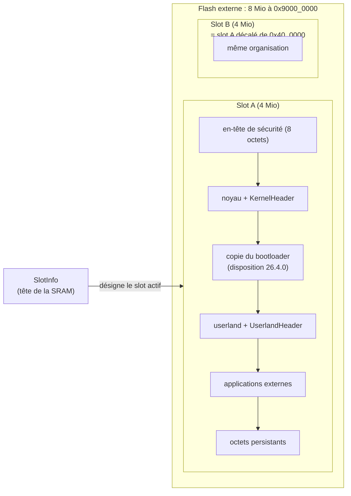

# L'appareil

::: tip En bref
Comme Nwasabi n'exécute pas Epsilon, il **fabrique le décor** qu'Epsilon laisserait en mémoire après le démarrage : des en-têtes, des tables, un système de fichiers vide. Une application qui regarde autour d'elle y trouve ce qu'elle attend.
:::

Nwasabi n'exécute pas Epsilon. `device/` **fabrique** ce qu'Epsilon laisserait en mémoire une fois démarré (en-têtes, tables du userland, système de fichiers vide)
pour que les applications qui regardent la mémoire y retrouvent ce qu'elles attendent. Ce que ces structures contiennent vient de relevés de comportement
sur des appareils et sur des firmwares publiés ; aucun code d'Epsilon n'est utilisé.

## Le profil de firmware

`profile/` regroupe **tout ce qui change d'un modèle ou d'une version d'Epsilon** et que les applications peuvent observer. Rien de cela n'est écrit en dur ailleurs : l'adresse
du `UserlandHeader`, par exemple, dépend de la version du firmware et pas seulement du modèle.

`FirmwareProfile` : le modèle (`N0110`, `N0115`, `N0120`), la version d'Epsilon (`software_version`), la version du userland attendue, le commit, le niveau de sécurité, la taille de
la charge signée, les deux slots, le slot actif, la taille de la SRAM et celle de la partie du noyau, l'adresse du système de fichiers et la taille de son tampon, la RAM des applications,
les piles initiales du userland et du noyau, la fréquence en MHz, l'identifiant FCC, le numéro de série et le nom de l'appareil. `validate()` vérifie la cohérence : chaînes ASCII de la bonne
taille, adresses dans la bonne zone, plages qui ne se chevauchent pas (`ProfileError`).

Deux dispositions, choisies par nom (`FirmwareProfile::for_layout("24", modèle)` ou `"26.4.0"`) :

| | `24` (défaut) | `26.4.0` |
|---|---|---|
| Source | valeurs relevées sur des appareils (N0110 en 24.11.0, N0115 en 24.3.0, N0120 en 23.2.6) | valeurs mesurées dans les firmwares officiels des trois modèles |
| `UserlandHeader` | `slot + 0x10000` (N0110, N0115), `slot + 0x20000` (N0120) | `slot + 0x20000` |
| Copie du bootloader dans le slot | non (N0110, N0115) | oui, 64 Kio |
| Provenance (`Provenance`) | `Measured` pour les relevés, `Derived` pour ce qui est déduit des sources d'Epsilon 23.2.3 ou repris de la 26.4.0 | `Measured` (sauf `pcb_version` et numéro de série, fictifs) |

L'écart compte : les applications qui devinent le modèle d'après la mémoire (celles qui s'appuient sur `eadkp`) se trompent sur N0110 et N0115 avec la disposition `26.4.0`, d'où le défaut.

## Les slots et la flash externe

La flash externe fait 8 Mio à `0x9000_0000` et se partage en deux **slots** de 4 Mio (`SLOT_B_OFFSET = 0x40_0000`). Un slot contient, dans cet ordre : l'en-tête de sécurité (8 octets), le noyau (avec
son `KernelHeader`), éventuellement la copie du bootloader, le userland (avec son `UserlandHeader`), la zone des applications externes, et les octets persistants. L'appareil exécute **un seul slot**
(`active_slot`) ; c'est celui qu'indique le `SlotInfo`, en tête de la SRAM, et dont la zone des applications est publiée. Les secteurs font 64 Kio (`EXTERNAL_APP_SECTOR`) : les applications y sont alignées.

## Les structures fabriquées (`structures/`, `device/fabric.rs`)

| Structure | Magic | Contenu |
|---|---|---|
| `SlotHeader` (8 octets) | | niveau de sécurité, taille de la charge signée |
| `KernelHeader` (24 octets) | `0xDEC00DF0` en tête et en queue | version d'Epsilon, commit |
| `UserlandHeader` | `0xDEC0EDFE` en tête et en queue | version attendue du noyau, adresse et taille du système de fichiers, zones de flash et de RAM des applications, zone du nom de l'appareil |
| `SlotInfo` | `0xEFEEDBBA` | en tête de la SRAM : désigne le slot actif |
| `AppHeader` (32 octets) | `0xDEC0BEBA` en tête et en queue | niveau d'API, décalages du nom et de l'icône, point d'entrée, taille |

`write_structures` écrit les deux slots, le `SlotInfo` et un système de fichiers vide. Après le `UserlandHeader`, la **table de fonctions du userland** (décalage `0x38` : la « trampoline » d'où
l'éditeur de liens lit `eadk_display_draw_string`) et deux petits **stubs** qui ne sont jamais ceux d'Epsilon :

| Décalage | Contenu | Rôle |
|---|---|---|
| `0x40` | `svc #0x80 ; bx lr` | `drawString` du userland |
| `0x44` | `b .` | point d'entrée du userland (jamais exécuté : c'est l'application qui l'est) |
| `0x48` | `svc #0x89 ; b .` | **adresse de retour de `main`** (`lr` au lancement) : fin de l'application |
| `0x50` | chaîne FCC (16 octets) | l'appel système `fcc_id` en renvoie l'adresse |

## Fabriquer, installer, relire

`DeviceImage` regroupe la `Memory`, le profil et l'emplacement libre suivant.

- **`DeviceImage::new(profile)`** : crée les zones (voir ci-dessous) et écrit les structures.
- **`app_layout()`** donne à l'éditeur de liens les zones de flash et de RAM de l'application, selon le slot actif.
- **`install(app)`** écrit l'application en flash « comme l'outil de flashage » : à la suite des précédentes, complétée de `0xFF` jusqu'à la fin de son dernier secteur de 64 Kio ; elle doit avoir
  été liée avec `app_layout` (sinon `DeviceError::WrongPlace`) ; `DeviceError::NoRoom` si la zone est pleine.
- **`list_apps`** relit la zone des applications **comme Epsilon** : la première au début de la zone, chaque suivante à la fin de la précédente (taille de l'en-tête) arrondie au secteur ; on s'arrête au
  premier emplacement sans en-tête valide ; en **mode examen**, toutes les applications externes sont masquées. Le défaut du format est reproduit : la taille de l'en-tête ne compte pas la copie
  de `.data`, donc une application dont cette copie franchit un secteur « perd » la suivante (`LinkWarning::AppSizeMismatch`).
- **`update_profile`** réécrit les structures quand on change de profil (version, slot, nom…) sans toucher aux applications ni aux fichiers.

## La carte mémoire

`build_memory(profile, ram_fill)` crée les zones : `flash_ext` (`0x9000_0000`, 8 Mio, lecture + exécution), `sram` (début du modèle, jusqu'à la SRAM du noyau, lecture + écriture + exécution),
`sram_kernel` (droits nuls, mais présente), `scs` (voir plus bas), et selon le modèle la flash interne : `internal_flash` (`0x0800_0000`, 64 Kio) et `bootloader_itcm` (`0x0020_0000`) sur N0110 et N0115,
`internal_flash` de 512 Kio sur N0120. La flash interne est **vide** : Nwasabi n'embarque aucun code d'Epsilon.

## Registres de faute

`scb.rs` simule le bloc de contrôle du système (SCB) dans la zone `scs` (`0xE000_E000`, 4 Kio, **lecture seule pour l'application** ; seul l'hôte l'écrit) :

| Registre | Adresse | Valeur de départ / remplissage |
|---|---|---|
| `CPUID` | `0xE000_ED00` | `0x411FC270` (ARM, ARMv7-M, partie `0xC27` = Cortex-M7, révision 0) |
| `ICSR` | `0xE000_ED04` | `VECTACTIVE` = 3 (HardFault) après une faute |
| `SHCSR` | `0xE000_ED24` | |
| `CFSR` | `0xE000_ED28` | bits cumulés : `IACCVIOL` (0), `DACCVIOL` (1), `MMARVALID` (7), `IBUSERR` (8), `PRECISERR` (9), `BFARVALID` (15), `UNDEFINSTR` (16), `INVSTATE` (17), `UNALIGNED` (24) |
| `HFSR` | `0xE000_ED2C` | `FORCED` (bit 30) |
| `DFSR` | `0xE000_ED30` | `BKPT` (bit 1) |
| `MMFAR`, `BFAR` | `0xE000_ED34`, `0xE000_ED38` | dernière adresse en cause |

`scb::record` est appelé par `Emulator` quand une faute arrête l'application. `scb::reset` remet tout à zéro (sauf `CPUID`) à chaque relance.

## Réglages (`settings.rs`)

`Settings` donne accès aux réglages **là où l'appareil les garde**, pour que l'application les voie comme sur un vrai appareil : lus en mémoire (versions, commit, nom de l'appareil, réécrits en flash
comme le ferait une mise à jour) ou répondus par un appel système (FCC, numéro de série, batterie, tension, luminosité, USB, niveau d'autorisation, drapeaux de compilation, type de redémarrage). Le
mode examen cache les applications externes (seul l'effet est reproduit). Les setters du profil vérifient la cohérence et ne changent rien en cas d'erreur.

## Inspection (`inspect/`)

`read_structures` **relit** les structures dans la mémoire, pas dans la configuration : si une application les écrase, l'inspection le montre. Chaque structure revient avec son adresse (`Found<T>`)
et un indicateur de validité (magics et pointeurs en place) plutôt que d'être cachée quand elle est abîmée. `detect_sram_base` distingue une SRAM en `0x2000_0000` (N0110, N0115, non
distinguables par la mémoire) d'une en `0x2400_0000` (N0120).

## Dans le code

| Fichier | Rôle | À regarder |
|---|---|---|
| [`profile/firmware.rs`](code:src/profile/firmware.rs) | le profil et ses vérifications | [`FirmwareProfile`](code:src/profile/firmware.rs#FirmwareProfile), [`ProfileError`](code:src/profile/firmware.rs#ProfileError) |
| [`profile/presets.rs`](code:src/profile/presets.rs) | les profils prêts à l'emploi | [`epsilon_24`](code:src/profile/presets.rs#epsilon_24), [`epsilon_26_4_0`](code:src/profile/presets.rs#epsilon_26_4_0), [`for_layout`](code:src/profile/presets.rs#for_layout) |
| [`profile/layout.rs`](code:src/profile/layout.rs) | la disposition de la flash externe | [`SlotLayout`](code:src/profile/layout.rs#SlotLayout), [`EXTERNAL_FLASH_BASE`](code:src/profile/layout.rs#EXTERNAL_FLASH_BASE) |
| [`device/mod.rs`](code:src/device/mod.rs) | l'appareil fabriqué | [`DeviceImage`](code:src/device/mod.rs#DeviceImage), [`install`](code:src/device/mod.rs#install), [`update_profile`](code:src/device/mod.rs#update_profile) |
| [`device/fabric.rs`](code:src/device/fabric.rs) | écriture des structures | [`write_structures`](code:src/device/fabric.rs#write_structures) |
| [`device/map.rs`](code:src/device/map.rs) | la carte mémoire | [`build_memory`](code:src/device/map.rs#build_memory) |
| [`device/apps.rs`](code:src/device/apps.rs) | relire les applications comme Epsilon | [`list_apps`](code:src/device/apps.rs#list_apps) |
| [`structures/`](code:src/structures/) | les formats binaires des en-têtes | [`AppHeader`](code:src/structures/app.rs#AppHeader), [`KernelHeader`](code:src/structures/kernel.rs#KernelHeader), [`UserlandHeader`](code:src/structures/userland.rs#UserlandHeader) |
| [`inspect/`](code:src/inspect/) | relire les structures en mémoire | [`read_structures`](code:src/inspect/read.rs#read_structures) |
| [`scb.rs`](code:src/scb.rs) | registres de faute | [`record`](code:src/scb.rs#record), [`reset`](code:src/scb.rs#reset) |
| [`settings.rs`](code:src/settings.rs) | réglages modifiables | [`Settings`](code:src/settings.rs#Settings) |

## Pourquoi un profil, et pourquoi deux dispositions

Les applications **regardent** la mémoire : certaines devinent le modèle d'après l'adresse du `UserlandHeader`, d'autres cherchent le système de fichiers à une adresse déduite de la version. Ces adresses changent d'une version d'Epsilon à l'autre. Les écrire en dur dans dix endroits ferait deviner une valeur fausse à l'un d'eux ; un **profil unique** les centralise, avec la **provenance** de chaque valeur (`Measured`, `Derived`) pour qu'on sache ce qui est relevé et ce qui est supposé. Deux dispositions existent parce qu'**un même modèle** (N0110) a des adresses différentes sous 24.x et 26.4.0, et que les applications d'aujourd'hui (`eadkp`, KhiCAS…) en dépendent.

Les structures sont **fabriquées**, puis **relues** par `inspect` à partir de la mémoire : si une application les écrase, on le voit. C'est aussi ce qui permet de tester que `write_structures` produit ce que `read_structures` attend.

## Pour modifier

- **Ajouter une version d'Epsilon** : une nouvelle fonction dans [`presets.rs`](code:src/profile/presets.rs) (sur le modèle de `epsilon_24`), enregistrée dans [`for_layout`](code:src/profile/presets.rs#for_layout) ; indiquer la provenance de **chaque** valeur. [`validate`](code:src/profile/firmware.rs#validate) doit passer pour les trois modèles.
- **Ajouter un modèle de calculatrice** : [`Model`](code:src/profile/mod.rs#Model), sa carte dans [`build_memory`](code:src/device/map.rs#build_memory), ses valeurs dans les deux dispositions, puis `Model::ALL`.
- **Modifier une structure de l'OS** : l'encodage et le décodage vivent **ensemble** dans [`structures/`](code:src/structures/), pour ne pas diverger.
- **Tests** : [`device_image.rs`](code:tests/device_image.rs), [`inspect_structures.rs`](code:tests/inspect_structures.rs), [`settings.rs`](code:tests/settings.rs).
