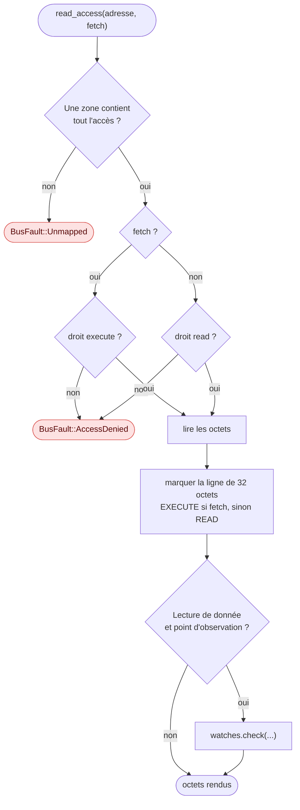
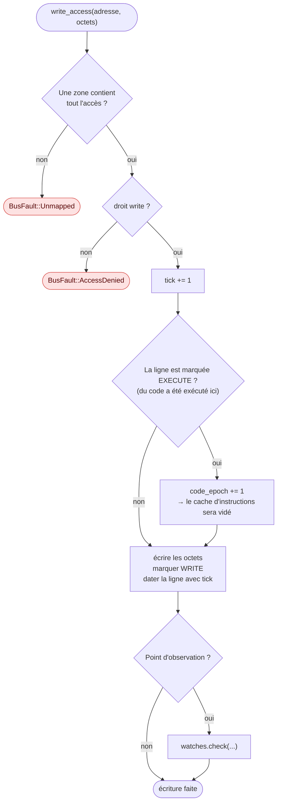

# La mémoire émulée

::: tip En bref
La mémoire est un **espace d'adresses découpé en zones** (flash, RAM…), avec des droits par zone. Elle ne réserve que les pages touchées, **note** ce qui est lu, écrit et exécuté, et sait prendre des **photos** de la RAM.
:::

`Memory` est ce que le processeur voit à travers le trait `cpu::Bus`, et ce que l'hôte inspecte. Elle n'est qu'un **espace d'adressage de 32 bits** découpé en
**zones**, sans aucun périphérique : tout ce qui ressemble à un registre matériel est simulé par du contenu mémoire (voir
[Appareil](./appareil.md)).

## Zones

Une zone (`RegionSpec`) a un nom, une base, une taille, des droits (`Perms { read, write, execute }`), une nature (`RegionKind` : `Flash`, `Ram` ou
`Reserved`) et un octet de remplissage. Les droits usuels sont `READ_EXECUTE` (flash), `READ_WRITE_EXECUTE` (RAM), `READ_ONLY` (registres de faute)
et `NONE` (SRAM du noyau). `add_region` refuse (`MemoryError::BadRegion`) une zone de taille nulle, dont la base ou la taille ne sont pas des multiples de 4 Kio ou qui dépasse 4 Gio, et (`Overlap`) une zone qui en recouvre une autre.

- **Pages paresseuses** : une zone n'alloue de mémoire que pour les pages de 4 Kio (`PAGE_SIZE`) qu'on touche. Une flash de 8 Mio vide ne coûte rien ; ce
  qu'on lit dans une page non allouée vaut l'octet de remplissage (`0xFF` pour la flash, la valeur d'`DeviceOptions::ram_fill` pour la RAM).
  `allocated_pages(zone)` mesure la consommation réelle.
- **Recherche de la zone** : `find(address, len)` essaie d'abord les **deux dernières zones utilisées** (`last`, `previous`) : un programme alterne
  surtout entre sa pile ou son tas (RAM) et ses constantes (flash), et le plus récent est essayé en premier. Sinon, recherche linéaire.
- **Deux sortes d'accès** : ceux **du programme** (par `Bus` : vérifient les droits, marquent les lignes, déclenchent les points d'observation) et ceux **de
  l'hôte** (`read_bytes`, `write_bytes`, `read_u32`, `fill`… : ignorent les droits, ne marquent rien, ne comptent pas comme une activité du programme).
  Seule l'hôte fabrique l'image de l'appareil ou en lit le contenu sans fausser les mesures.

## Chemin d'un accès du programme

Chaque lecture ou écriture du processeur passe par un contrôle de zone et de droits, puis laisse des **traces** (lignes marquées, observation). Voici les deux chemins.

### Lecture (et chargement d'une instruction)

### Écriture

`read_block` et `write_block` (utilisés par les appels système : pixels, textes, fichiers) ont un **chemin rapide** : un seul bloc recopié page par page
quand tout le bloc tient dans une zone qui l'autorise **et** qu'aucun point d'observation n'existe ; sinon on retombe sur l'accès octet par octet, qui produit
exactement les mêmes fautes et les mêmes observations.

## Suivi des lignes

Chaque zone garde, pour chaque **ligne de 32 octets** (`LINE_SIZE`), un octet d'indicateurs : `READ` (1), `WRITE` (2), `EXECUTE` (4). Ils servent à :

- la carte d'utilisation de la mémoire (`usage` : tas et pile, plus haute adresse écrite du tas, plus basse de la pile, `access_extent`) ;
- la détection du **code modifié** (`code_epoch`) ;
- l'inspection des octets « touchés » dans l'éditeur de mémoire de la page ;
- les cartes d'accès enregistrées dans un état `.nds` (`access_map`, `set_access_map`).

`clear_access` efface les indicateurs (à chaque relance). Le suivi se fait au grain de la ligne : la mesure de la pile est donc exacte à 32 octets près.

## Datation et changements

Un compteur `tick` augmente à chaque écriture. Chaque ligne écrite garde la date de sa dernière écriture (le vecteur `stamps` n'existe qu'à la première écriture
de la zone). `change_cursor()` rend le compteur actuel, et `changes_since(cursor)` rend les plages `ChangedRange` modifiées depuis, **fusionnées par zone** et triées
par adresse. C'est ainsi que la page ne relit que ce qui a changé. `flash_changed_since` détecte une écriture en flash (fichiers écrits par l'application) : l'historique en
tire que ce qui précède n'est plus rejouable.

## Instantanés

`snapshot_volatile()` copie les pages allouées de **toutes les zones qui ne sont pas de la flash** (`VolatileImage`, `bytes()` en donne le poids) ;
`restore_volatile` les remet et **vide le cache d'instructions** (`code_epoch += 1`), car de la RAM exécutable a pu changer. Les indicateurs d'accès ne sont pas
restaurés. Ces instantanés sont la base des points de reprise de l'[historique](../debogage/historique.md).

## Points d'observation

`Watchpoints` surveille des plages `[start, start+len)` en lecture, écriture ou les deux (`WatchKind`). `check` est appelé par chaque accès du programme quand au
moins un point existe ; un accès qui recouvre la plage même en partie déclenche. Un déclenchement (`WatchHit`) garde l'identifiant, l'adresse, la largeur (1, 2 ou 4),
le sens, la valeur lue ou écrite et l'adresse de l'instruction (`pc`, connue tant qu'un point existe : l'émulateur la pose avant chaque instruction). Les déclenchements
s'accumulent dans une file bornée à **4096** (`MAX_HITS`, les plus anciens perdus et comptés dans `dropped`). Un point avec `stop` fixe un `stop_hit` que l'émulateur
lit après l'instruction : l'exécution s'arrête **juste après** l'accès. Un rejeu de l'historique **suspend** les points sans les retirer.

Dès qu'un point d'observation existe, le chemin rapide des blocs est désactivé et l'émulateur exécute [instruction par instruction](../execution/index.md).

## Accès exclusifs

`allow_exclusive_accesses(false)` (le défaut) fait refuser `ldrex`/`strex` en RAM (`FaultKind::ExclusiveUnsupported`) : sur la calculatrice, la RAM est partageable et sans moniteur
global. La flash accepte les accès exclusifs.

## Dans le code

Le module est [`src/memory/`](code:src/memory/) :

| Fichier | Rôle | À regarder |
|---|---|---|
| [`mod.rs`](code:src/memory/mod.rs) | la mémoire et son API d'hôte | [`Memory`](code:src/memory/mod.rs#Memory), [`add_region`](code:src/memory/mod.rs#add_region), [`snapshot_volatile`](code:src/memory/mod.rs#snapshot_volatile), [`changes_since`](code:src/memory/mod.rs#changes_since) |
| [`bus.rs`](code:src/memory/bus.rs) | l'implémentation du trait [`Bus`](code:src/cpu/bus.rs#Bus) | [`read_access`](code:src/memory/bus.rs#read_access), [`write_access`](code:src/memory/bus.rs#write_access), [`block_region`](code:src/memory/bus.rs#block_region) |
| [`region.rs`](code:src/memory/region.rs) | stockage d'une zone : pages, indicateurs, dates | [`Region`](code:src/memory/region.rs#Region), [`Perms`](code:src/memory/region.rs#Perms), [`PAGE_SIZE`](code:src/memory/region.rs#PAGE_SIZE) |
| [`watch.rs`](code:src/memory/watch.rs) | points d'observation | [`Watchpoints`](code:src/memory/watch.rs#Watchpoints), [`check`](code:src/memory/watch.rs#check) |
| [`error.rs`](code:src/memory/error.rs) | erreurs de l'API d'hôte | [`MemoryError`](code:src/memory/error.rs#MemoryError) |

## Pourquoi ainsi

- **Pages paresseuses** : la flash externe fait 8 Mio et la SRAM 256 Kio ; allouer tout pour chaque appareil (et pour chaque **point de reprise** de l'historique) serait gaspilleur. Seules les pages touchées existent, ce qui rend un instantané proportionnel à ce que l'application a utilisé.
- **Deux sortes d'accès** : si l'hôte (page, débogueur) lisait par le chemin du programme, il marquerait des lignes « lues » et déclencherait des points d'observation : **observer changerait l'observation**. D'où `read_bytes` / `write_bytes` côté hôte, qui ne touchent à rien.
- **Les points d'observation et le suivi sont dans la mémoire**, pas dans le processeur : c'est elle qui voit **tous** les accès (processeur, appels système du noyau) au même endroit.
- **L'époque du code** est le seul canal entre mémoire et cache d'instructions : voir [Décodage et cache](../processeur/decodage.md).

## Pour modifier

- **Ajouter une zone** (par exemple un autre modèle de calculatrice) : [`device/map.rs`](code:src/device/map.rs#build_memory) (jamais directement dans `Memory`). `add_region` refuse les zones qui se recouvrent ou ne sont pas alignées sur 4 Kio : les tests de `build_memory` le vérifient pour les trois modèles.
- **Changer ce que le suivi retient** (par exemple une granularité plus fine que 32 octets) : [`LINE_SIZE`](code:src/memory/region.rs#LINE_SIZE), mais attention : `usage`, les cartes d'accès d'un `.nds` et l'éditeur de mémoire de la page en dépendent.
- **Un chemin rapide qui change une observation** est un bug : [`block_region`](code:src/memory/bus.rs#block_region) se retire quand un point d'observation existe, pour que les blocs produisent **les mêmes** fautes et déclenchements que l'accès octet par octet.
- **Tests** : [`memory/tests.rs`](code:src/memory/tests.rs), [`emulator_memory.rs`](code:tests/emulator_memory.rs).
