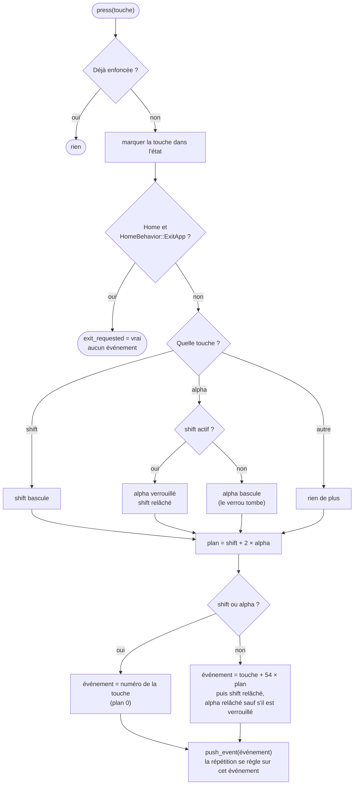

# Clavier et événements

::: tip En bref
Il y a deux façons de lire le clavier : l'**état** (« quelles touches sont enfoncées ? ») et les **événements** (« qu'est-ce qui vient d'être tapé ? »). Les événements tiennent compte de `shift` et d'`alpha`.
:::

Deux vues du clavier coexistent, comme dans l'EADK : l'**état** (`eadk_keyboard_scan`, `pop_state`) et les **événements** (`eadk_event_get`).

## L'état

`Keyboard::state()` est un `u64` : le bit `Key::bit()` d'une touche vaut 1 quand elle est enfoncée. Les 46 touches (`KEY_NAMES`) ont les numéros de l'API EADK publique (`eadk_key_*`), de 0, dans cet ordre : `left`, `up`, `down`, `right`, `ok`, `back`, `home`, `on_off`, `shift`, `alpha`, `xnt`, `var`, `toolbox`, `backspace`, `exp`, `ln`, `log`, `imaginary`, `comma`, `power`, `sine`,
`cosine`, `tangent`, `pi`, `sqrt`, `square`, `seven`, `eight`, `nine`, `left_parenthesis`, `right_parenthesis`, `four`, `five`, `six`, `multiplication`, `division`, `one`, `two`, `three`, `plus`, `minus`, `zero`, `dot`, `ee`, `ans`, `exe`.
`set_state` remplace l'état sans produire d'événement ; `press` et `release` font les deux.

## Les événements

Un événement est un numéro. Le clavier a 9 rangées de 6 touches = **54** événements par « plan » (`EVENTS_PER_PLANE`) ; le plan dépend de `shift` et d'`alpha` :

| Plan | Modificateurs actifs | Événement d'une touche `k` |
|---|---|---|
| 0 | aucun | `k` |
| 1 | `shift` | `k + 54` |
| 2 | `alpha` | `k + 108` |
| 3 | `shift` et `alpha` | `k + 162` |

L'événement « rien » (le délai est écoulé sans touche) vaut `EVENT_NONE = 4 × 54 = 216`.

`press(key)` met à jour les modificateurs **avant** de produire l'événement :

À retenir : un modificateur ne vaut que pour **une** touche ; `shift` puis `alpha` verrouille `alpha` ; `Home` ne produit pas d'événement mais fait quitter l'application au prochain appel système (avec `HomeBehavior::Deliver`, l'application la reçoit comme les autres).

La file d'événements garde au plus **64** événements en attente (`MAX_PENDING_EVENTS`) : le clavier réel n'en garde qu'un nombre limité. `shiftAlphaStatus` (appels 26 et 28) lit et impose les modificateurs :
`1` shift, `2` alpha, `4` alpha verrouillé, 3 et 5 les combinaisons avec shift.

## La répétition

Les événements des **flèches**, de `back`, de `backspace`, et des flèches avec `shift` se répètent tant que la touche reste enfoncée (`is_repeatable`, relevé dans le noyau d'Epsilon 26.4.0). Le premier délai est de
**299 ms**, les suivants de **50 ms** (`REPEAT_FIRST_MS`, `REPEAT_NEXT_MS`). Une nouvelle touche arrête la répétition de la précédente ; relâcher la touche répétée aussi. `Kernel::next_event(now)` rend le plus
ancien événement en file, sinon la répétition si son délai est écoulé, et compte les répétitions dans `repeat_count` (`long_press_counter`, appel 55).

## Texte des événements

`eadk_event_copy_text` (appel 22) rend le texte qu'insère un événement (`sin(`, `×`, les chiffres, les lettres…). `event_text.rs` est une table de **216** entrées indexée par le numéro d'événement ; `None` : événement non défini, `Some("")` :
défini sans texte ; le caractère `U+0011` marque la position du curseur après l'insertion (`sin(` puis `)`). Les valeurs sont celles de l'Epsilon 26.4.0, identiques sur les trois modèles. `is_defined` (appel 24) dit si un événement
existe : toutes les entrées de la table, plus les événements spéciaux.

## Gestes et fichiers de mapping

Le noyau ne connaît que les **touches de la calculatrice**. Le lien entre le clavier de l'ordinateur ou les gestes tactiles et ces touches est dans `keymap/` (module de règles) et dans `@nwasabi/js` (`input.ts`,
`gestures.ts` : reconnaissance des gestes au plus près des événements du navigateur). Voir le format [`.nmk`](../../reference/formats/nmk.md).

## Dans le code

| Où | Quoi |
|---|---|
| [`Key`](code:src/kernel/keyboard.rs#Key), [`KEY_NAMES`](code:src/kernel/keyboard.rs#KEY_NAMES) | les 46 touches et leurs noms |
| [`Keyboard::press`](code:src/kernel/keyboard.rs#press), [`release`](code:src/kernel/keyboard.rs#release) | la logique de `shift` et d'`alpha` |
| [`is_repeatable`](code:src/kernel/keyboard.rs#is_repeatable), [`REPEAT_FIRST_MS`](code:src/kernel/mod.rs#REPEAT_FIRST_MS) | la répétition |
| [`next_event`](code:src/kernel/mod.rs#next_event) | file d'abord, répétition ensuite |
| [`event_text.rs`](code:src/kernel/event_text.rs) | la table des 216 textes |
| [`keymap/`](code:src/keymap/mod.rs) | le lien clavier de l'ordinateur → touches (côté Rust) |
| [`input.ts`](code:packages/js/src/input.ts), [`gestures.ts`](code:packages/js/src/gestures.ts), [`keymap.ts`](code:packages/js/src/keymap.ts) | le même, côté navigateur |

## Pourquoi ainsi

- **La logique de `shift`/`alpha` est dans le noyau**, pas dans la page : c'est l'application qui la voit (par `event_get`), et un `.nrp` ou un test en ligne de commande doit la reproduire sans interface.
- **La répétition est générée à la demande** (`next_event`), pas par un minuteur : tout reste déterministe et sans fil ; elle dépend seulement de `micros()`.
- **Les touches de l'ordinateur ne sont pas dans le noyau** : le noyau ne connaît que les touches de la calculatrice. Le mapping clavier/gestes est un format séparé ([`.nmk`](../../reference/formats/nmk.md)), lu par `keymap/` (Rust) et `keymap.ts` (JavaScript), dont la **parité** est testée.

## Pour modifier

- **Un événement qui n'a pas le bon numéro** : `press`, puis la table [`event_text.rs`](code:src/kernel/event_text.rs).
- **Changer la répétition** : [`is_repeatable`](code:src/kernel/keyboard.rs#is_repeatable) et les constantes de délai.
- **Modifier le format `.nmk`** : [`keymap/mod.rs`](code:src/keymap/mod.rs) **et** [`keymap.ts`](code:packages/js/src/keymap.ts) **et** la [spécification](../../reference/formats/nmk.md) ; le test [`keymap.mjs`](code:tests/wasm/keymap.mjs) compare les deux implémentations.
