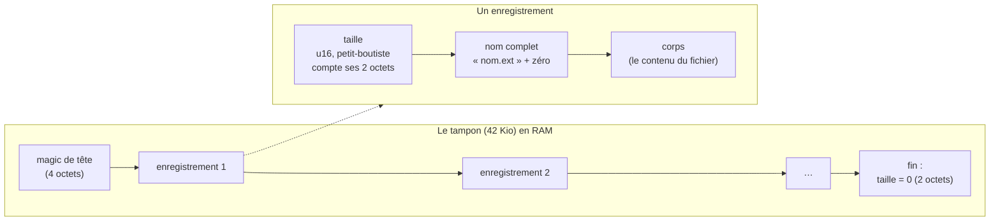

# Le système de fichiers

::: tip En bref
Les fichiers de la calculatrice sont une **liste d'enregistrements** dans un tampon de RAM. Nwasabi ne les copie jamais : il relit le tampon à chaque opération, car l'application a pu le modifier.
:::

Sur la calculatrice, les fichiers (scripts Python, réglages…) vivent dans un **tampon en RAM** que le système et les applications lisent et modifient directement. Nwasabi n'en garde **aucune copie** : chaque opération relit
le tampon dans la mémoire émulée, et les écritures de l'hôte le modifient en place. L'hôte n'agit qu'entre deux appels à `Emulator::run`, donc jamais au milieu d'une instruction : ses modifications sont atomiques pour
l'application. Le tampon est à `storage_address` du `UserlandHeader` (`SRAM + 0x657C`) et fait 42 Kio (`0xA800`).

## Le format

`taille = 2 + longueur du nom + 1 + longueur du corps`.

Un enregistrement ne dépasse pas **65 535** octets (`FsError::TooLarge`). Un nom est `nom.extension` (jamais de zéro, moins de 256 octets, une extension non vide, un nom non vide : `check_name`).
`records.rs` travaille sur une **copie** du tampon (`&[u8]`) : aucun accès à la mémoire de l'appareil, d'où des tests simples. Aucun index n'est gardé : le tampon est relu à chaque opération, car l'application émulée a pu le modifier, voire l'abîmer.

## Sortes de fichiers

| `FileKind` | Extension | Traitement |
|---|---|---|
| `Python` | `.py` | le corps est **un octet « importé automatiquement » puis le texte** (`PythonSource { auto_import, text }`), terminé par un zéro |
| `System` | `.sys` | réglages du système : ne pas supprimer |
| `Other` | tout le reste | formats instables d'une version d'Epsilon à l'autre : traités comme des octets |

## Opérations

`Emulator::fs()` rend un `Fs` qui offre : `list()` (`Listing { files, corrupt_at }`), `stats()` (`Stats { total, used, free, records }`), `read`, `write` (crée à la fin ou remplace le corps **en gardant la place**), `remove`
(les suivants remontent), `rename` (garde place et corps), `read_python`, `write_python`, `raw()` / `restore_raw()` (copie du tampon, pour défaire une opération qui a échoué à moitié) et `generation()`.

`generation()` augmente chaque fois que le tampon a changé **depuis le dernier appel**, que ce soit par l'hôte ou par l'application. Les changements sont détectés à l'appel : deux modifications entre deux appels ne
comptent que pour une. La page s'en sert pour ne relire la liste que quand c'est utile, et la conservation des fichiers dans le navigateur copie à chaque changement.

## Tampon abîmé

Une structure abîmée **n'est pas une erreur** : `parse` rend ce qui a pu être lu avant, et `corrupt_at`. La lecture de ce qui précède reste possible, l'**écriture est refusée** (`FsError::Corrupt { offset }`), pour ne pas
écraser davantage. Un fichier qui ne tient plus donne `FsError::NoSpace { needed }` ; un nom absent, `NotFound`.

## Dans le code

| Où | Quoi |
|---|---|
| [`storage/mod.rs`](code:src/storage/mod.rs) | l'API : [`Storage`](code:src/storage/mod.rs#Storage), [`Fs`](code:src/storage/mod.rs#Fs), [`FsError`](code:src/storage/mod.rs#FsError), [`generation`](code:src/storage/mod.rs#generation) |
| [`storage/records.rs`](code:src/storage/records.rs) | le format, sans accès mémoire : [`parse`](code:src/storage/records.rs#parse), [`write`](code:src/storage/records.rs#write), [`remove`](code:src/storage/records.rs#remove), [`rename`](code:src/storage/records.rs#rename), [`check_name`](code:src/storage/records.rs#check_name) |
| [`formats/nfs.rs`](code:src/formats/nfs.rs) | le format `.nfs` (fichiers exportés) |
| [`Session::fs`](code:src/session/fichiers.rs#fs) | les commandes `fs_*` |
| [`emulator_fs.rs`](code:tests/emulator_fs.rs) | les tests |

## Pourquoi ainsi

- **Deux couches** : `records.rs` ne connaît que des `&[u8]` ; `Fs` lit et écrit le tampon dans la mémoire émulée. La première se teste sans appareil, la seconde ne contient que de la plomberie.
- **Aucune copie en mémoire de la liste** : l'application peut ajouter, supprimer ou **abîmer** un fichier à tout moment ; un index gardé par l'hôte serait faux au premier tour.
- **Écrire dans un tampon abîmé est refusé** : on évite d'aggraver un dégât qu'on ne sait pas interpréter.
- **`generation()` détecte les changements par comparaison** : l'hôte n'est pas prévenu d'une écriture de l'application ; il doit donc comparer. Deux modifications entre deux appels comptent pour une : suffisant pour savoir **s'il faut relire**.

## Pour modifier

- **Ajouter un type de fichier** : [`FileKind`](code:src/storage/mod.rs#FileKind) (reconnu par extension). Le corps d'un type inconnu est traité comme des octets.
- **Changer le format d'enregistrement** : seulement [`records.rs`](code:src/storage/records.rs) ; vérifier que `parse` rend toujours « ce qui a pu être lu » et la position du dégât, sans erreur fatale.
- **Tests** : unitaires dans `records.rs`/`mod.rs`, intégration dans [`emulator_fs.rs`](code:tests/emulator_fs.rs) et [`fixtures.rs`](code:tests/fixtures.rs).
