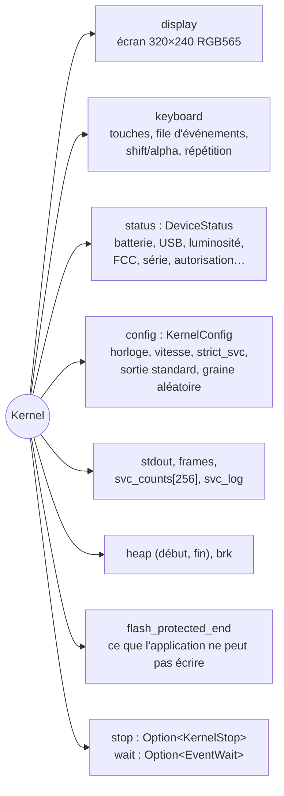
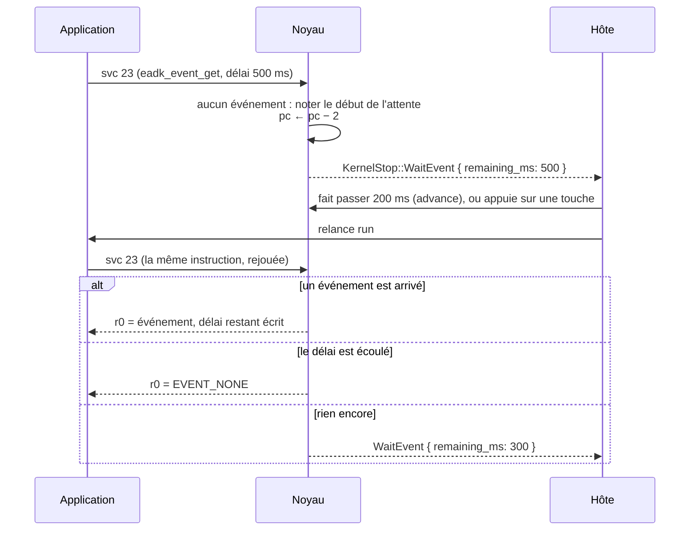
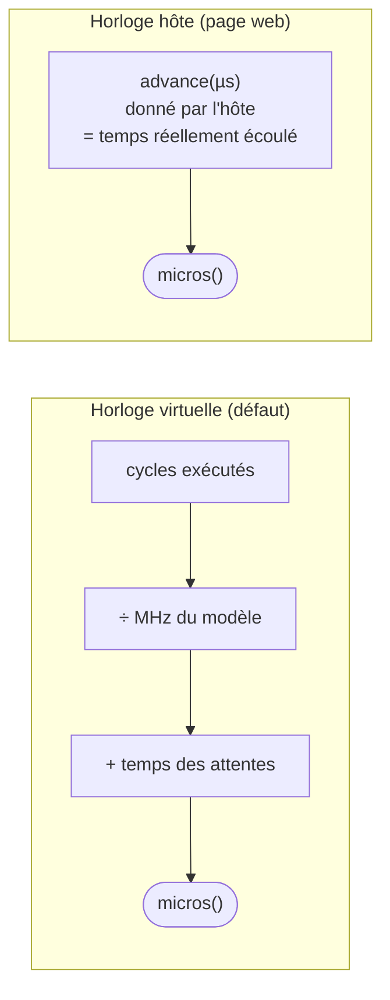

# Le noyau simulé

::: tip En bref
Le noyau est le **guichet** auquel l'application s'adresse par `svc`. Il rend l'écran, le clavier, le temps et les fichiers. Quand il doit attendre, il ne bloque pas : il **s'arrête** et laisse l'hôte décider.
:::

`Kernel` (`src/kernel/`) répond à la place d'Epsilon quand l'application exécute `svc`. Il n'utilise **aucun code d'Epsilon** : il reproduit le comportement observable aux frontières
(valeurs rendues, écran, clavier, temps). Il implémente `cpu::Hooks` : le processeur lui donne chaque `svc #N`, et il rend `Handled`, `HandledAndStop` ou, jamais, `Raise`.

## Pourquoi le noyau s'arrête

Un appel qui doit rendre la main à l'hôte pose un `KernelStop` et rend `HandledAndStop` ; `Cpu::run` s'arrête alors sur `Stop::Requested`, et l'émulateur lit la raison avec
`take_stop()`.

| `KernelStop` | Déclencheur | Ce que fait l'hôte |
|---|---|---|
| `Frame` | `eadk_display_wait_for_vblank` (svc 21) | affiche l'écran |
| `Sleep { ms }` | `msleep`, `usleep` (49, 50) | fait passer `ms` millisecondes de temps réel |
| `WaitEvent { remaining_ms }` | `eadk_event_get` (23) sans événement ; `remaining_ms` : délai restant (`None` : sans fin) | attend une touche ou la fin du délai |
| `Exited(code)` | retour de `main` (svc privé `0x89`) | l'application est finie |
| `Reset` | svc 46 | redémarrage demandé |
| `HomePressed` | touche `Home` | l'utilisateur quitte l'application |
| `BusFault` | un pointeur passé par l'application sort de la mémoire | faute, rapportée sur l'instruction `svc` |
| `UnknownSvc(n)` | numéro inconnu **avec** `strict_svc` | faute |

## Rejouer l'appel plutôt que bloquer

Une attente (`event_get` sans événement, `usleep` avec l'horloge hôte) **ne bloque pas** : l'émulateur n'a pas de fil à endormir. Le noyau fait deux choses : il **recule `pc` de 2 octets** (l'instruction `svc` fait 2 octets) et il **s'arrête**. À la reprise, le processeur retombe sur le même `svc` et **réévalue la condition**.

C'est ce qui rend l'attente **interruptible**, **déterministe** et **sans fil** : tout l'état de l'attente tient dans `EventWait { started_us, timeout_ms }` (ou `sleep_until_us`), et se sauvegarde dans un `.nds`.

## Le temps

Il y a deux horloges (`ClockMode`) :

| Mode | `micros(cycles)` | Usage |
|---|---|---|
| `Virtual` (défaut) | `cycles / cycles_par_µs + extra_us` : le temps avance avec les instructions exécutées **et** par les attentes de l'application | tests, ligne de commande, enregistrements : même exécution, même résultat, sans jamais attendre |
| `Host` | `extra_us` seulement : le temps n'avance que par `advance_time(us)`, que l'hôte appelle avec le temps réellement écoulé | la page web : en pause, l'application ne voit pas le temps passer |

`cycles_per_us` est la fréquence en MHz du modèle (192 sur N0110 et N0115, 540 sur N0120), ou la fréquence choisie (`CpuSpeed::Custom`, `DEFAULT_CUSTOM_MHZ = 192`, au plus 100 000), ou celle du modèle pour
`CpuSpeed::Max` — qui n'impose aucune **limite** à l'hôte (`limit_mhz()` rend `None`) mais garde le temps virtuel à la fréquence du modèle. Une image dure `FRAME_US = 16 667 µs` (60 Hz) : avec l'horloge virtuelle,
`wait_for_vblank` saute à la prochaine multiple ; avec l'horloge hôte, c'est l'hôte qui règle la cadence.

## Réglages

`KernelConfig` : `clock`, `speed`, `custom_mhz`, `strict_svc` (un appel inconnu arrête l'application ; sinon il est compté dans `unknown_svcs` et ignoré, comme sur l'appareil), `stdout_to_screen` (le texte
du `write` de la bibliothèque C est aussi dessiné en haut de l'écran) et `random_seed` (xorshift32 ; même graine, même suite).

`DeviceStatus` : niveau et tension de la batterie, charge, USB, luminosité (4 bits : lue et écrite par pas de 16), niveau d'autorisation (`clearance_level`), drapeaux de compilation, CRC du bootloader, type du dernier
redémarrage, version du PCB, numéro de série, adresse de la chaîne FCC, fréquence du processeur. Les valeurs de départ viennent du profil du firmware.

## Instrumentation

- `svc_counts[n]` compte chaque numéro (statistiques de la page) ;
- `svc_log` (démarré à la demande) garde les **2000 derniers** appels : numéro, adresse du `svc`, `r0`–`r3` à l'entrée, `r0` au retour, image en cours (`SvcLog::CAPACITY`) ;
- `stdout` garde au plus 1 Mio (`MAX_STDOUT`).

## Enregistrer l'état

`state.rs` implémente `to_state` et `restore_state` : écran, clavier (touches tenues, événements en attente, répétition), temps, compteurs, aléa, tas, attente en cours, réglages. Seul `stop` n'y est pas : il est toujours
consommé avant que l'hôte reprenne la main. L'écran est enregistré en `raw16` (deux octets par pixel) ou en `rle16` (nombre de répétitions sur deux octets puis le pixel), le plus court des deux. En cas d'erreur de
lecture, le noyau n'est pas modifié.

## Pages

- [Les appels système](./appels-systeme.md)
- [Écran et police](./ecran-et-police.md)
- [Clavier et événements](./clavier.md)
- [Le système de fichiers](./fichiers.md)
