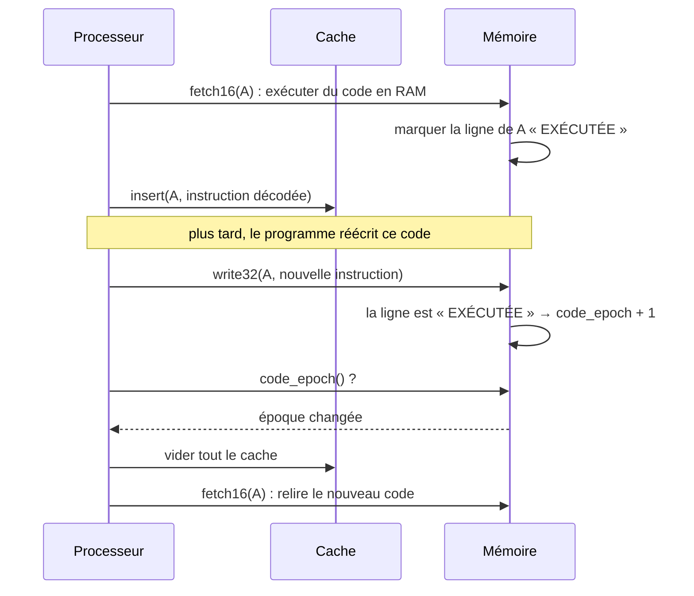
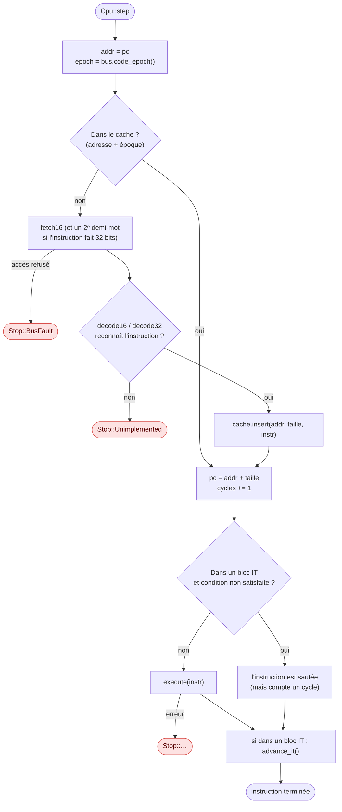

# Décodage et cache d'instructions

::: tip En bref
Reconnaître une instruction coûte plus cher que l'exécuter. Nwasabi garde donc un **carnet** des instructions déjà reconnues, et le **jette en entier** dès que du code a pu changer.
:::

## Deux demi-mots au plus

Une instruction Thumb-2 fait 16 ou 32 bits. Le premier demi-mot `hw1` dit laquelle : elle est sur **32 bits** si `hw1 >> 11 >= 0b11101` (les cinq
premiers bits valent `11101`, `11110` ou `11111`), sinon sur 16 bits. `cpu::decode16(hw1)` et `cpu::decode32(hw1, hw2)` rendent
`Option<Instr>` : `None` pour un encodage non reconnu, que `step` transforme en `Stop::Unimplemented { pc, halfword }`.

Séparer le décodage de l'exécution (`decode.rs` / `exec.rs`) a trois avantages : on teste le décodeur seul, le désassembleur le réutilise
([voir plus loin](./desassembleur.md)), et le résultat peut être **mémorisé**.

## La représentation : `Instr`

`Instr` (`instr.rs`) est un `enum` `Copy` dont les variantes regroupent les instructions par famille plutôt que par encodage. Les familles :

| Famille | Variantes |
|---|---|
| traitement de données | `Dp { op, rd, rn, rhs, flags }` (`and eor sub rsb add adc sbc orr orn bic mov mvn tst teq cmp cmn`), `Shift`, `Movw`, `Movt`, `AddSubImm12`, `Adr` |
| multiplication et division | `Mul`, `Mla`, `Mls`, `MulLong`, `Umaal`, `Div`, `Smul16`, `Smmul`, `Smulw`, `Smlalxy`, `Dual16`, `Dual16Long`, `Usad8` |
| DSP | `Saturating`, `Sat`, `Sat16`, `Parallel` (`s/q/sh/u/uq/uh` × `add16 asx sax sub16 add8 sub8`), `Sel`, `Pkh`, `Extend` (`sxtb uxth sxtab16`…), `Rev`, `Rbit`, `Clz`, `Bfi`, `Bfx` |
| branchements | `B`, `BCond`, `Bl`, `Bx`, `Blx`, `Cbz`, `TableBranch` |
| mémoire | `Load`, `Store` (taille `Byte/Half/Word`, signe, adressage `Imm/Reg/Literal`, `Offset/PreIndex/PostIndex`), `Ldrd`, `Strd`, `Ldm`, `Stm`, `Exclusive` |
| état et système | `It`, `Nop`, `Wfi`, `Wfe`, `Svc`, `Bkpt`, `Udf`, `Mrs`, `Msr`, `Cps`, `Barrier` (`dmb dsb isb`), `Clrex` |
| flottant | `Fp(FpInstr)` |

Le second opérande d'un traitement de données est un `Rhs` : une constante (`Imm { value, carry }` — le champ `carry` est la retenue produite
par le codage `ThumbExpandImm`, `None` si elle ne change pas) ou un registre décalé (`Reg { rm, kind, amount }`). `FlagMode` dit si
l'instruction met à jour les drapeaux : `Always` (forme 32 bits avec `S`, `cmp`, `tst`…), `Never`, ou `OutsideIt` — les formes 16 bits comme
`adds r0, r1, r2` ne modifient les drapeaux **qu'en dehors** d'un bloc `IT`.

Les petites fonctions d'arithmétique partagées sont dans `alu.rs` : `add_with_carry`, `shift_with_carry`, `decode_imm_shift`,
`thumb_expand_imm` (le codage des constantes modifiées sur 12 bits), `sign_extend`, `signed_saturate`, `unsigned_saturate`.

## Le cache : `DecodeCache`

Décoder coûte plus cher qu'exécuter, et un programme repasse sans cesse sur les mêmes instructions. `cache.rs` garde, pour une adresse,
l'`Instr` décodée et sa taille.

- **Correspondance directe** : 4096 cases (`SLOTS`), indexées par `(adresse >> 1) & 4095` ; une instruction fait 2 ou 4 octets, 4096 cases couvrent donc 8 Kio de code
  sans conflit. Une case garde l'adresse complète pour détecter un conflit.
- **Une époque** (`Bus::code_epoch`) accompagne le cache. Quand elle change, **tout le cache est vidé**. La mémoire l'incrémente à chaque écriture qui touche une ligne déjà marquée « exécutée » : du code copié en RAM puis exécuté, ou une flash reprogrammée, invalide donc le cache sans qu'on ait à surveiller chaque écriture dans le processeur.

- **Un bus qui répond `None`** (le défaut du trait) désactive le cache : le processeur reste correct avec n'importe quel bus.

Le cache ne gêne pas le débogage : il est transparent (il ne change aucune valeur observable), et un point d'observation ou un point d'arrêt
fait avancer l'exécution instruction par instruction par `Emulator`, sans rien changer à ce que le cache contient.

## Boucle de base : une instruction

`pc4` (adresse + 4) est la valeur qu'une instruction lit quand elle utilise `PC` comme opérande, comme sur la puce ; le `pc` du registre, lui,
désigne déjà l'instruction suivante pendant l'exécution (d'où `fault_pc`, qui garde l'adresse de l'instruction fautive).

## Dans le code

| Où | Quoi |
|---|---|
| [`is_32bit`](code:src/cpu/decode.rs#is_32bit) | la règle des deux demi-mots |
| [`decode16`](code:src/cpu/decode.rs#decode16), [`decode32`](code:src/cpu/decode.rs#decode32) | les deux décodeurs (un grand `match` sur des champs de bits) |
| [`Instr`](code:src/cpu/instr.rs#Instr) | le résultat du décodage |
| [`DecodeCache`](code:src/cpu/cache.rs#DecodeCache), [`lookup`](code:src/cpu/cache.rs#lookup), [`insert`](code:src/cpu/cache.rs#insert) | le cache |
| [`step_inline`](code:src/cpu/exec.rs#step_inline) | où le cache est consulté |
| [`code_epoch`](<code:src/memory/mod.rs#~code_epoch: u64>) | la source de l'époque dans la mémoire |

## Pourquoi un cache « à correspondance directe »

- Une instruction décodée se garde dans la **case** que désigne son adresse (`(adresse >> 1) & 4095`) : pas de table de hachage, pas de parcours, un accès par instruction. Un conflit (deux adresses pour la même case) remplace simplement l'ancienne : correct, juste un peu plus lent.
- L'**époque** évite de **surveiller chaque écriture** dans le processeur : c'est la mémoire, qui voit déjà toutes les écritures, qui incrémente un compteur quand une ligne déjà exécutée change. Le processeur compare un entier par instruction.
- Le cache est **dans `Cpu`**, pas dans `Memory` : il appartient à celui qui décode. Un `Bus` qui ne suit pas ses modifications (`code_epoch() = None`) désactive le cache : la correction ne dépend jamais de lui.

## Pour modifier

- **Changer la taille du cache** : [`SLOTS`](code:src/cpu/cache.rs#SLOTS) (une puissance de deux). Mesurer avec `just test-wasm` (le test `speed.mjs` donne un ordre de grandeur) avant et après.
- **Ajouter un événement qui doit vider le cache** : le faire passer par `code_epoch` (ne jamais vider le cache à la main depuis l'extérieur). C'est ce que fait déjà [`restore_volatile`](code:src/memory/mod.rs#restore_volatile).
- **Le cache ne doit jamais changer un résultat** : si un test donne une réponse différente avec et sans cache, c'est un bug d'invalidation, pas de décodage.
