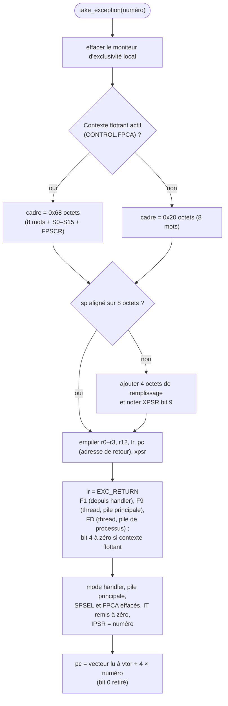

# Exceptions et fautes

::: tip En bref
Sur Nwasabi, une **faute arrête** l'application au lieu de lancer un gestionnaire. Le mécanisme d'exception complet (empiler le contexte, sauter au vecteur) existe, mais il ne sert qu'aux `svc` non traités et aux tests.
:::

## Deux cas bien séparés

1. **Une faute de l'application** (accès interdit, instruction indéfinie, `bkpt`, `wfi`) : l'exécution **s'arrête** avec une raison (`Stop`). Aucun
   gestionnaire ne s'exécute. L'émulateur note la cause dans les registres de faute simulés ([Appareil](../memoire/appareil.md#registres-de-faute)) pour qu'un
   débogueur voie un plantage ordinaire.
2. **Un `svc` que personne ne traite** (`SvcAction::Raise`) : le processeur lève lui-même l'exception `SVCall` (numéro 11). C'est le mécanisme
   d'un futur mode « firmware complet » ; le noyau simulé actuel traite tous les `svc` lui-même et ne s'en sert pas. Il est exercé par les tests
   du processeur.

## `take_exception`

`exception.rs` implémente l'entrée dans une exception (`Cpu::take_exception(bus, numéro)`) comme le décrit l'architecture ARMv7-M :

En mots : 1) le moniteur d'exclusivité local est effacé ; 2) le **contexte** est empilé (8 mots, plus ceux de la FPU si elle est active) ; 3) un mot de remplissage aligne la pile sur 8 octets si besoin ; 4) `lr` reçoit la valeur **`EXC_RETURN`** ; 5) le processeur passe en mode handler et saute au vecteur.

Le retour se déclenche quand `bx`, `pop {pc}` ou un chargement dans `pc` écrit une valeur `EXC_RETURN` **en mode handler** (`bx_write_pc`) : le contexte est
dépilé et l'état d'avant (mode, pile, `FPCA`) restauré.

## Ce qui n'existe pas

Pas de contrôleur d'interruptions (NVIC), de priorités, de `SysTick`, de basculement `PendSV`, d'imbrication d'exceptions pilotée par priorité,
de MPU. **Un ordonnanceur préemptif ne peut donc pas tourner sur Nwasabi**, et ce n'est pas un objectif : l'émulateur exécute l'application, pas le
système. Une application qui programme ses propres gestionnaires se heurte à la même limite.

## De l'arrêt à la faute

`Emulator::run_inner` convertit chaque `Stop` en `RunStop::Fault(Fault)` :

| `Stop` | `Fault` | Bits des registres de faute |
|---|---|---|
| `BusFault` en lecture ou écriture, zone inexistante ou accès exclusif refusé | `Bus(...)` | `CFSR.PRECISERR` + `BFARVALID`, `BFAR` = adresse |
| `BusFault` en lecture ou écriture, droits refusés | `Bus(...)` | `CFSR.DACCVIOL` + `MMARVALID`, `MMFAR` = adresse |
| `BusFault` au chargement de l'instruction, droits refusés | `Bus(...)` | `CFSR.IACCVIOL` |
| `BusFault` au chargement de l'instruction, zone inexistante | `Bus(...)` | `CFSR.IBUSERR` |
| `Unimplemented` / `UsageFault::UndefinedInstruction` | `Unimplemented` / `UsageFault` | `CFSR.UNDEFINSTR` |
| `UsageFault::InvalidState` | `UsageFault` | `CFSR.INVSTATE` |
| `UsageFault::Unaligned` | `UsageFault` | `CFSR.UNALIGNED` |
| `Breakpoint` | `Breakpoint` | `DFSR.BKPT` |
| `WaitForInterrupt` | `WaitForInterrupt` | |
| `KernelStop::UnknownSvc` (avec `strict_svc`) | `UnknownSvc` | |

Toute faute qui remplit `CFSR` met aussi `HFSR.FORCED` (faute escaladée en HardFault) et `ICSR.VECTACTIVE` à 3. Les bits se **cumulent** et ne s'effacent qu'à la relance
de l'application ; `MMFAR` et `BFAR` gardent la dernière adresse en cause. Un chargement d'instruction est reconnu à `adresse == pc` en lecture.

Les fautes sont rapportées avec l'adresse de l'instruction fautive (`fault_pc`), et non celle du `pc` déjà avancé. Une faute causée par un
pointeur passé à un appel système (par exemple un tampon hors mémoire) est rapportée sur l'instruction `svc`, juste avant `pc`.

## Dans le code

| Où | Quoi |
|---|---|
| [`take_exception`](code:src/cpu/exception.rs#take_exception) | l'entrée dans une exception |
| [`exception_return`](code:src/cpu/exception.rs#exception_return) | le retour par `EXC_RETURN` |
| [`bx_write_pc`](code:src/cpu/exec.rs#bx_write_pc) | où un retour d'exception est reconnu |
| [`SvcAction`](code:src/cpu/hooks.rs#SvcAction) | `Raise` : le seul chemin qui lève `SVCall` |
| [`scb::record`](code:src/scb.rs#record) | remplir les registres de faute |
| [`Emulator::run`](code:src/emulator.rs#run) | où une faute est convertie et enregistrée |

## Pourquoi arrêter plutôt qu'exécuter un gestionnaire

Une application NumWorks n'a **pas de gestionnaire d'exception** : sur la vraie machine, une faute rend la main à Epsilon, qui décide. Émuler cela exigerait d'émuler Epsilon. Nwasabi **s'arrête**, dit pourquoi, et remplit les registres de faute comme le ferait la puce : un débogueur y lit la cause et l'adresse, comme après un plantage sur une carte. Le mécanisme d'entrée d'exception existe pourtant, parce qu'il est **correct et testable** et qu'il servirait un mode « firmware complet » ; il n'est pas exposé tant que rien ne l'exige.

## Pour modifier

- **Signaler une nouvelle cause de faute** : ajouter une variante à [`Stop`](code:src/cpu/mod.rs#Stop), la convertir dans [`run_inner`](code:src/emulator.rs#run_inner), la classer dans [`scb::record`](code:src/scb.rs#record) (bit de `CFSR`, `DFSR`…), et l'ajouter au tableau de cette page.
- **Faire fonctionner des gestionnaires** : il faudrait un vrai NVIC (priorités, masquage, `PendSV`, `SysTick`) — hors périmètre, voir [Compatibilité](../../reference/compatibilite.md).
