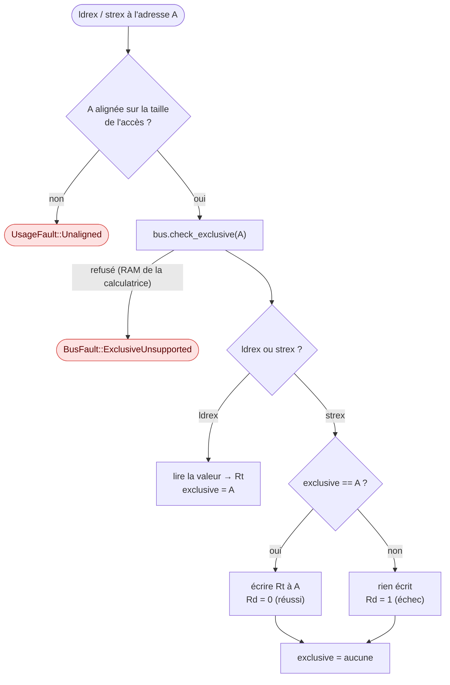

# Exécution des instructions

::: tip En bref
Les cas qui demandent de la méthode : un bloc `IT` rend des instructions **conditionnelles**, écrire dans `PC` est un **saut**, et un accès **exclusif** est une réservation d'adresse qui peut échouer.
:::

`exec.rs` contient `Cpu::step`, `Cpu::run` et le grand `match` de `execute`. Cette page note ce qui n'est pas évident à la lecture.

## Blocs `IT`

L'état `IT` vit dans `xpsr` (bits 15–10 et 26–25) comme sur la puce. À chaque instruction :

1. `ctx.in_it` vaut `regs.in_it_block()` **avant** l'exécution ;
2. si l'instruction n'est pas `It` elle-même et que la condition courante (`it_state >> 4`) n'est pas satisfaite (`cond_passed`), elle est
   **sautée** : elle ne s'exécute pas, mais compte un cycle ;
3. après elle, si elle était dans le bloc, `advance_it` décale l'état.

Les formes 16 bits qui mettent à jour les drapeaux hors d'un bloc ne le font **pas** à l'intérieur (`FlagMode::OutsideIt`, testé par `sets_flags`).
`cond_passed(cond)` évalue les 14 conditions ARM à partir de `N Z C V`.

## Écrire dans PC

Un résultat de traitement de données dont le registre destination est `PC` est un branchement (`write_result`) ; `bx_write_pc` impose le bit 0 :
à zéro, c'est un branchement en mode ARM, donc `UsageFault::InvalidState`. En mode « handler », une valeur de type `EXC_RETURN` (`0xFFFF_FFxx`) est
un **retour d'exception** (voir [Exceptions](./exceptions.md)). L'écriture dans `SP` masque ses deux bits de poids faible.

## Lectures et écritures groupées

`ldm`, `stm`, `push` et `pop` passent par `exec_ldm` et `exec_stm` ; `ldrd`, `strd`, les accès multiples et les accès exclusifs exigent un alignement sur un mot (ou sur leur taille, pour `ldrexh`) : un accès non aligné
donne `UsageFault::Unaligned`. Les accès simples non alignés (`ldr`, `ldrh`, `str`…) sont permis, comme sur un Cortex-M7 dont `UNALIGN_TRP`
est à zéro. Les accès passent par `Bus` un octet, un demi-mot ou un mot à la fois ; `read_block` n'est utilisé que par le noyau.

## Accès exclusifs

`ldrex`, `ldrexb`, `ldrexh`, `strex`, `strexb`, `strexh` passent par `exec_exclusive`. Le principe de l'architecture : `ldrex` **réserve** une adresse ; `strex` n'écrit que si la réservation tient toujours.

Le contrôle du bus passe **d'abord** : il peut refuser l'accès avec `FaultKind::ExclusiveUnsupported`. C'est ce que fait la calculatrice, dont la RAM est « partageable » sans moniteur global : `ldrex` sur la pile y provoque une `BusFault`. `Memory` reproduit ce refus par défaut (`allow_exclusive_accesses(false)`) ; la flash, elle, accepte `ldrex`. Le moniteur **local** (`Cpu::exclusive`) est effacé par `clrex` et par toute exception.

## Registres système : `mrs`, `msr`, `cps`

| Numéro `SYSm` | Registre | Remarque |
|---|---|---|
| 0, 2 | `APSR`, `EAPSR` | `msr` écrit `N Z C V Q` (masque bit 1) et `GE` (masque bit 0) |
| 1, 3 | `IAPSR`, `XPSR` | |
| 5, 7 | `IPSR`, `IEPSR` | |
| 6 | `EPSR` | se lit zéro |
| 8, 9 | `MSP`, `PSP` | lecture selon la pile active (`CONTROL.SPSEL` en mode thread) |
| 16 | `PRIMASK` | |
| 17, 18 | `BASEPRI`, `BASEPRI_MAX` | `BASEPRI_MAX` n'écrit que si la valeur est plus prioritaire |
| 19 | `FAULTMASK` | |
| 20 | `CONTROL` | changer `SPSEL` en mode thread échange `sp` avec `msp` ou `psp` |

Les bits d'état d'exécution (Thumb, `IT`) se lisent toujours comme zéro avec `mrs`, comme sur la puce. `cps` agit sur `PRIMASK` et `FAULTMASK`. `dmb`,
`dsb`, `isb` ne font rien (la mémoire est cohérente à tout instant), `wfi` et `wfe` arrêtent l'exécution.

## Opérations DSP

Les instructions de l'extension DSP (`parallel`, `extend`, saturations, doubles produits, `usad8`, `pkh`, `sel`) sont codées dans `exec.rs` :

- `parallel(op, a, b)` rend le résultat et, pour les formes signées et non signées, les quatre bits `GE` (mis à jour dans `xpsr`) ; les formes `q`,
  `uq`, `sh`, `uh` saturent ou divisent par deux sans toucher à `GE` ;
- `sel` choisit chaque octet selon `GE` ;
- `extend` (`sxtb`, `uxth`, `sxtab`, `uxtab16`…) applique la rotation avant l'extension, avec l'addition en option ;
- `Saturating` (`qadd`, `qsub`, `qdadd`, `qdsub`) et `Sat` (`ssat`, `usat`) positionnent `Q` (collant) quand elles saturent ; `ssat16`/`usat16` aussi.

Les vecteurs de test de ces instructions viennent de QEMU ([Vérification](../verification/index.md)).

## Ce qui n'est pas exécuté

Un encodage que le décodeur ne reconnaît pas arrête l'application sur `Stop::Unimplemented` : l'application s'arrête, avec l'adresse et le premier
demi-mot, plutôt que de continuer sur une exécution fausse. Sont dans ce cas les instructions de coprocesseur, de NEON (sans objet sur un
Cortex-M7) et les instructions du jeu ARM.
