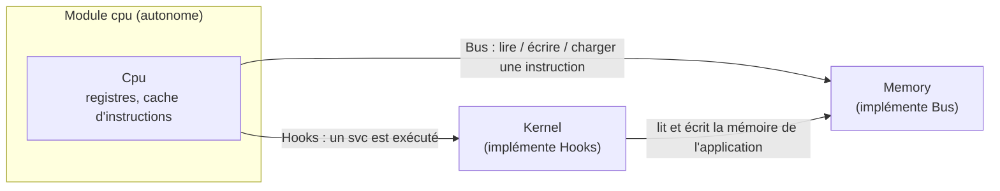

# Le processeur

::: tip En bref
Le processeur est une **boucle** : lire une instruction, la reconnaître, l'exécuter, recommencer. Tout ce qu'il ne sait pas faire seul (lire la mémoire, répondre à un `svc`) est demandé à l'extérieur par deux « prises » : `Bus` et `Hooks`.
:::


Le module `src/cpu/` émule un **Cortex-M7** : jeu d'instructions **Thumb-2** (ARMv7E-M), extension **DSP**, unité flottante **FPv5-D16** en
simple et double précision. Il est écrit pour pouvoir devenir une caisse à part : il n'utilise ni le reste de Nwasabi ni aucune dépendance
externe, et ne contient rien de propre à NumWorks (ni carte mémoire, ni appels système). `tests/cpu_independence.rs` interdit tout chemin
`crate::` dans ce dossier.

## Les coutures



```rust
pub trait Bus   { read8/16/32, write8/16/32, fetch16, read_block, write_block,
                  check_exclusive, code_epoch, privileged_write }
pub trait Hooks { fn on_svc<B: Bus>(&mut self, imm8: u8, cpu: &mut Cpu, bus: &mut B) -> SvcAction }
```

- **`Bus`** est la mémoire telle que la voit le processeur. Toutes les méthodes prennent `&mut self` : un accès peut avoir des effets de bord
  (suivi des accès, points d'observation). Les valeurs sont petit-boutistes. `fetch16` distingue le chargement d'une instruction de la lecture
  de donnée (droit d'exécution contre droit de lecture). `read_block` et `write_block` ont une version octet par octet par défaut, qu'un bus
  remplace par un accès en bloc. `code_epoch` donne le numéro qui change quand du code déjà exécuté a pu être modifié : `None` (le défaut)
  désactive le cache d'instructions. `privileged_write` est l'écriture du noyau simulé (programmation de la flash), permise même dans une zone
  en lecture seule.
- **`Hooks`** reçoit chaque `svc #imm8`. Il rend `Handled` (on continue), `HandledAndStop` (l'exécution rend la main à l'hôte) ou `Raise` (le
  processeur lève lui-même l'exception `SVCall`, voir [Exceptions](./exceptions.md)). Le noyau simulé est l'implémentation de `Hooks`.

## L'état : `Cpu`

| Champ | Rôle |
|---|---|
| `regs: Registers` | `r[0..=12]`, `sp`, `lr`, `pc`, `xpsr`, et les 32 registres flottants `s[0..32]` (mots de 32 bits) ; `fpscr` |
| `cycles: u64` | un cycle par instruction exécutée, **y compris celles d'un bloc `IT` qui n'ont pas lieu** : c'est le temps du noyau virtuel |
| `msp`, `psp` | la pile qui n'est pas active (la pile active est `regs.sp`) |
| `control`, `handler_mode` | bit 0 `nPRIV`, bit 1 `SPSEL`, bit 2 `FPCA` ; mode « handler » pendant une exception |
| `vtor`, `primask`, `faultmask`, `basepri` | registres système |
| `exclusive: Option<u32>` | moniteur d'exclusivité **local** (posé par `ldrex`, consommé par `strex`) |
| `fault_pc` | adresse de la dernière instruction dont un accès mémoire a été refusé (`pc` a déjà avancé) |
| `cache` | cache des instructions décodées ([Décodage](./decodage.md)) |

`xpsr` garde ensemble les drapeaux `N Z C V Q` (bits 31 à 27), le bit Thumb (24, toujours à 1), `GE[3:0]` (19 à 16), l'état `IT` (bits 26–25 et
15–10) et le numéro d'exception (`ipsr`, bits 8 à 0). `Registers` offre `n() z() c() v() q()`, `set_nz`, `set_nzcv`, `ge`, `it_state`, `advance_it`.

## Les arrêts : `Stop`

`Cpu::run(bus, hooks, max)` exécute au plus `max` instructions et rend la raison de l'arrêt :

| `Stop` | Cause |
|---|---|
| `Budget` | les `max` instructions sont faites |
| `Requested` | un hook a demandé l'arrêt (image prête, attente, fin de l'application…) |
| `BusFault(BusFault)` | accès mémoire refusé : adresse, sens, largeur, et `FaultKind` (`Unmapped`, `AccessDenied`, `ExclusiveUnsupported`) |
| `Unimplemented { pc, halfword }` | encodage valide ou non que le décodeur ne reconnaît pas |
| `UsageFault { pc, kind }` | `udf`, branchement en mode ARM (`InvalidState`), accès non aligné interdit (`Unaligned`) |
| `Breakpoint { imm8 }` | instruction `bkpt` |
| `WaitForInterrupt` | `wfi` ou `wfe` : rien ne pourrait réveiller le processeur |

Il n'y a **pas de gestionnaire d'exception pour les fautes** : le processeur s'arrête, et l'émulateur note la cause dans les registres de faute
simulés ([Appareil](../memoire/appareil.md#registres-de-faute)).

## Ce qui n'y est pas

Pas de pipeline, de cache de données, de temps d'accès à la flash ni de prédiction de branchement : **un cycle par instruction**. Pas de MPU,
de NVIC, de SysTick, de coprocesseurs, de NEON (le Cortex-M7 n'en a pas), de mode ARM. Le modèle de temps reste simple à dessein : le temps
d'une application est celui d'un processeur idéal à la fréquence du modèle, pas celui de la vraie puce.

## Pages

- [Décodage et cache d'instructions](./decodage.md)
- [Exécution](./execution.md) : blocs `IT`, drapeaux, accès mémoire, exclusivité, registres système
- [Virgule flottante](./virgule-flottante.md)
- [Exceptions et fautes](./exceptions.md)
- [Désassembleur](./desassembleur.md)

## Dans le code

Le module est le dossier [`src/cpu/`](code:src/cpu/). Chaque fichier a une seule responsabilité :

| Fichier | Rôle | À regarder |
|---|---|---|
| [`mod.rs`](code:src/cpu/mod.rs) | l'état et les arrêts | [`Cpu`](code:src/cpu/mod.rs#Cpu), [`Stop`](code:src/cpu/mod.rs#Stop), [`UsageFault`](code:src/cpu/mod.rs#UsageFault) |
| [`bus.rs`](code:src/cpu/bus.rs) | la couture avec la mémoire | [`Bus`](code:src/cpu/bus.rs#Bus), [`BusFault`](code:src/cpu/bus.rs#BusFault), [`FaultKind`](code:src/cpu/bus.rs#FaultKind) |
| [`hooks.rs`](code:src/cpu/hooks.rs) | la couture avec le noyau | [`Hooks`](code:src/cpu/hooks.rs#Hooks), [`SvcAction`](code:src/cpu/hooks.rs#SvcAction) |
| [`regs.rs`](code:src/cpu/regs.rs) | registres, drapeaux, état `IT` | [`Registers`](code:src/cpu/regs.rs#Registers), [`advance_it`](code:src/cpu/regs.rs#advance_it) |
| [`instr.rs`](code:src/cpu/instr.rs) | la représentation d'une instruction | [`Instr`](code:src/cpu/instr.rs#Instr), [`Rhs`](code:src/cpu/instr.rs#Rhs), [`FlagMode`](code:src/cpu/instr.rs#FlagMode) |
| [`decode.rs`](code:src/cpu/decode.rs) | octets → `Instr` | [`decode16`](code:src/cpu/decode.rs#decode16), [`decode32`](code:src/cpu/decode.rs#decode32), [`is_32bit`](code:src/cpu/decode.rs#is_32bit) |
| [`exec.rs`](code:src/cpu/exec.rs) | `Instr` → effet | [`step_inline`](code:src/cpu/exec.rs#step_inline), [`run`](code:src/cpu/exec.rs#run), [`execute`](code:src/cpu/exec.rs#execute) |
| [`cache.rs`](code:src/cpu/cache.rs) | cache des instructions décodées | [`DecodeCache`](code:src/cpu/cache.rs#DecodeCache) |
| [`alu.rs`](code:src/cpu/alu.rs) | arithmétique partagée | [`add_with_carry`](code:src/cpu/alu.rs#add_with_carry), [`thumb_expand_imm`](code:src/cpu/alu.rs#thumb_expand_imm) |
| [`fpu.rs`](code:src/cpu/fpu.rs), [`fpu_double.rs`](code:src/cpu/fpu_double.rs) | virgule flottante | [`FpInstr`](code:src/cpu/fpu.rs#FpInstr), [`exec_fp`](code:src/cpu/fpu.rs#exec_fp), [`exec_double`](code:src/cpu/fpu_double.rs#exec_double) |
| [`exception.rs`](code:src/cpu/exception.rs) | entrée et retour d'exception | [`take_exception`](code:src/cpu/exception.rs#take_exception) |
| [`disasm.rs`](code:src/cpu/disasm.rs) | désassembleur | [`disassemble`](code:src/cpu/disasm.rs#disassemble) |
| [`tests.rs`](code:src/cpu/tests.rs) | tests unitaires | |

## Pourquoi cette découpe

- **Décoder et exécuter sont séparés** : `decode.rs` ne connaît pas la mémoire, `exec.rs` ne connaît pas les encodages. On teste le décodeur seul, le désassembleur réutilise le décodeur (une seule vérité sur les encodages), et le résultat du décodage peut être **mis en cache**.
- **Deux traits plutôt que des dépendances** : le processeur ne sait pas qu'il y a une NumWorks. Cela garde le module extractible en caisse autonome et testable avec une mémoire de trois lignes (voir [`cpu_vectors.rs`](code:tests/cpu_vectors.rs)). [`cpu_independence.rs`](code:tests/cpu_independence.rs) fait échouer la compilation de la suite si quelqu'un y glisse un `crate::`.
- **Un cycle par instruction** : un modèle de temps plus fin (pipeline, cache, flash) serait faux sans mesures sur la vraie puce et rendrait l'exécution moins prévisible ; un modèle idéal est suffisant pour que les applications tournent à la bonne vitesse apparente.
- **S'arrêter plutôt que continuer** : un encodage inconnu est un `Stop::Unimplemented`, pas un `nop`. Une exécution fausse qui continue est bien plus difficile à diagnostiquer qu'un arrêt qui dit où.

## Pour modifier

**Ajouter ou corriger une instruction** :

1. Si elle n'est représentable par aucune variante, ajouter une variante à [`Instr`](code:src/cpu/instr.rs#Instr) (ou à `FpInstr` pour le flottant). Préférer **regrouper par famille** (un seul `Dp` pour tous les traitements de données) plutôt qu'une variante par encodage.
2. La reconnaître dans [`decode16`](code:src/cpu/decode.rs#decode16) (16 bits) ou [`decode32`](code:src/cpu/decode.rs#decode32) (32 bits).
3. L'exécuter dans le `match` de [`execute`](code:src/cpu/exec.rs#execute) : respecter le drapeau `FlagMode`, écrire dans `PC` par `write_result`/`bx_write_pc`, et remonter une `Stop` plutôt que de paniquer.
4. L'afficher dans [`disasm.rs`](code:src/cpu/disasm.rs) (même variante, même syntaxe unifiée).
5. La tester : un cas dans [`tests.rs`](code:src/cpu/tests.rs) pour la logique, et — pour le comportement exact — un lot dans [`generate_vectors.py`](code:tests/cpu/generate_vectors.py) rejoué par QEMU, dont les résultats sont versionnés dans `tests/golden/cpu/`.

**À préserver** : le module ne doit utiliser que `std` et lui-même ; `Cpu::step` ne doit jamais appeler quelque chose qui lit l'heure ; un accès mémoire refusé doit poser `fault_pc`.

**Tests à lancer** : `cargo test cpu` (unitaires), `cargo test --test cpu_vectors`, `cargo test --test cpu_independence`.
